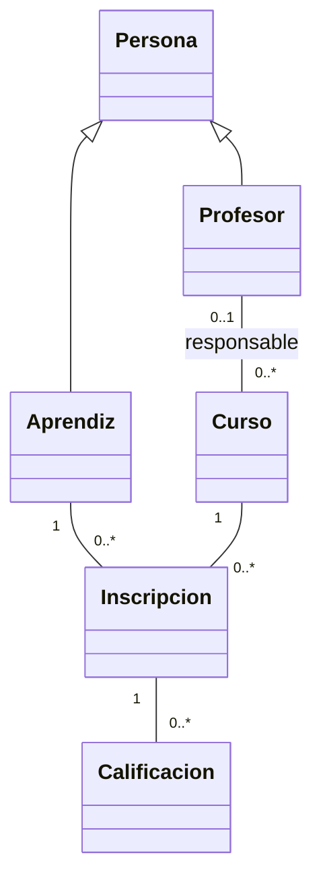

# Sistema de Gestión Académica

## Descripción

Aplicación de consola desarrollada en Python mediante Programación Orientada a Objetos (POO) y los principios SOLID. Permite administrar profesores, aprendices, cursos, inscripciones, calificaciones y reportes académicos.

La información se almacena temporalmente en memoria, sin bases de datos, frameworks ni dependencias externas.

## Objetivo general

Desarrollar un sistema académico modular que permita gestionar la formación titulada y complementaria, aplicando buenas prácticas de programación y control de versiones colaborativo.

## Tecnologías utilizadas

- Python 3.10 o superior (pruebas realizadas con Python 3.14.4).
- Biblioteca estándar de Python: `abc`, `typing`, `collections`, `datetime` y `unittest`.
- Git y GitHub.
- Visual Studio Code.

## Funcionalidades implementadas

### Gestión de profesores

- Registrar nombre, documento, edad, profesión, código y especialidad.
- Buscar por documento y listar profesores.
- Validar datos y evitar documentos duplicados.
- Consultar cursos asignados y aprendices inscritos en dichos cursos.

### Gestión de aprendices

- Registrar nombre, documento, edad, teléfono, correo y dirección.
- Buscar por documento y listar aprendices.
- Validar datos personales y de contacto, y evitar documentos duplicados.
- Consultar cursos en los que se encuentran inscritos.

### Gestión de cursos

- Registrar código, nombre, descripción, duración en horas y modalidad.
- Gestionar modalidades titulada y complementaria.
- Buscar por código y listar cursos.
- Asignar profesores registrados y consultar aprendices inscritos.
- Validar datos y evitar códigos duplicados.

### Gestión de inscripciones

- Registrar la relación muchos a muchos entre aprendices y cursos.
- Validar que el aprendiz y el curso estén registrados.
- Evitar códigos duplicados e inscripciones repetidas para el mismo aprendiz y curso.
- Registrar fecha y estado de inscripción.
- Buscar, listar y consultar inscripciones por aprendiz o curso.
- Cancelar y finalizar inscripciones.

### Gestión de calificaciones

- Registrar calificaciones asociadas a una inscripción existente.
- Validar notas entre 0.0 y 5.0.
- Buscar, listar y modificar calificaciones.
- Consultar calificaciones por aprendiz, curso o inscripción.
- Calcular el promedio cuando existen al menos tres notas.
- Mostrar el promedio con dos decimales y determinar el estado académico: Aprobado (promedio mínimo de 3.0), Reprobado o Pendiente (menos de tres notas).

### Reportes académicos

- Resumen de cantidades de profesores, aprendices, cursos, inscripciones y calificaciones.
- Reporte general de calificaciones con promedio general, nota máxima y mínima.
- Consulta de rendimiento por aprendiz, curso e inscripción.

## Estructura del proyecto

```text
sistema-gestion-academica/
├── personas/
│   ├── personas.py
│   ├── profesores.py
│   ├── gestion_profesores.py
│   ├── aprendices.py
│   └── gestion_aprendices.py
├── cursos/
│   ├── curso.py
│   └── gestion_cursos.py
├── inscripciones/
│   ├── __init__.py
│   ├── inscripcion.py
│   └── gestion_inscripciones.py
├── calificaciones/
│   ├── __init__.py
│   ├── calificacion.py
│   └── gestion_calificaciones.py
├── tests/
│   ├── __init__.py
│   ├── test_personas.py
│   ├── test_profesores.py
│   ├── test_aprendices.py
│   ├── test_cursos.py
│   ├── test_inscripciones.py
│   ├── test_calificaciones.py
│   ├── test_gestion_academica.py
│   └── test_main.py
├── gestion_academica.py
├── main.py
├── .gitignore
└── README.md
```

## Arquitectura y relaciones

- Las entidades representan los datos y comportamientos del dominio académico.
- Los gestores administran registros, búsquedas, validaciones y consultas.
- `GestionAcademica` coordina los cinco gestores y valida las relaciones entre entidades.
- `main.py` configura las dependencias y controla la interacción por consola.



Un profesor puede tener varios cursos asignados. Un aprendiz puede inscribirse en varios cursos y un curso puede tener varios aprendices mediante `Inscripcion`. Cada calificación pertenece a una inscripción.

## Pilares de Programación Orientada a Objetos

### Encapsulamiento

Las entidades utilizan atributos privados, propiedades y setters para controlar el acceso y validar los datos. Por ejemplo, `Calificacion` valida el rango de la nota y `Curso` valida la duración y modalidad.

### Abstracción

`Persona` define un contrato común mediante métodos abstractos como `mostrar_informacion()` y `obtener_rol()`. Los protocolos de gestión también abstraen las operaciones de los gestores.

### Herencia

`Profesor` y `Aprendiz` heredan de `Persona`, reutilizando los atributos y comportamientos comunes.

### Polimorfismo

`Profesor` y `Aprendiz` implementan sus propias versiones de `mostrar_informacion()` y `obtener_rol()`, permitiendo utilizar objetos derivados mediante un contrato común.

## Principios SOLID

### S — Single Responsibility Principle (SRP)

Las entidades representan información académica, los gestores administran operaciones específicas, `GestionAcademica` coordina los módulos y `main.py` controla la interfaz de consola.

### O — Open/Closed Principle (OCP)

`Curso` permite extender las modalidades mediante el atributo de clase `MODALIDADES_VALIDAS`, sin modificar la clase base. Ejemplo de extensión utilizado como concepto en las pruebas:

```python
class CursoExtendido(Curso):
    MODALIDADES_VALIDAS = Curso.MODALIDADES_VALIDAS | {"especializacion"}
```

La modalidad adicional es un ejemplo de extensibilidad, no una nueva modalidad oficial del sistema.

### L — Liskov Substitution Principle (LSP)

`Profesor` y `Aprendiz` respetan el contrato de `Persona`. Las pruebas también verifican que una clase derivada de `Curso` pueda utilizarse en las operaciones de gestión de cursos.

### I — Interface Segregation Principle (ISP)

Se definen protocolos específicos para las operaciones requeridas de cada gestor:

- `IGestionProfesores`
- `IGestionAprendices`
- `IGestionCursos`
- `IGestionInscripciones`
- `IGestionCalificaciones`

Los contratos excluyen operaciones de presentación innecesarias para la coordinación académica.

### D — Dependency Inversion Principle (DIP)

`GestionAcademica` recibe obligatoriamente sus cinco dependencias mediante protocolos, sin construir gestores concretos internamente. `main.py` configura las implementaciones:

```python
sistema = GestionAcademica(
    profesores=Gestion_profesores(),
    aprendices=Gestion_aprendices(),
    cursos=GestionCursos(),
    inscripciones=GestionInscripciones(),
    calificaciones=GestionCalificaciones()
)
```

Los gestores aceptan almacenamiento mediante la abstracción `MutableSequence`, utilizando listas por defecto. Las pruebas verifican el uso de implementaciones alternativas como `UserList`, sin incorporar persistencia permanente.

## Instalación y ejecución

Clonar el repositorio:

```bash
git clone https://github.com/ivanandrescortesolaya-spec/sistema-gestion-academica.git
cd sistema-gestion-academica
```

Para consultar la versión integrada de desarrollo:

```bash
git switch develop
git pull origin develop
```

Verificar Python y ejecutar el sistema:

```bash
python3 --version
python3 main.py
```

No es necesario instalar dependencias externas.

## Menú principal

```text
====================================
   SISTEMA DE GESTIÓN ACADÉMICA
====================================
1. Gestión de profesores
2. Gestión de aprendices
3. Gestión de cursos
4. Gestión de inscripciones
5. Gestión de calificaciones
6. Reportes académicos
0. Salir
```

### Flujo de uso sugerido

1. Registrar un profesor y un aprendiz.
2. Registrar un curso y asignarle el profesor.
3. Inscribir al aprendiz en el curso.
4. Registrar al menos tres calificaciones para la inscripción.
5. Consultar el promedio, estado académico y reportes.

## Pruebas automatizadas

El proyecto utiliza `unittest` para comprobar entidades, gestores, integración académica, menús y casos relacionados con SOLID.

```bash
python3 -m unittest discover -s tests -v
```

Para ejecutar un módulo específico:

```bash
python3 -m unittest discover -s tests -p "test_gestion_academica.py" -v
```

### Distribución de pruebas

| Módulo | Pruebas |
|---|---:|
| Personas | 6 |
| Profesores | 8 |
| Aprendices | 12 |
| Cursos | 24 |
| Inscripciones | 20 |
| Calificaciones | 31 |
| Gestión académica | 45 |
| Menú de consola | 36 |
| **Total** | **182** |

Último resultado confirmado en `develop`, después de integrar el Pull Request #14 (`f8573ab`): 182 pruebas aprobadas, sin errores ni fallos.

## Control de versiones

El proyecto utiliza Git y GitHub con un flujo de ramas de funcionalidades, correcciones y documentación, integradas mediante Pull Requests y commits descriptivos en inglés.

- `main`: rama principal.
- `develop`: rama de integración.
- `feature/integrante-2-inscripciones-calificaciones`: integración de módulos del integrante 2.
- `fix/inscripciones`: correcciones de inscripciones.
- `fix/calificaciones`: correcciones de calificaciones.
- `fix/integracion-academica`: integración académica.
- `fix/menu-consola`: mejoras del menú.
- `fix/solid-principles`: refactorización SOLID.
- `docs/final-documentation`: actualización de documentación.

Las ramas anteriores describen el trabajo realizado; las ramas de funcionalidades pueden eliminarse después de su integración.

## Distribución de responsabilidades

### Integrante 1

- Clase abstracta Persona, profesores, aprendices y cursos.
- Gestión académica centralizada y menú interactivo.
- Pruebas automatizadas, integración, refactorización SOLID y documentación.

### Integrante 2

- Gestión de inscripciones y calificaciones.
- Consultas académicas y reportes de calificaciones correspondientes a sus módulos.

## Almacenamiento y alcance

Los registros permanecen disponibles durante la ejecución del programa y se pierden al finalizarlo. El sistema no utiliza bases de datos, archivos de persistencia ni autenticación de usuarios. Las operaciones se realizan mediante el menú de consola.

## Estado del proyecto

- [x] Gestión de profesores, aprendices y cursos.
- [x] Gestión de inscripciones y calificaciones.
- [x] Gestión académica centralizada y reportes.
- [x] Menú interactivo.
- [x] Implementación de los cuatro pilares de POO.
- [x] Refactorización de los cinco principios SOLID.
- [x] 182 pruebas automatizadas aprobadas en develop.
- [x] Integración de SOLID mediante Pull Request #14.

## Contexto académico

- Institución: SENA.
- Programa: Análisis y Desarrollo de Software (ADSO).
- Tipo de proyecto: Actividad académica colaborativa.
