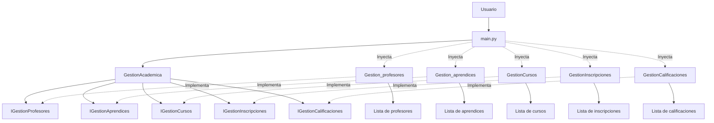
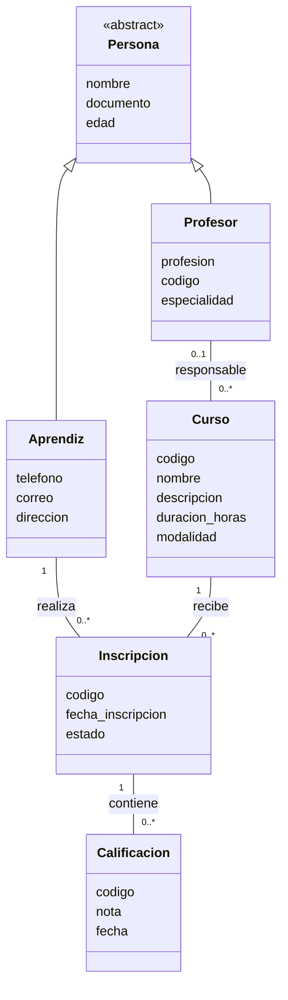
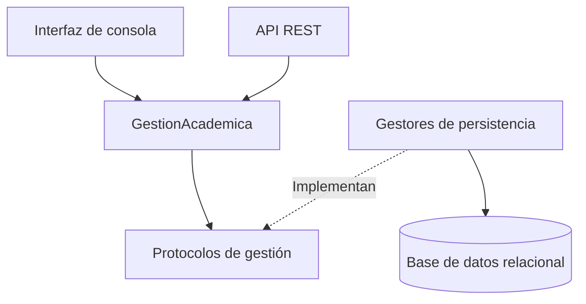

# Análisis del aplicativo existente

## Fase 1: Análisis y diseño de base de datos

**Proyecto:** Sistema de Gestión Académica  
**Lenguaje:** Python  
**Versión del aplicativo:** Aplicación de consola con almacenamiento en memoria.

---

## 1. Introducción

El Sistema de Gestión Académica es una aplicación desarrollada en Python
que permite administrar profesores, aprendices, cursos, inscripciones
y calificaciones de una institución educativa.

El aplicativo utiliza programación orientada a objetos y principios
SOLID para organizar sus componentes, separar responsabilidades y
facilitar el mantenimiento del código.

Actualmente, la información se almacena mediante colecciones en memoria,
por lo que los registros se pierden cuando finaliza la ejecución del
programa.

La evolución del sistema requiere incorporar una base de datos
relacional que permita almacenar información permanentemente y
establecer las bases para una futura API REST.

## 2. Objetivo del análisis

Analizar la estructura, el comportamiento y las limitaciones del
aplicativo existente para identificar las entidades, atributos,
relaciones, restricciones y reglas de negocio necesarias para el
diseño de una base de datos relacional.

### 2.1. Objetivos específicos

- Identificar las clases y sus responsabilidades.
- Identificar los atributos y métodos existentes.
- Analizar las relaciones entre los objetos.
- Identificar los mecanismos de almacenamiento temporal.
- Documentar las operaciones disponibles para el usuario.
- Identificar las reglas de negocio existentes.
- Analizar la aplicación de los principios POO y SOLID.
- Identificar las limitaciones del sistema.
- Establecer una línea base mediante pruebas automatizadas.

## 3. Alcance

El análisis comprende los módulos de profesores, aprendices, cursos,
inscripciones, calificaciones, gestión académica y la interfaz de
consola.

Esta fase se limita al análisis y diseño. La implementación de la base
de datos, la adaptación de la persistencia y la construcción de la API
REST corresponden a fases posteriores.

## 4. Estructura del aplicativo

```text
sistema-gestion-academica/
├── personas/
│   ├── personas.py
│   ├── profesores.py
│   ├── aprendices.py
│   ├── gestion_profesores.py
│   └── gestion_aprendices.py
├── cursos/
│   ├── curso.py
│   └── gestion_cursos.py
├── inscripciones/
│   ├── __init__.py
│   ├── inscripcion.py
│   └── gestion_inscripciones.py
├── calificaciones/
│   ├── __init__.py
│   ├── calificacion.py
│   └── gestion_calificaciones.py
├── tests/
│   ├── __init__.py
│   ├── test_aprendices.py
│   ├── test_calificaciones.py
│   ├── test_cursos.py
│   ├── test_gestion_academica.py
│   ├── test_inscripciones.py
│   ├── test_main.py
│   ├── test_personas.py
│   └── test_profesores.py
├── gestion_academica.py
├── main.py
├── .gitignore
└── README.md
```

## 5. Arquitectura actual

El aplicativo presenta una arquitectura modular compuesta por una
interfaz de consola, una capa de coordinación académica, protocolos,
gestores concretos y clases de dominio.



### 5.1. Capa de presentación

El archivo `main.py` contiene los menús, la recepción de datos,
la conversión de tipos, la presentación de resultados y el manejo
de errores de validación.

### 5.2. Capa de coordinación

La clase `GestionAcademica` coordina las operaciones entre los
diferentes módulos y verifica la existencia y coherencia de los
objetos relacionados.

### 5.3. Capa de dominio

Las clases Persona, Profesor, Aprendiz, Curso, Inscripcion y
Calificacion representan los conceptos principales del sistema.

### 5.4. Capa de gestión

Los gestores administran las colecciones de objetos, realizan
búsquedas, controlan duplicados y ejecutan operaciones específicas
de cada módulo.

### 5.5. Almacenamiento

Los gestores utilizan colecciones de tipo MutableSequence,
inicializadas por defecto mediante listas de Python.

No existe actualmente una conexión a una base de datos.

## 6. Análisis de las clases de dominio

### 6.1. Clase Persona

**Archivo:** `personas/personas.py`

**Responsabilidad:** representar las características comunes de
profesores y aprendices mediante una clase abstracta.

#### Atributos

| Atributo | Tipo | Descripción |
|---|---|---|
| nombre | str | Nombre de la persona. |
| documento | int | Número de identificación. |
| edad | int | Edad de la persona. |

#### Métodos

| Método | Responsabilidad |
|---|---|
| __init__ | Inicializar los atributos. |
| nombre | Consultar y validar el nombre. |
| documento | Consultar y validar el documento. |
| edad | Consultar y validar la edad. |
| mostrar_informacion | Definir el contrato de presentación. |
| obtener_rol | Definir el contrato de identificación del rol. |

#### Validaciones

- El nombre no puede estar vacío.
- El documento debe ser un entero positivo.
- La edad debe ser un entero mayor o igual a cero.
- La clase abstracta no puede instanciarse directamente.

### 6.2. Clase Profesor

**Archivo:** `personas/profesores.py`

**Responsabilidad:** representar un profesor y sus características
profesionales.

Hereda los atributos y comportamientos comunes de Persona.

#### Atributos propios

| Atributo | Tipo | Descripción |
|---|---|---|
| profesion | str | Profesión del profesor. |
| codigo | int | Código del profesor. |
| especialidad | str | Área de especialización. |

#### Métodos

| Método | Responsabilidad |
|---|---|
| __init__ | Inicializar los datos personales y profesionales. |
| profesion | Consultar y validar la profesión. |
| codigo | Consultar y validar el código. |
| especialidad | Consultar y validar la especialidad. |
| mostrar_informacion | Retornar la información del profesor. |
| obtener_rol | Retornar el rol Profesor. |

#### Validaciones

- La profesión es obligatoria.
- El código debe ser un entero positivo.
- La especialidad es obligatoria.
- El gestor impide documentos duplicados entre profesores.

### 6.3. Clase Aprendiz

**Archivo:** `personas/aprendices.py`

**Responsabilidad:** representar un aprendiz y almacenar sus datos
personales y de contacto.

Hereda los atributos comunes de Persona.

#### Atributos propios

| Atributo | Tipo | Descripción |
|---|---|---|
| telefono | str | Número telefónico. |
| correo | str | Correo electrónico. |
| direccion | str | Dirección de residencia. |

#### Métodos

| Método | Responsabilidad |
|---|---|
| __init__ | Inicializar los datos personales y de contacto. |
| telefono | Consultar y validar el teléfono. |
| correo | Consultar y validar el correo electrónico. |
| direccion | Consultar y validar la dirección. |
| mostrar_informacion | Retornar la información del aprendiz. |
| obtener_rol | Retornar el rol Aprendiz. |

#### Validaciones

- El teléfono es obligatorio y admite caracteres numéricos
  con prefijo internacional.
- El correo electrónico debe cumplir una validación básica.
- La dirección no puede estar vacía.
- El gestor impide documentos duplicados entre aprendices.

### 6.4. Clase Curso

**Archivo:** `cursos/curso.py`

**Responsabilidad:** representar un curso académico y permitir
la asignación de un profesor responsable.

#### Atributos

| Atributo | Tipo | Descripción |
|---|---|---|
| codigo | str | Identificador funcional del curso. |
| nombre | str | Nombre del curso. |
| descripcion | str | Descripción del contenido. |
| duracion_horas | int | Duración total en horas. |
| modalidad | str | Modalidad de formación. |
| profesor | Profesor o None | Profesor responsable. |
| MODALIDADES_VALIDAS | frozenset | Modalidades permitidas. |

#### Métodos

| Método | Responsabilidad |
|---|---|
| __init__ | Inicializar el curso. |
| codigo | Consultar y validar el código. |
| nombre | Consultar y validar el nombre. |
| descripcion | Consultar y validar la descripción. |
| duracion_horas | Consultar y validar la duración. |
| modalidad | Consultar y validar la modalidad. |
| profesor | Consultar el profesor asignado. |
| asignar_profesor | Establecer el profesor responsable. |
| mostrar_informacion | Retornar la información del curso. |

#### Validaciones

- El código, nombre y descripción son obligatorios.
- La duración debe ser un entero positivo.
- Las modalidades iniciales son titulada y complementaria.
- Un curso puede crearse sin profesor asignado.
- El profesor asignado debe ser una instancia válida de Profesor.
- El gestor impide códigos de curso duplicados.

### 6.5. Clase Inscripcion

**Archivo:** `inscripciones/inscripcion.py`

**Responsabilidad:** representar la vinculación de un aprendiz
con un curso académico.

#### Atributos

| Atributo | Tipo | Descripción |
|---|---|---|
| codigo | str | Código de la inscripción. |
| aprendiz | Aprendiz | Aprendiz inscrito. |
| curso | Curso | Curso seleccionado. |
| fecha_inscripcion | date | Fecha de creación. |
| estado | str | Estado de la inscripción. |

#### Métodos

| Método | Responsabilidad |
|---|---|
| __init__ | Inicializar la inscripción. |
| codigo | Consultar y validar el código. |
| aprendiz | Consultar y validar el aprendiz. |
| curso | Consultar y validar el curso. |
| fecha_inscripcion | Consultar la fecha de inscripción. |
| estado | Consultar el estado actual. |
| cancelar | Cambiar el estado a Cancelada. |
| finalizar | Cambiar el estado a Finalizada. |
| mostrar_informacion | Retornar los datos de la inscripción. |

#### Validaciones

- El código es obligatorio.
- El aprendiz y el curso deben ser objetos válidos.
- La fecha se genera automáticamente.
- El estado inicial es Activa.
- El código de inscripción no puede repetirse.
- No se permiten inscripciones duplicadas para la misma
  combinación de aprendiz y curso.

### 6.6. Clase Calificacion

**Archivo:** `calificaciones/calificacion.py`

**Responsabilidad:** representar una nota académica asociada
a una inscripción.

#### Atributos

| Atributo | Tipo | Descripción |
|---|---|---|
| codigo | str | Código de la calificación. |
| inscripcion | Inscripcion | Inscripción relacionada. |
| nota | float | Valor de la calificación. |
| fecha | date | Fecha de registro. |

#### Métodos

| Método | Responsabilidad |
|---|---|
| __init__ | Inicializar la calificación. |
| codigo | Consultar y validar el código. |
| inscripcion | Consultar y validar la inscripción. |
| nota | Consultar y validar la nota. |
| fecha | Consultar la fecha de registro. |
| mostrar_informacion | Retornar la información de la calificación. |

#### Validaciones

- El código es obligatorio.
- La inscripción debe ser un objeto válido.
- La nota debe ser numérica.
- La nota debe estar entre 0.0 y 5.0.
- No se admiten valores booleanos como notas.
- La fecha se genera automáticamente.
- El gestor impide códigos de calificación duplicados.

## 7. Análisis de los gestores

Los gestores administran los objetos de dominio mediante
colecciones temporales y proporcionan operaciones específicas
para cada módulo.

### 7.1. Gestion_profesores

**Archivo:** `personas/gestion_profesores.py`

**Atributo:** `__profesores`, colección MutableSequence de Profesor.

| Método | Responsabilidad |
|---|---|
| __init__ | Inicializar o recibir el almacenamiento. |
| registrar | Registrar profesores sin duplicar documentos. |
| buscar_por_documento | Buscar un profesor por documento. |
| listar | Retornar una lista de profesores. |
| mostrar | Presentar la información de un profesor. |

### 7.2. Gestion_aprendices

**Archivo:** `personas/gestion_aprendices.py`

**Atributo:** `__aprendices`, colección MutableSequence de Aprendiz.

| Método | Responsabilidad |
|---|---|
| __init__ | Inicializar o recibir el almacenamiento. |
| registrar | Registrar aprendices sin duplicar documentos. |
| buscar_documento | Buscar un aprendiz por documento. |
| listar | Retornar una lista de aprendices. |
| mostrar | Presentar la información de un aprendiz. |

### 7.3. GestionCursos

**Archivo:** `cursos/gestion_cursos.py`

**Atributo:** `__cursos`, colección MutableSequence de Curso.

| Método | Responsabilidad |
|---|---|
| __init__ | Inicializar o recibir el almacenamiento. |
| registrar | Registrar cursos sin duplicar códigos. |
| buscar_por_codigo | Buscar un curso por código. |
| listar | Retornar una lista de cursos. |
| mostrar | Retornar información de los cursos. |
| asignar_profesor | Asignar un profesor a un curso existente. |
| buscar_por_profesor | Consultar cursos asignados a un profesor. |

### 7.4. GestionInscripciones

**Archivo:** `inscripciones/gestion_inscripciones.py`

**Atributo:** `__inscripciones`, colección MutableSequence
de Inscripcion.

| Método | Responsabilidad |
|---|---|
| __init__ | Inicializar o recibir el almacenamiento. |
| registrar | Registrar inscripciones sin duplicados. |
| buscar_por_codigo | Buscar una inscripción por código. |
| listar | Retornar una lista de inscripciones. |
| buscar_por_aprendiz | Consultar inscripciones por aprendiz. |
| buscar_por_curso | Consultar inscripciones por curso. |
| buscar_por_aprendiz_y_curso | Verificar una inscripción específica. |
| mostrar | Retornar información de las inscripciones. |

### 7.5. GestionCalificaciones

**Archivo:** `calificaciones/gestion_calificaciones.py`

**Atributo:** `__calificaciones`, colección MutableSequence
de Calificacion.

| Método | Responsabilidad |
|---|---|
| __init__ | Inicializar o recibir el almacenamiento. |
| registrar | Registrar calificaciones sin duplicar códigos. |
| buscar_por_codigo | Buscar una calificación por código. |
| listar | Retornar una lista de calificaciones. |
| buscar_por_aprendiz | Consultar notas por aprendiz. |
| buscar_por_curso | Consultar notas por curso. |
| buscar_por_inscripcion | Consultar notas por inscripción. |
| modificar_calificacion | Actualizar una nota existente. |
| calcular_promedio | Calcular la media aritmética. |
| obtener_estado_academico | Determinar aprobación o reprobación. |
| consultar_rendimiento | Consolidar el rendimiento académico. |
| mostrar | Retornar información de las calificaciones. |

## 8. Protocolos e interfaces

El aplicativo utiliza Protocol, del módulo typing de Python,
para establecer contratos entre los componentes.

| Protocolo | Operaciones definidas |
|---|---|
| IGestionProfesores | registrar, buscar_por_documento, listar. |
| IGestionAprendices | registrar, buscar_documento, listar. |
| IGestionCursos | registrar, buscar_por_codigo, listar, asignar_profesor, buscar_por_profesor. |
| IGestionInscripciones | registrar, buscar_por_codigo, listar, buscar_por_aprendiz, buscar_por_curso. |
| IGestionCalificaciones | registrar, buscar_por_codigo, listar, buscar_por_aprendiz, buscar_por_curso, buscar_por_inscripcion, modificar_calificacion, calcular_promedio, obtener_estado_academico, consultar_rendimiento. |

Los protocolos permiten incorporar implementaciones alternativas
sin que GestionAcademica dependa directamente de los gestores
concretos.

## 9. Clase GestionAcademica

**Archivo:** `gestion_academica.py`

**Responsabilidad:** coordinar los módulos del sistema, delegar
operaciones y verificar la integridad lógica de las relaciones
entre los objetos.

### 9.1. Atributos

| Atributo | Tipo |
|---|---|
| __profesores | IGestionProfesores |
| __aprendices | IGestionAprendices |
| __cursos | IGestionCursos |
| __inscripciones | IGestionInscripciones |
| __calificaciones | IGestionCalificaciones |

### 9.2. Métodos

| Método | Responsabilidad |
|---|---|
| __init__ | Recibir las cinco dependencias. |
| registrar_profesor | Registrar un profesor. |
| buscar_profesor | Buscar un profesor por documento. |
| listar_profesores | Consultar profesores. |
| registrar_aprendiz | Registrar un aprendiz. |
| buscar_aprendiz | Buscar un aprendiz por documento. |
| listar_aprendices | Consultar aprendices. |
| registrar_curso | Registrar un curso. |
| buscar_curso | Buscar un curso por código. |
| listar_cursos | Consultar cursos. |
| asignar_profesor | Asignar un profesor registrado. |
| consultar_cursos_profesor | Consultar cursos asignados. |
| consultar_aprendices_profesor | Consultar aprendices de sus cursos. |
| registrar_inscripcion | Validar y registrar una inscripción. |
| buscar_inscripcion | Buscar una inscripción. |
| listar_inscripciones | Consultar inscripciones. |
| consultar_inscripciones_aprendiz | Consultar inscripciones por aprendiz. |
| consultar_inscripciones_curso | Consultar inscripciones por curso. |
| consultar_cursos_aprendiz | Consultar cursos de un aprendiz. |
| consultar_aprendices_curso | Consultar aprendices de un curso. |
| registrar_calificacion | Validar y registrar una calificación. |
| buscar_calificacion | Buscar una calificación. |
| listar_calificaciones | Consultar calificaciones. |
| modificar_calificacion | Actualizar una nota. |
| consultar_calificaciones_aprendiz | Consultar notas por aprendiz. |
| consultar_calificaciones_curso | Consultar notas por curso. |
| consultar_calificaciones_inscripcion | Consultar notas por inscripción. |
| calcular_promedio | Calcular el promedio de una inscripción. |
| obtener_estado_academico | Determinar el resultado académico. |
| consultar_rendimiento_inscripcion | Consultar rendimiento por inscripción. |
| consultar_rendimiento_aprendiz | Consultar rendimiento por aprendiz. |
| consultar_rendimiento_curso | Consultar rendimiento por curso. |
| generar_reporte_calificaciones | Generar estadísticas generales. |
| obtener_resumen | Contar los registros del sistema. |

### 9.3. Validaciones entre módulos

- El profesor debe estar registrado antes de asignarse a un curso.
- El aprendiz debe estar registrado antes de realizar una inscripción.
- El curso debe existir antes de registrar una inscripción.
- La inscripción debe existir antes de registrar una calificación.
- Las relaciones utilizan las instancias originales almacenadas.
- Las consultas de rendimiento verifican la existencia de los
  registros correspondientes.

## 10. Relaciones entre los objetos



### 10.1. Persona y Profesor

Existe una relación de herencia. Profesor reutiliza los atributos
y comportamientos comunes definidos en Persona.

### 10.2. Persona y Aprendiz

Existe una relación de herencia. Aprendiz reutiliza los atributos
y comportamientos comunes definidos en Persona.

### 10.3. Profesor y Curso

Un profesor puede tener cero o muchos cursos asignados.

Un curso puede tener cero o un profesor responsable.

### 10.4. Aprendiz y Curso

Existe una relación muchos a muchos.

Un aprendiz puede inscribirse en varios cursos y un curso puede
tener varios aprendices.

La clase Inscripcion representa esta asociación.

### 10.5. Aprendiz e Inscripcion

Un aprendiz puede tener cero o muchas inscripciones.

Cada inscripción corresponde obligatoriamente a un aprendiz.

### 10.6. Curso e Inscripcion

Un curso puede tener cero o muchas inscripciones.

Cada inscripción corresponde obligatoriamente a un curso.

### 10.7. Inscripcion y Calificacion

Una inscripción puede tener cero o muchas calificaciones.

Cada calificación pertenece obligatoriamente a una inscripción.

Se requieren al menos tres calificaciones para determinar el
promedio y el resultado académico.

## 11. Identificación preliminar de entidades

A partir de las clases existentes y los requisitos del proyecto
se identifican las siguientes entidades candidatas:

| Entidad | Origen | Responsabilidad |
|---|---|---|
| Persona | Clase Persona | Almacenar información personal común. |
| Profesor | Clase Profesor | Almacenar información profesional. |
| Aprendiz | Clase Aprendiz | Almacenar información de contacto. |
| Curso | Clase Curso | Almacenar información académica de cursos. |
| Modalidad | Atributo modalidad de Curso | Administrar modalidades de formación. |
| Inscripcion | Clase Inscripcion | Relacionar aprendices con cursos. |
| Calificacion | Clase Calificacion | Almacenar notas académicas. |

La entidad Modalidad no existe actualmente como una clase
independiente. Se propone incorporarla como catálogo en el
modelo relacional para centralizar los valores permitidos.

Los gestores, protocolos y la clase GestionAcademica no se
consideran entidades persistentes porque representan operaciones,
contratos y lógica de negocio.

## 12. Almacenamiento temporal

Los gestores utilizan las siguientes colecciones:

| Gestor | Colección | Tipo |
|---|---|---|
| Gestion_profesores | __profesores | MutableSequence[Profesor] |
| Gestion_aprendices | __aprendices | MutableSequence[Aprendiz] |
| GestionCursos | __cursos | MutableSequence[Curso] |
| GestionInscripciones | __inscripciones | MutableSequence[Inscripcion] |
| GestionCalificaciones | __calificaciones | MutableSequence[Calificacion] |

Cada gestor permite recibir una colección alternativa mediante
su constructor.

Cuando no se proporciona una colección, se inicializa una lista
vacía.

El archivo main.py crea los cinco gestores sin proporcionar un
almacenamiento alternativo.

### 12.1. Características

- Los registros existen durante la ejecución del programa.
- Las búsquedas se realizan mediante recorridos de colecciones.
- Los duplicados se controlan mediante validaciones en Python.
- Las relaciones se representan mediante referencias a objetos.
- Los métodos listar retornan nuevas listas con referencias a
  los objetos almacenados.
- Las modificaciones de los objetos se reflejan en memoria.
- No existe almacenamiento permanente.
- No existe recuperación de registros entre ejecuciones.

## 13. Operaciones disponibles para el usuario

El aplicativo proporciona 34 operaciones funcionales distribuidas
en seis submenús.

### 13.1. Gestión de profesores

1. Registrar profesor.
2. Buscar profesor.
3. Listar profesores.
4. Consultar cursos asignados.
5. Consultar aprendices de sus cursos.

### 13.2. Gestión de aprendices

1. Registrar aprendiz.
2. Buscar aprendiz.
3. Listar aprendices.
4. Consultar cursos inscritos.

### 13.3. Gestión de cursos

1. Registrar curso.
2. Buscar curso.
3. Listar cursos.
4. Asignar profesor.
5. Consultar aprendices inscritos.

### 13.4. Gestión de inscripciones

1. Registrar inscripción.
2. Buscar inscripción.
3. Listar inscripciones.
4. Consultar inscripciones por aprendiz.
5. Consultar inscripciones por curso.
6. Cancelar inscripción.
7. Finalizar inscripción.

### 13.5. Gestión de calificaciones

1. Registrar calificación.
2. Buscar calificación.
3. Listar calificaciones.
4. Modificar calificación.
5. Consultar notas por inscripción.
6. Consultar notas por aprendiz.
7. Consultar notas por curso.
8. Consultar promedio y estado académico.

### 13.6. Reportes académicos

1. Resumen académico.
2. Reporte general de calificaciones.
3. Rendimiento por aprendiz.
4. Rendimiento por curso.
5. Rendimiento por inscripción.

### 13.7. Matriz CRUD

| Entidad | Crear | Consultar | Actualizar | Eliminar |
|---|---|---|---|---|
| Profesor | Sí | Sí | No | No |
| Aprendiz | Sí | Sí | No | No |
| Curso | Sí | Sí | Parcial | No |
| Inscripcion | Sí | Sí | Parcial | No |
| Calificacion | Sí | Sí | Sí | No |
| Modalidad | No | No | No | No |

La actualización de cursos corresponde a la asignación del
profesor responsable.

La actualización de inscripciones corresponde al cambio de estado.

La actualización de calificaciones corresponde a la modificación
de la nota.

Cancelar una inscripción no implica eliminarla.

## 14. Rendimiento académico

El promedio académico se obtiene mediante la media aritmética
de las notas asociadas a una inscripción.

Para calcular el promedio se requieren mínimo tres calificaciones.

| Condición | Resultado académico |
|---|---|
| Menos de tres calificaciones | Pendiente |
| Promedio mayor o igual a 3.0 | Aprobado |
| Promedio inferior a 3.0 | Reprobado |

El promedio presentado al usuario se redondea a dos decimales.

Actualmente, la aprobación se determina utilizando el promedio
sin redondear.

El promedio y el estado académico son datos derivados de las
calificaciones, por lo que inicialmente se propone calcularlos
mediante consultas en lugar de almacenarlos como valores
redundantes.

El estado académico es independiente del estado administrativo
de una inscripción.

## 15. Programación orientada a objetos

### 15.1. Encapsulamiento

Las clases utilizan atributos privados y propiedades para
controlar el acceso y la modificación de los datos.

Los setters permiten validar los valores antes de asignarlos.

### 15.2. Abstracción

La clase Persona establece características y comportamientos
comunes mediante una clase abstracta.

Los protocolos definen contratos para las operaciones de gestión.

### 15.3. Herencia

Las clases Profesor y Aprendiz heredan de Persona, reutilizando
los atributos y comportamientos comunes.

### 15.4. Polimorfismo

Profesor y Aprendiz implementan sus propias versiones de los
métodos mostrar_informacion y obtener_rol.

Los componentes pueden utilizar diferentes implementaciones
que respeten los protocolos establecidos.

## 16. Principios SOLID

### 16.1. Responsabilidad única (SRP)

Las clases de dominio representan conceptos académicos y los
gestores administran las operaciones de cada módulo.

GestionAcademica coordina las operaciones y main.py administra
la interacción con el usuario.

Existe una separación de responsabilidades, aunque algunos
métodos de presentación y reporte todavía pueden desacoplarse.

### 16.2. Abierto/cerrado (OCP)

Los protocolos permiten incorporar implementaciones alternativas
de los gestores.

La clase Curso permite extender las modalidades mediante
especialización, sin modificar las modalidades de la clase base.

### 16.3. Sustitución de Liskov (LSP)

Las clases derivadas deben conservar los contratos establecidos
por sus clases base.

Las implementaciones alternativas de los gestores deben mantener
los comportamientos esperados por GestionAcademica.

Las pruebas existentes proporcionan evidencia de sustitución
en los escenarios evaluados.

### 16.4. Segregación de interfaces (ISP)

Cada módulo dispone de un protocolo independiente que define
las operaciones requeridas.

Los clientes no necesitan depender de una única interfaz que
contenga todas las operaciones del sistema.

### 16.5. Inversión de dependencias (DIP)

GestionAcademica recibe sus dependencias mediante el constructor
y utiliza protocolos en lugar de depender directamente de las
implementaciones concretas.

Esta estructura facilita incorporar gestores con persistencia
relacional en fases posteriores.

## 17. Limitaciones del aplicativo

| Código | Limitación identificada |
|---|---|
| LIM-01 | Pérdida de información al finalizar el programa. |
| LIM-02 | Ausencia de almacenamiento permanente. |
| LIM-03 | Ausencia de restricciones de integridad en una base de datos. |
| LIM-04 | Dependencia de referencias e identidad de objetos en memoria. |
| LIM-05 | Ausencia de transacciones de base de datos. |
| LIM-06 | Cambios de estado de inscripciones directamente desde la consola. |
| LIM-07 | Búsquedas mediante recorridos de colecciones. |
| LIM-08 | Ausencia de una interfaz HTTP. |
| LIM-09 | Algunos reportes se generan directamente como texto. |
| LIM-10 | Ausencia de historial de modificaciones. |
| LIM-11 | Ausencia de autenticación y autorización. |
| LIM-12 | Operaciones CRUD incompletas desde la interfaz. |
| LIM-13 | Ausencia de control de concurrencia entre clientes. |
| LIM-14 | Modalidades definidas directamente en el código. |

Estas limitaciones constituyen hallazgos del análisis y no
implican que todas deban resolverse durante la primera fase.

## 18. Consideraciones para la migración

### 18.1. Identidad de los objetos

Actualmente GestionAcademica utiliza el operador is para
comprobar que los objetos relacionados correspondan exactamente
a las instancias almacenadas.

En una base de datos, dos objetos diferentes de Python pueden
representar el mismo registro persistente.

Se propone adaptar estas comprobaciones mediante identificadores
persistentes y restricciones de integridad referencial.

### 18.2. Fechas de registro

Los constructores de Inscripcion y Calificacion generan la
fecha actual automáticamente.

La futura implementación deberá permitir recuperar las fechas
originales almacenadas sin reemplazarlas por la fecha de consulta.

### 18.3. Actualización de inscripciones

La consola modifica directamente el estado de los objetos
mediante los métodos cancelar y finalizar.

La persistencia deberá incorporar operaciones explícitas que
actualicen los registros correspondientes en la base de datos.

### 18.4. Integridad referencial

Las relaciones entre profesores, cursos, aprendices, inscripciones
y calificaciones deberán representarse mediante claves primarias
y claves foráneas.

### 18.5. Registros duplicados

Las validaciones de unicidad deberán trasladarse también a
restricciones de la base de datos.

La combinación de aprendiz y curso deberá ser única en la tabla
de inscripciones para conservar el comportamiento actual.

### 18.6. Consultas académicas

Las búsquedas y reportes podrán utilizar consultas SQL,
operaciones JOIN y funciones de agregación como COUNT, AVG,
MIN y MAX.

### 18.7. Decisiones pendientes

Durante el diseño deberán definirse los siguientes aspectos:

- Tipo y longitud de los documentos de identificación.
- Unicidad global del documento entre profesores y aprendices.
- Posibilidad de que una persona desempeñe ambos roles.
- Unicidad del código del profesor.
- Longitudes máximas de los campos de texto.
- Precisión decimal de las calificaciones.
- Política de redondeo del promedio académico.
- Transiciones válidas entre estados de inscripción.
- Posibilidad de reinscripción después de una cancelación.
- Registro de notas en inscripciones canceladas o finalizadas.
- Sensibilidad a mayúsculas y minúsculas de los códigos.
- Políticas de actualización y eliminación de registros.
- Necesidad de conservar historiales de modificaciones.

Estas decisiones deberán documentarse antes de implementar
el modelo físico.

## 19. Pruebas automatizadas

El aplicativo dispone de pruebas automatizadas desarrolladas
mediante unittest de Python.

### 19.1. Inventario de pruebas

| Archivo | Cantidad |
|---|---:|
| test_aprendices.py | 12 |
| test_calificaciones.py | 31 |
| test_cursos.py | 24 |
| test_gestion_academica.py | 45 |
| test_inscripciones.py | 20 |
| test_main.py | 36 |
| test_personas.py | 6 |
| test_profesores.py | 8 |
| **Total** | **182** |

### 19.2. Comando de ejecución

```bash
python3 -m unittest discover -s tests -v
```

### 19.3. Resultado obtenido

```text
----------------------------------------------------------------------
Ran 182 tests in 0.010s

OK
```

| Indicador | Resultado |
|---|---:|
| Archivos de pruebas | 8 |
| Pruebas ejecutadas | 182 |
| Pruebas exitosas | 182 |
| Fallos | 0 |
| Errores | 0 |
| Porcentaje de éxito | 100 % |
| Tiempo de ejecución observado | 0.010 segundos |

### 19.4. Aspectos evaluados

De acuerdo con las pruebas ejecutadas, se evalúan escenarios
relacionados con:

- Registro y consulta de profesores.
- Registro y consulta de aprendices.
- Validación de atributos.
- Registro y asignación de cursos.
- Validación de modalidades.
- Prevención de registros duplicados.
- Relaciones entre aprendices y cursos.
- Cambios de estado de inscripciones.
- Registro y modificación de calificaciones.
- Validación del rango de notas.
- Cálculo de promedios.
- Rendimiento académico.
- Inyección de dependencias.
- Implementaciones alternativas de almacenamiento.
- Segregación de interfaces.
- Extensión de modalidades.
- Sustitución de clases.
- Operaciones de los menús.
- Reportes y resúmenes académicos.

### 19.5. Interpretación de resultados

Las 182 pruebas ejecutadas finalizaron correctamente.

Este resultado establece una línea base funcional para comparar
el comportamiento del sistema antes y después de incorporar
la persistencia relacional.

El porcentaje de éxito de las pruebas no equivale a un porcentaje
de cobertura del código.

Las pruebas actuales tampoco verifican persistencia en una base
de datos, transacciones, concurrencia ni endpoints HTTP, porque
estas funcionalidades todavía no se encuentran implementadas.

## 20. Arquitectura futura propuesta



La arquitectura propuesta busca conservar la lógica académica
existente y permitir que diferentes interfaces utilicen las
mismas operaciones.

Los gestores de persistencia serán responsables de almacenar,
consultar y actualizar la información en una base de datos
relacional.

La selección definitiva del sistema gestor de base de datos
se documentará de manera independiente.

## 21. Conclusiones

El análisis permitió identificar la estructura del aplicativo,
sus clases, atributos, métodos, responsabilidades, relaciones,
mecanismos de almacenamiento y operaciones disponibles.

Se identificaron siete entidades candidatas para el diseño
relacional: Persona, Profesor, Aprendiz, Curso, Modalidad,
Inscripcion y Calificacion.

La relación muchos a muchos entre aprendices y cursos se
encuentra representada mediante la clase Inscripcion.

La aplicación de programación orientada a objetos y principios
SOLID proporciona una estructura favorable para incorporar
implementaciones alternativas de persistencia.

Sin embargo, el almacenamiento temporal, la dependencia de
referencias a objetos y la ausencia de restricciones de base
de datos requieren una adaptación progresiva.

La ejecución exitosa de las 182 pruebas automatizadas permite
establecer una referencia funcional para las siguientes fases.

El siguiente paso consiste en formalizar las reglas de negocio
y desarrollar el modelo entidad-relación, el modelo relacional,
el diccionario de datos, la normalización y la selección del
sistema gestor de base de datos.
