# Modelo entidad-relación (MER)

## Fase 1: Análisis y diseño de base de datos

**Proyecto:** Sistema de Gestión Académica  
**Documento:** Modelo entidad-relación  
**Versión:** 1.0

---

## 1. Introducción

El modelo entidad-relación representa la estructura de la
información requerida por el Sistema de Gestión Académica.

Su elaboración se fundamenta en el análisis del aplicativo
existente, las reglas de negocio identificadas y las decisiones
de diseño aprobadas.

El modelo establece las entidades, atributos, identificadores,
relaciones y cardinalidades necesarias para representar la
información académica de manera organizada y consistente.

## 2. Objetivos

### 2.1. Objetivo general

Diseñar un modelo entidad-relación que represente las
necesidades de información del Sistema de Gestión Académica
y sirva como fundamento para el modelo relacional.

### 2.2. Objetivos específicos

- Identificar las entidades principales del sistema.
- Definir los atributos de cada entidad.
- Identificar las claves primarias y foráneas propuestas.
- Establecer las relaciones y cardinalidades.
- Representar la especialización de Persona.
- Resolver la relación muchos a muchos entre aprendices y cursos.
- Identificar los atributos derivados.
- Garantizar la coherencia con las reglas de negocio.
- Representar gráficamente el modelo mediante Mermaid.

## 3. Documentos de referencia

El presente modelo se fundamenta en:

- [Análisis del aplicativo](analisis-aplicativo.md).
- [Reglas de negocio](reglas-negocio.md).

Las decisiones sobre tipos de datos SQL, tamaños y restricciones
físicas se detallarán en el modelo relacional y el diccionario
de datos.

## 4. Identificación de entidades

| Entidad | Clasificación | Descripción |
|---|---|---|
| Persona | Entidad general | Información personal común. |
| Profesor | Entidad especializada | Información profesional de los profesores. |
| Aprendiz | Entidad especializada | Información de contacto de los aprendices. |
| Modalidad | Entidad catálogo | Tipos de formación disponibles. |
| Curso | Entidad principal | Información de los cursos académicos. |
| Inscripcion | Entidad asociativa | Vinculación entre aprendices y cursos. |
| Calificacion | Entidad dependiente | Notas asociadas a una inscripción. |

El modelo está compuesto por siete entidades.

## 5. Descripción de entidades y atributos

### 5.1. Persona

Representa la información personal común de los profesores
y aprendices.

| Atributo | Tipo conceptual | Identificador | Descripción |
|---|---|---|---|
| id_persona | Entero | PK | Identificador interno de la persona. |
| documento | Texto | UQ | Documento de identificación. |
| nombre | Texto | | Nombre completo. |
| edad | Entero | | Edad de la persona. |

#### Restricciones

- El identificador interno debe ser único.
- El documento debe ser único globalmente.
- El documento es obligatorio.
- El nombre no puede estar vacío.
- La edad debe ser mayor o igual a cero.
- Una persona puede desempeñar ambos roles académicos.

### 5.2. Profesor

Representa la especialización de Persona correspondiente
a los profesores.

| Atributo | Tipo conceptual | Identificador | Descripción |
|---|---|---|---|
| id_persona | Entero | PK, FK | Identificador de la persona asociada. |
| codigo | Entero | UQ | Código profesional del profesor. |
| profesion | Texto | | Profesión del profesor. |
| especialidad | Texto | | Área de especialización. |

#### Restricciones

- Debe existir una Persona asociada.
- El identificador se comparte con Persona.
- Una persona puede tener como máximo un registro de Profesor.
- El código debe ser único y positivo.
- La profesión y especialidad son obligatorias.

### 5.3. Aprendiz

Representa la especialización de Persona correspondiente
a los aprendices.

| Atributo | Tipo conceptual | Identificador | Descripción |
|---|---|---|---|
| id_persona | Entero | PK, FK | Identificador de la persona asociada. |
| telefono | Texto | | Número telefónico. |
| correo | Texto | | Correo electrónico. |
| direccion | Texto | | Dirección de residencia. |

#### Restricciones

- Debe existir una Persona asociada.
- El identificador se comparte con Persona.
- Una persona puede tener como máximo un registro de Aprendiz.
- Los datos de contacto son obligatorios.
- El teléfono y correo deben cumplir las validaciones establecidas.

### 5.4. Modalidad

Representa el catálogo de modalidades de formación.

| Atributo | Tipo conceptual | Identificador | Descripción |
|---|---|---|---|
| id_modalidad | Entero | PK | Identificador interno de la modalidad. |
| nombre | Texto | UQ | Nombre de la modalidad. |
| descripcion | Texto | | Descripción de la modalidad. |

#### Restricciones

- El identificador debe ser único.
- El nombre debe ser obligatorio y único.
- Las modalidades iniciales serán titulada y complementaria.
- Una modalidad puede estar asociada a múltiples cursos.
- No se podrá eliminar una modalidad referenciada por cursos.

#### Justificación

En el aplicativo original, las modalidades se encuentran
definidas directamente en la clase Curso.

La incorporación de esta entidad permite centralizar los
valores permitidos, facilitar futuras ampliaciones y garantizar
la integridad referencial.

### 5.5. Curso

Representa los cursos ofrecidos por la institución.

| Atributo | Tipo conceptual | Identificador | Descripción |
|---|---|---|---|
| id_curso | Entero | PK | Identificador interno del curso. |
| codigo | Texto | UQ | Código funcional del curso. |
| nombre | Texto | | Nombre del curso. |
| descripcion | Texto | | Descripción del curso. |
| duracion_horas | Entero | | Duración total en horas. |
| id_modalidad | Entero | FK | Modalidad de formación. |
| id_profesor | Entero | FK | Profesor responsable. |

#### Restricciones

- El código debe ser obligatorio y único.
- El nombre y descripción son obligatorios.
- La duración debe ser mayor que cero.
- Todo curso debe pertenecer a una modalidad existente.
- La asignación de profesor es opcional.
- Un curso puede tener como máximo un profesor responsable.
- El profesor asignado debe existir.

### 5.6. Inscripcion

Representa la vinculación de un aprendiz con un curso.

Esta entidad permite resolver la relación muchos a muchos
entre Aprendiz y Curso.

| Atributo | Tipo conceptual | Identificador | Descripción |
|---|---|---|---|
| id_inscripcion | Entero | PK | Identificador interno de la inscripción. |
| codigo | Texto | UQ | Código funcional de la inscripción. |
| id_aprendiz | Entero | FK | Aprendiz inscrito. |
| id_curso | Entero | FK | Curso seleccionado. |
| fecha_inscripcion | Fecha | | Fecha original de inscripción. |
| estado | Texto | | Estado administrativo. |

#### Restricciones

- El código debe ser obligatorio y único.
- El aprendiz debe existir.
- El curso debe existir.
- La combinación de aprendiz y curso debe ser única.
- La fecha debe conservarse permanentemente.
- El estado inicial debe ser Activa.
- Los estados permitidos son Activa, Cancelada y Finalizada.
- Solo una inscripción activa puede cancelarse o finalizarse.
- No se permiten reinscripciones para la misma combinación
  de aprendiz y curso.

### 5.7. Calificacion

Representa una nota académica asociada a una inscripción.

| Atributo | Tipo conceptual | Identificador | Descripción |
|---|---|---|---|
| id_calificacion | Entero | PK | Identificador interno de la calificación. |
| codigo | Texto | UQ | Código funcional de la calificación. |
| id_inscripcion | Entero | FK | Inscripción relacionada. |
| nota | Decimal | | Valor de la calificación. |
| fecha | Fecha | | Fecha original de registro. |

#### Restricciones

- El código debe ser obligatorio y único.
- La inscripción debe existir.
- La nota debe estar entre 0.00 y 5.00.
- La nota podrá tener como máximo dos decimales.
- La fecha original deberá conservarse.
- Solo se podrán registrar y modificar calificaciones
  correspondientes a inscripciones activas.
- Las calificaciones existentes podrán consultarse
  independientemente del estado de la inscripción.

## 6. Especialización de Persona

En el aplicativo original, Profesor y Aprendiz heredan
de la clase abstracta Persona.

Para conservar esta estructura en el diseño de la base de
datos, se utilizará una entidad general y dos entidades
especializadas.

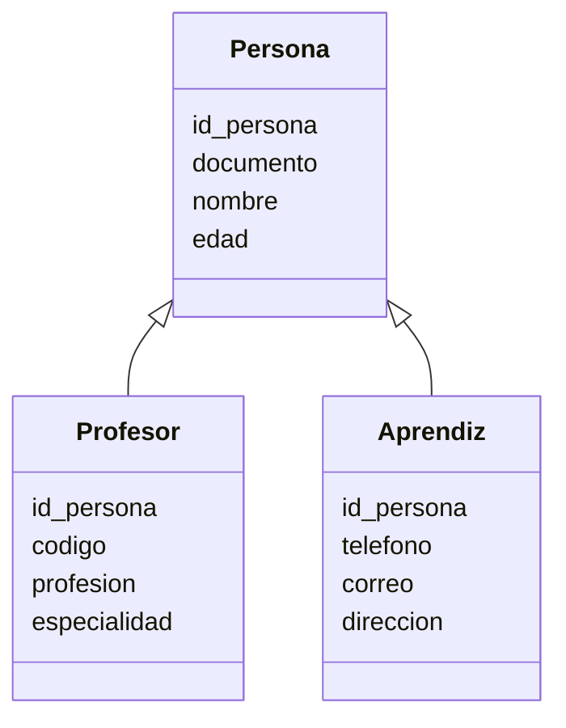

### 6.1. Especialización solapada

La especialización será solapada porque una misma persona
puede desempeñar simultáneamente los roles de profesor
y aprendiz.

Los roles no son mutuamente excluyentes.

### 6.2. Participación

Cada Profesor y Aprendiz debe estar asociado exactamente
a una Persona.

Una Persona puede estar asociada a cero o un Profesor
y a cero o un Aprendiz.

Para este diseño preliminar se admite participación parcial.
La necesidad de exigir al menos un rol deberá definirse
antes de la implementación definitiva.

### 6.3. Identificador compartido

Las entidades Profesor y Aprendiz utilizarán id_persona
como clave primaria y clave foránea.

Esta estructura garantiza que una persona no pueda tener
más de un registro dentro del mismo rol.

### 6.4. Beneficios

- Evita duplicar los datos personales.
- Permite conservar la relación de herencia conceptual.
- Facilita la administración de múltiples roles.
- Garantiza la unicidad del documento.
- Reduce inconsistencias en los datos comunes.

## 7. Relaciones y cardinalidades

### 7.1. Persona - Profesor

**Tipo:** uno a uno (1:1).

Una Persona puede tener cero o un registro de Profesor.

Cada Profesor debe pertenecer exactamente a una Persona.

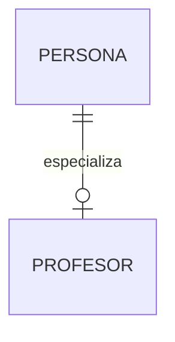

### 7.2. Persona - Aprendiz

**Tipo:** uno a uno (1:1).

Una Persona puede tener cero o un registro de Aprendiz.

Cada Aprendiz debe pertenecer exactamente a una Persona.

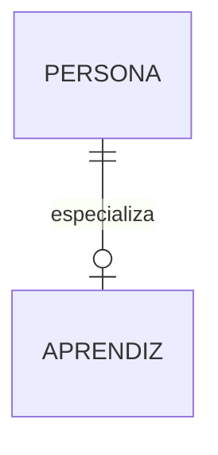

### 7.3. Profesor - Curso

**Tipo:** uno a muchos (1:N).

Un Profesor puede tener cero o muchos cursos asignados.

Un Curso puede tener cero o un Profesor responsable.

La participación de Profesor en Curso es opcional.

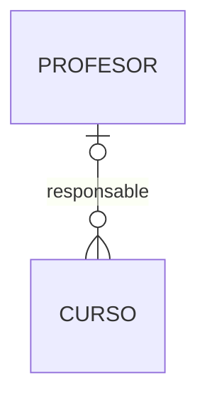

### 7.4. Modalidad - Curso

**Tipo:** uno a muchos (1:N).

Una Modalidad puede estar asociada a cero o muchos cursos.

Cada Curso debe pertenecer exactamente a una Modalidad.

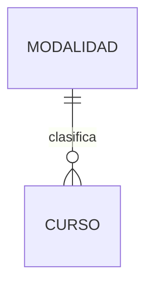

### 7.5. Aprendiz - Inscripcion

**Tipo:** uno a muchos (1:N).

Un Aprendiz puede tener cero o muchas inscripciones.

Cada Inscripcion debe pertenecer exactamente a un Aprendiz.

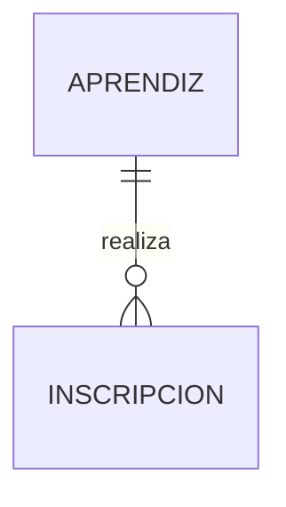

### 7.6. Curso - Inscripcion

**Tipo:** uno a muchos (1:N).

Un Curso puede tener cero o muchas inscripciones.

Cada Inscripcion debe pertenecer exactamente a un Curso.

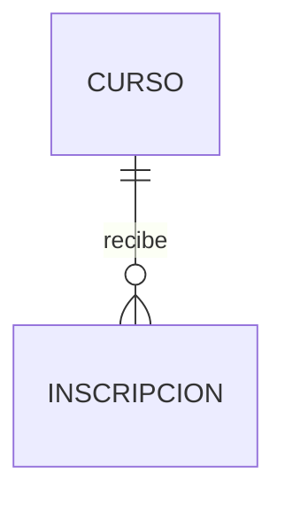

### 7.7. Inscripcion - Calificacion

**Tipo:** uno a muchos (1:N).

Una Inscripcion puede tener cero o muchas calificaciones.

Cada Calificacion debe pertenecer exactamente a una Inscripcion.

El mínimo de tres calificaciones corresponde a una regla
de rendimiento académico y no a una restricción mínima
de creación de la inscripción.

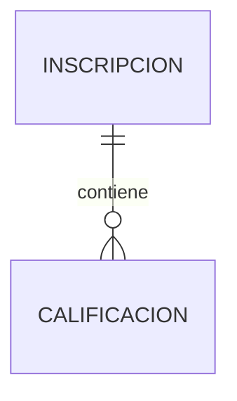

## 8. Matriz de cardinalidades

| Entidad A | Entidad B | Tipo | Cantidad de A por B | Cantidad de B por A |
|---|---|---|---|---|
| Persona | Profesor | 1:1 | 1 | 0..1 |
| Persona | Aprendiz | 1:1 | 1 | 0..1 |
| Profesor | Curso | 1:N | 0..1 | 0..N |
| Modalidad | Curso | 1:N | 1 | 0..N |
| Aprendiz | Inscripcion | 1:N | 1 | 0..N |
| Curso | Inscripcion | 1:N | 1 | 0..N |
| Inscripcion | Calificacion | 1:N | 1 | 0..N |
| Aprendiz | Curso | N:M | 0..N | 0..N |

La relación N:M entre Aprendiz y Curso es conceptual.

Su implementación se realiza mediante dos relaciones 1:N
a través de Inscripcion.

## 9. Resolución de la relación muchos a muchos

### 9.1. Relación conceptual

Un aprendiz puede participar en varios cursos.

Un curso puede contar con varios aprendices.

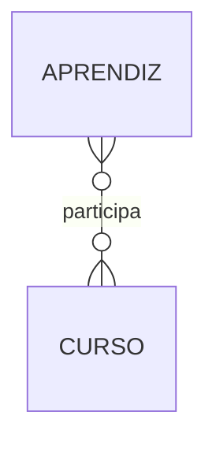

### 9.2. Entidad asociativa

Para representar esta relación se utiliza Inscripcion.

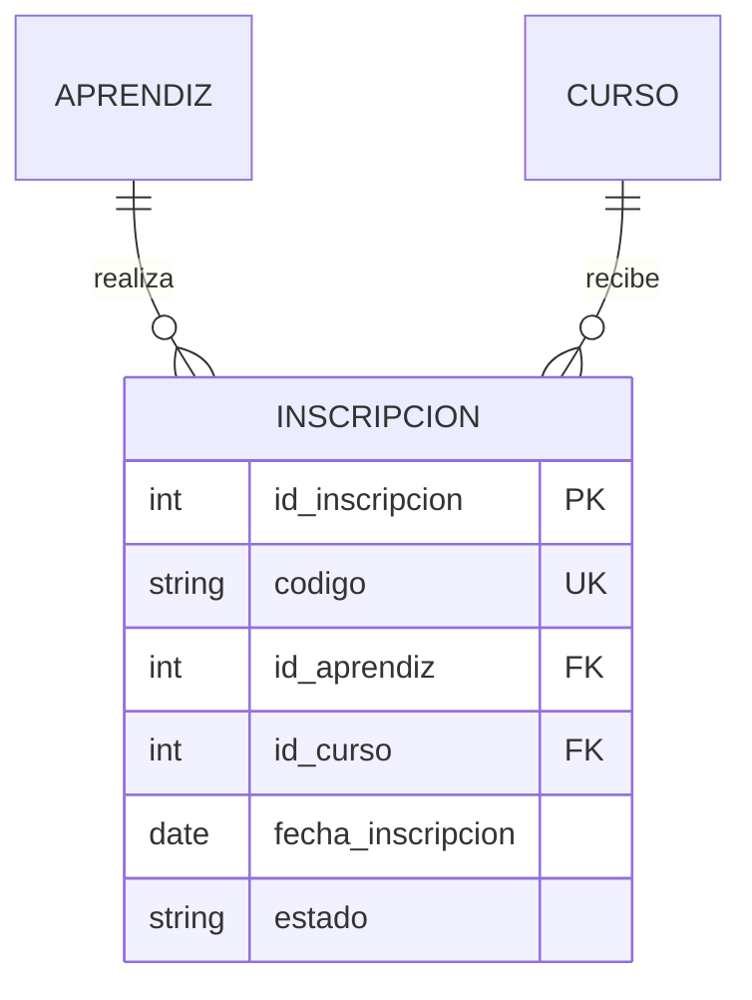

La entidad asociativa permite almacenar información propia
de la relación, como la fecha y el estado administrativo.

### 9.3. Prevención de duplicados

Se utilizará una restricción de unicidad compuesta sobre
los atributos id_aprendiz e id_curso.

```sql
UNIQUE (id_aprendiz, id_curso)
```

Esta restricción es independiente de la clave primaria
id_inscripcion.

### 9.4. Ejemplo conceptual

| Inscripcion | Aprendiz | Curso | Estado |
|---|---|---|---|
| INS-001 | APR-001 | CUR-001 | Activa |
| INS-002 | APR-001 | CUR-002 | Activa |
| INS-003 | APR-002 | CUR-001 | Finalizada |

El aprendiz APR-001 participa en dos cursos.

El curso CUR-001 contiene dos aprendices.

Los identificadores APR utilizados en este ejemplo son
etiquetas ilustrativas y no atributos adicionales del modelo.

## 10. Modelo entidad-relación completo

El siguiente diagrama utiliza la notación de pata de gallo
mediante Mermaid.

Los tipos de datos incluidos son conceptuales y serán
transformados a tipos SQL durante el diseño relacional.

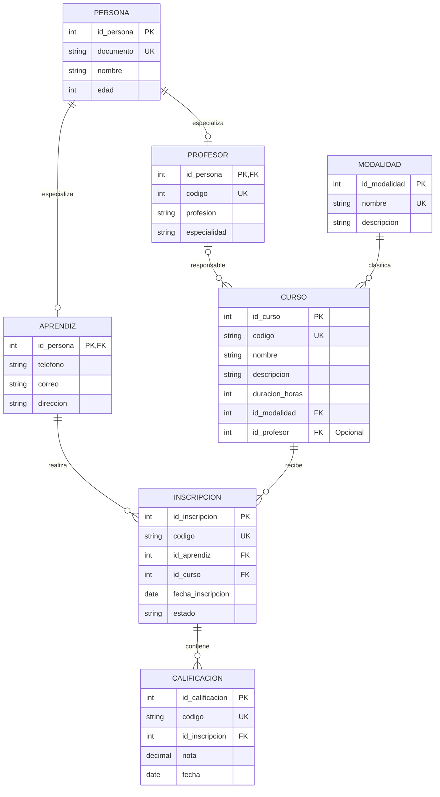

### 10.1. Convenciones

| Símbolo | Significado |
|---|---|
| PK | Clave primaria. |
| FK | Clave foránea. |
| UK | Clave o restricción única. |
| 1 | Participación de exactamente un registro. |
| 0..1 | Participación opcional de máximo un registro. |
| 0..N | Participación de cero o muchos registros. |
| 1:1 | Relación uno a uno. |
| 1:N | Relación uno a muchos. |
| N:M | Relación muchos a muchos. |

### 10.2. Restricción adicional del diagrama

La entidad Inscripcion posee una restricción de unicidad
compuesta sobre id_aprendiz e id_curso.

Esta restricción se documenta de forma independiente porque
la representación Mermaid no permite expresar claramente
todas las restricciones compuestas del modelo relacional.

## 11. Identificadores de las entidades

### 11.1. Claves primarias

| Entidad | Clave primaria |
|---|---|
| Persona | id_persona |
| Profesor | id_persona |
| Aprendiz | id_persona |
| Modalidad | id_modalidad |
| Curso | id_curso |
| Inscripcion | id_inscripcion |
| Calificacion | id_calificacion |

Se proponen identificadores internos independientes de los
códigos funcionales del aplicativo.

Profesor y Aprendiz constituyen una excepción porque utilizan
la clave primaria compartida con Persona.

### 11.2. Claves foráneas

| Entidad | Clave foránea | Entidad referenciada | Atributo referenciado | Obligatoria |
|---|---|---|---|---|
| Profesor | id_persona | Persona | id_persona | Sí |
| Aprendiz | id_persona | Persona | id_persona | Sí |
| Curso | id_modalidad | Modalidad | id_modalidad | Sí |
| Curso | id_profesor | Profesor | id_persona | No |
| Inscripcion | id_aprendiz | Aprendiz | id_persona | Sí |
| Inscripcion | id_curso | Curso | id_curso | Sí |
| Calificacion | id_inscripcion | Inscripcion | id_inscripcion | Sí |

### 11.3. Identificadores funcionales únicos

| Entidad | Atributo único |
|---|---|
| Persona | documento |
| Profesor | codigo |
| Modalidad | nombre |
| Curso | codigo |
| Inscripcion | codigo |
| Calificacion | codigo |
| Inscripcion | id_aprendiz + id_curso |

Los identificadores internos permiten mantener relaciones
estables sin depender directamente de los códigos utilizados
por los usuarios.

## 12. Atributos derivados

El promedio y el estado académico se obtienen a partir de
las calificaciones asociadas a una inscripción.

Por esta razón, no se representan como atributos persistentes.

| Atributo derivado | Origen | Cálculo |
|---|---|---|
| promedio | Calificacion.nota | Media aritmética redondeada a dos decimales. |
| estado_academico | Cantidad de notas y promedio | Pendiente, Aprobado o Reprobado. |
| total_calificaciones | Calificacion | Conteo de registros. |
| nota_maxima | Calificacion.nota | Valor máximo. |
| nota_minima | Calificacion.nota | Valor mínimo. |

### 12.1. Rendimiento académico

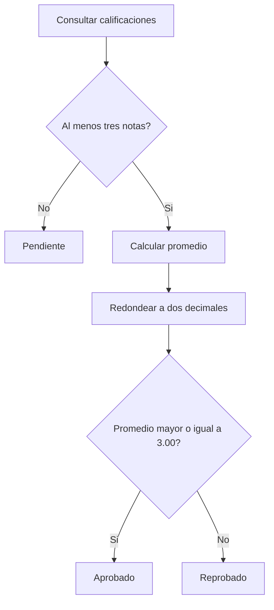

El promedio y el estado académico deberán calcularse
dinámicamente para evitar inconsistencias cuando se
modifiquen las calificaciones.

## 13. Restricciones de integridad

### 13.1. Integridad de entidad

Cada entidad deberá contar con un identificador único.

Las claves primarias no podrán ser nulas.

### 13.2. Integridad referencial

Las relaciones deberán impedir la existencia de registros
dependientes sin una entidad principal válida.

Por ejemplo:

- Un Profesor no puede existir sin Persona.
- Un Aprendiz no puede existir sin Persona.
- Un Curso no puede pertenecer a una Modalidad inexistente.
- Una Inscripcion no puede pertenecer a un Aprendiz inexistente.
- Una Calificacion no puede pertenecer a una Inscripcion inexistente.

### 13.3. Integridad de dominio

Los atributos deberán respetar las restricciones de tipo,
rango, formato y obligatoriedad.

| Atributo | Restricción |
|---|---|
| Persona.documento | Obligatorio y único. |
| Persona.edad | Mayor o igual a cero. |
| Profesor.codigo | Entero positivo y único. |
| Curso.duracion_horas | Entero positivo. |
| Inscripcion.estado | Activa, Cancelada o Finalizada. |
| Calificacion.nota | Entre 0.00 y 5.00. |

### 13.4. Integridad de negocio

Existen reglas que requieren validar información de varias
entidades o registros.

Entre ellas se encuentran:

- Evitar inscripciones duplicadas.
- Controlar las transiciones de estado.
- Permitir modificaciones de notas solo en inscripciones activas.
- Exigir tres calificaciones para determinar el rendimiento.
- Mantener la coherencia entre el promedio mostrado y el resultado.

Estas reglas se implementarán mediante restricciones,
consultas, transacciones y lógica de negocio, según corresponda.

## 14. Dependencias entre entidades

El orden conceptual de dependencias es el siguiente:

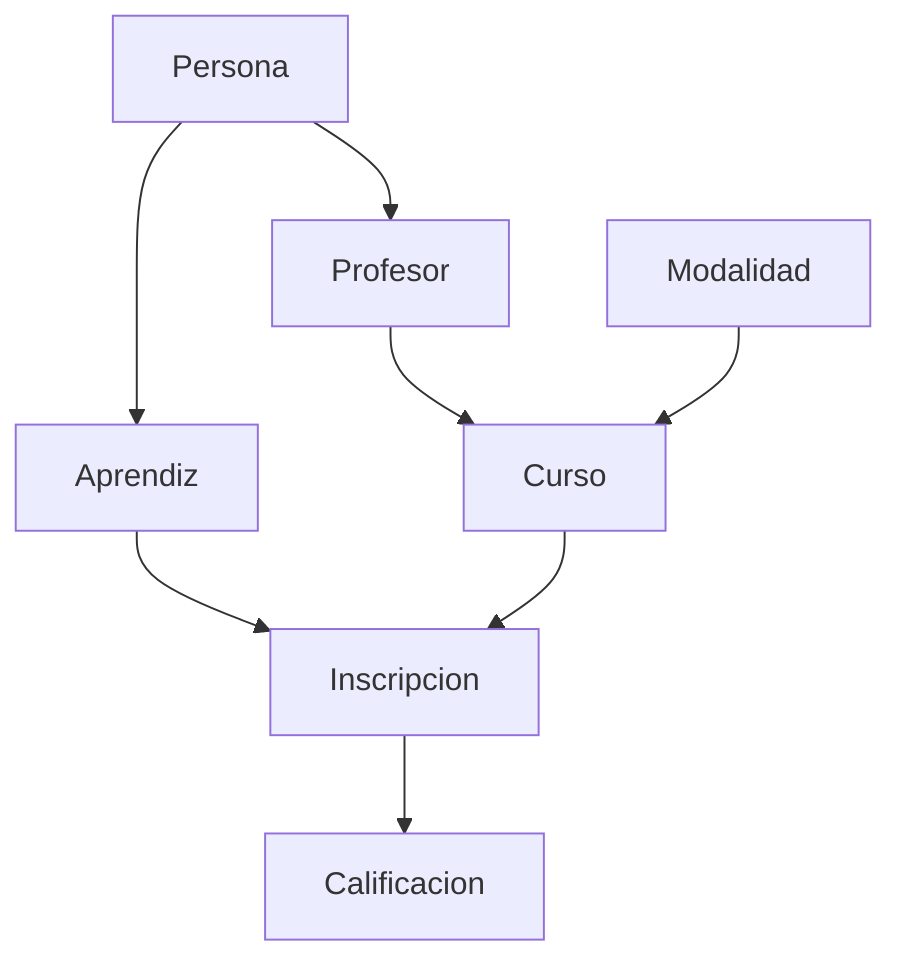

Para la futura implementación de la base de datos se
propone el siguiente orden de creación:

1. Persona.
2. Modalidad.
3. Profesor.
4. Aprendiz.
5. Curso.
6. Inscripcion.
7. Calificacion.

Este orden permite crear primero las entidades referenciadas
por las claves foráneas.

## 15. Justificación de las entidades seleccionadas

### 15.1. Persona

Centraliza los datos personales comunes y evita duplicarlos
entre profesores y aprendices.

### 15.2. Profesor

Conserva los atributos específicos de los profesores y
permite representar la asignación de cursos.

### 15.3. Aprendiz

Conserva los atributos de contacto y permite representar
la participación de los aprendices en los cursos.

### 15.4. Modalidad

Centraliza los tipos de formación y evita depender
exclusivamente de valores definidos en el código.

### 15.5. Curso

Representa la oferta académica y sus características.

### 15.6. Inscripcion

Resuelve la relación muchos a muchos entre aprendices
y cursos, almacenando información propia de la asociación.

### 15.7. Calificacion

Permite almacenar múltiples notas por inscripción sin
duplicar los datos del aprendiz ni del curso.

## 16. Elementos que no se representan como entidades

| Elemento | Justificación |
|---|---|
| GestionAcademica | Representa coordinación y lógica de negocio. |
| Gestores | Representan operaciones sobre las entidades. |
| Protocolos | Representan contratos de software. |
| Menús | Representan la interfaz de usuario. |
| Promedio | Es un atributo calculado. |
| Estado académico | Es un resultado derivado. |
| Reportes | Se generan mediante consultas. |
| Estado de inscripción | Se representa inicialmente como un atributo de dominio controlado. |

No se incorporan inicialmente entidades adicionales de
autenticación, auditoría o historial de cambios.

Su incorporación dependerá de los requisitos posteriores.

## 17. Trazabilidad con las reglas de negocio

| Componente del modelo | Reglas relacionadas |
|---|---|
| Persona | RN-PER-01 a RN-PER-12 |
| Profesor | RN-PRO-01 a RN-PRO-12 |
| Aprendiz | RN-APR-01 a RN-APR-11 |
| Modalidad | RN-MOD-01 a RN-MOD-07 |
| Curso | RN-CUR-01 a RN-CUR-17 |
| Inscripcion | RN-INS-01 a RN-INS-21 |
| Calificacion | RN-CAL-01 a RN-CAL-19 |
| Atributos derivados | RN-REN-01 a RN-REN-14 |
| Integridad | RN-INT-01 a RN-INT-12 |

## 18. Validación del modelo

| Criterio | Resultado del diseño |
|---|---|
| Incluye las siete entidades requeridas. | Cumple |
| Identifica los atributos de cada entidad. | Cumple |
| Identifica las claves primarias. | Cumple |
| Identifica las claves foráneas. | Cumple |
| Representa relaciones uno a uno. | Cumple |
| Representa relaciones uno a muchos. | Cumple |
| Identifica la relación muchos a muchos. | Cumple |
| Resuelve la relación N:M mediante Inscripcion. | Cumple |
| Representa la especialización de Persona. | Cumple |
| Identifica atributos derivados. | Cumple |
| Identifica restricciones de unicidad. | Cumple |
| Representa gráficamente las cardinalidades. | Cumple |

Esta validación corresponde a una revisión documental
del diseño y no a pruebas de una base de datos implementada.

## 19. Resumen del modelo

| Elemento | Cantidad |
|---|---:|
| Entidades | 7 |
| Atributos representados | 33 |
| Claves primarias | 7 |
| Claves foráneas | 7 |
| Relaciones directas 1:1 | 2 |
| Relaciones directas 1:N | 5 |
| Relaciones conceptuales N:M | 1 |
| Restricciones únicas adicionales a las PK | 7 |

## 20. Conclusiones

El modelo entidad-relación representa la estructura de
información necesaria para el Sistema de Gestión Académica.

Se identificaron siete entidades relacionadas mediante
cardinalidades uno a uno y uno a muchos.

La relación muchos a muchos entre aprendices y cursos
se resolvió mediante la entidad asociativa Inscripcion.

La especialización de Persona permite conservar la estructura
conceptual del aplicativo orientado a objetos y evitar
duplicaciones de información personal.

La incorporación de Modalidad como catálogo independiente
permite centralizar los tipos de formación.

El promedio y el estado académico se consideran atributos
derivados para evitar redundancias e inconsistencias.

El modelo constituye la base para la transformación al
modelo relacional, donde se definirán las tablas, tipos
de datos, claves y restricciones específicas.
