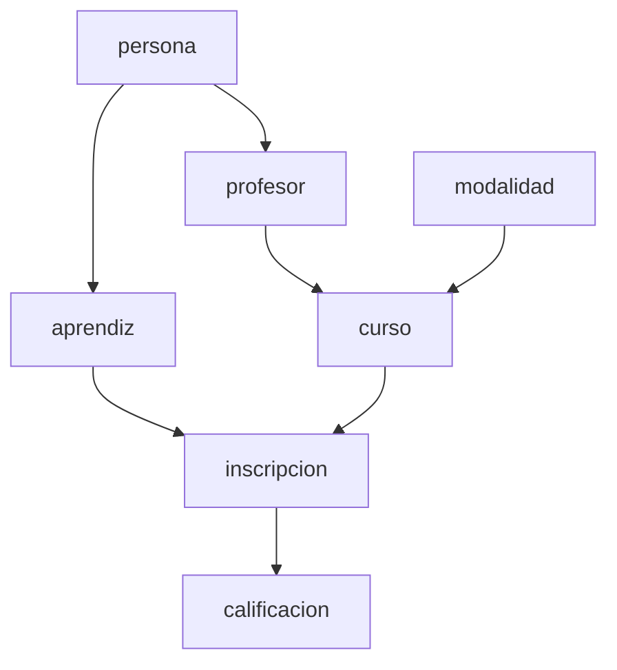

# Modelo relacional

## Fase 1: Análisis y diseño de base de datos

**Proyecto:** Sistema de Gestión Académica  
**Documento:** Modelo relacional  
**Versión:** 1.0

---

## 1. Introducción

El modelo relacional representa la transformación del modelo
entidad-relación del Sistema de Gestión Académica en una
estructura organizada mediante tablas, columnas, claves
primarias, claves foráneas y restricciones de integridad.

Este modelo establece las bases para implementar una base
de datos que permita conservar permanentemente la información
académica y garantizar su coherencia.

## 2. Objetivos

### 2.1. Objetivo general

Transformar el modelo entidad-relación en un modelo relacional
que permita representar y almacenar la información del Sistema
de Gestión Académica.

### 2.2. Objetivos específicos

- Transformar las entidades en tablas.
- Definir las columnas de cada tabla.
- Establecer los tipos de datos.
- Identificar claves primarias y foráneas.
- Definir restricciones de unicidad.
- Establecer restricciones de dominio.
- Determinar la obligatoriedad de los atributos.
- Garantizar la integridad referencial.
- Establecer las bases para la implementación física.

## 3. Documentos de referencia

- [Análisis del aplicativo](analisis-aplicativo.md).
- [Reglas de negocio](reglas-negocio.md).
- [Modelo entidad-relación](modelo-entidad-relacion.md).

## 4. Convenciones de diseño

### 4.1. Nomenclatura

Se utilizarán las siguientes convenciones:

- Nombres de tablas en singular.
- Nombres escritos en minúsculas.
- Separación de palabras mediante guion bajo.
- Identificadores internos con el prefijo id_.
- Nombres sin espacios ni caracteres especiales.
- Claves foráneas con nombres relacionados con la entidad
  referenciada.

### 4.2. Abreviaturas

| Abreviatura | Significado |
|---|---|
| PK | PRIMARY KEY |
| FK | FOREIGN KEY |
| UK | UNIQUE |
| NN | NOT NULL |
| AI | AUTO_INCREMENT |
| CK | CHECK |
| NULL | Valor no obligatorio |
| RESTRICT | Restricción de eliminación o actualización |

### 4.3. Tipos de datos

Se utilizarán tipos compatibles con MySQL 8.4 como candidato
a sistema gestor de base de datos.

La selección definitiva se justificará en el documento
seleccion-sgbd.md.

| Tipo | Aplicación |
|---|---|
| INT UNSIGNED | Identificadores y números enteros no negativos. |
| VARCHAR(n) | Cadenas de longitud variable. |
| TEXT | Descripciones de mayor extensión. |
| DATE | Fechas sin componente de hora. |
| DECIMAL(3,2) | Calificaciones con precisión decimal exacta. |

## 5. Transformación del modelo entidad-relación

### 5.1. Transformación de entidades

Cada entidad identificada en el MER se transforma en una tabla.

| Entidad | Tabla |
|---|---|
| Persona | persona |
| Profesor | profesor |
| Aprendiz | aprendiz |
| Modalidad | modalidad |
| Curso | curso |
| Inscripcion | inscripcion |
| Calificacion | calificacion |

### 5.2. Transformación de relaciones uno a uno

Las relaciones entre Persona y sus especializaciones
se implementarán mediante claves primarias compartidas.

Las tablas profesor y aprendiz utilizarán id_persona
como clave primaria y clave foránea.

Esta estructura permite que una persona tenga ambos roles
sin duplicar su información personal.

### 5.3. Transformación de relaciones uno a muchos

Las relaciones uno a muchos se implementarán mediante
una clave foránea ubicada en la tabla correspondiente
al lado de muchos.

### 5.4. Transformación de relaciones muchos a muchos

La relación entre aprendiz y curso se implementará mediante
la tabla asociativa inscripcion.

Esta tabla contendrá las claves foráneas id_aprendiz
e id_curso, además de los atributos propios de la inscripción.

Se establecerá una restricción UNIQUE compuesta para
evitar inscripciones duplicadas.

## 6. Esquema relacional

### 6.1. Tabla persona

```text
PERSONA(
    id_persona PK,
    documento UK,
    nombre,
    edad
)
```

### 6.2. Tabla profesor

```text
PROFESOR(
    id_persona PK FK,
    codigo UK,
    profesion,
    especialidad
)
```

### 6.3. Tabla aprendiz

```text
APRENDIZ(
    id_persona PK FK,
    telefono,
    correo,
    direccion
)
```

### 6.4. Tabla modalidad

```text
MODALIDAD(
    id_modalidad PK,
    nombre UK,
    descripcion
)
```

### 6.5. Tabla curso

```text
CURSO(
    id_curso PK,
    codigo UK,
    nombre,
    descripcion,
    duracion_horas,
    id_modalidad FK,
    id_profesor FK
)
```

### 6.6. Tabla inscripcion

```text
INSCRIPCION(
    id_inscripcion PK,
    codigo UK,
    id_aprendiz FK,
    id_curso FK,
    fecha_inscripcion,
    estado
)

UNIQUE(id_aprendiz, id_curso)
```

### 6.7. Tabla calificacion

```text
CALIFICACION(
    id_calificacion PK,
    codigo UK,
    id_inscripcion FK,
    nota,
    fecha
)
```

## 7. Definición de tablas

### 7.1. Tabla persona

Almacena la información personal común de profesores
y aprendices.

| Columna | Tipo de dato | Nulo | Restricciones |
|---|---|---|---|
| id_persona | INT UNSIGNED | No | PK, AI |
| documento | VARCHAR(20) | No | UK, CK |
| nombre | VARCHAR(150) | No | CK |
| edad | INT UNSIGNED | No | CK |

#### Clave primaria

- id_persona.

#### Clave alternativa

- documento.

#### Restricciones

- El documento debe ser único.
- El documento debe contener únicamente dígitos.
- El documento no puede representar el valor cero.
- El nombre no puede estar vacío.
- La edad debe ser mayor o igual a cero.

El documento se almacena como texto para conservar posibles
ceros iniciales.

Los documentos se compararán mediante su representación
textual después de eliminar espacios externos.

### 7.2. Tabla profesor

Almacena los atributos profesionales de las personas
que desempeñan el rol de profesor.

| Columna | Tipo de dato | Nulo | Restricciones |
|---|---|---|---|
| id_persona | INT UNSIGNED | No | PK, FK |
| codigo | INT UNSIGNED | No | UK, CK |
| profesion | VARCHAR(100) | No | CK |
| especialidad | VARCHAR(100) | No | CK |

#### Clave primaria

- id_persona.

#### Clave foránea

- id_persona referencia persona.id_persona.

#### Clave alternativa

- codigo.

#### Restricciones

- El profesor debe estar asociado a una persona existente.
- El código debe ser único y mayor que cero.
- La profesión no puede estar vacía.
- La especialidad no puede estar vacía.

La clave primaria no utilizará AUTO_INCREMENT porque
su valor se obtiene de la tabla persona.

### 7.3. Tabla aprendiz

Almacena los datos de contacto de las personas que
desempeñan el rol de aprendiz.

| Columna | Tipo de dato | Nulo | Restricciones |
|---|---|---|---|
| id_persona | INT UNSIGNED | No | PK, FK |
| telefono | VARCHAR(20) | No | CK |
| correo | VARCHAR(254) | No | CK |
| direccion | VARCHAR(200) | No | CK |

#### Clave primaria

- id_persona.

#### Clave foránea

- id_persona referencia persona.id_persona.

#### Restricciones

- El aprendiz debe estar asociado a una persona existente.
- El teléfono es obligatorio.
- El correo electrónico es obligatorio.
- La dirección es obligatoria.
- Los campos de contacto no pueden estar vacíos.

El teléfono y correo no tendrán inicialmente restricciones
de unicidad.

Las validaciones detalladas de formato se realizarán
principalmente desde la aplicación.

La clave primaria no utilizará AUTO_INCREMENT.

### 7.4. Tabla modalidad

Almacena el catálogo de modalidades de formación.

| Columna | Tipo de dato | Nulo | Restricciones |
|---|---|---|---|
| id_modalidad | INT UNSIGNED | No | PK, AI |
| nombre | VARCHAR(50) | No | UK, CK |
| descripcion | VARCHAR(255) | Sí | Ninguna adicional |

#### Clave primaria

- id_modalidad.

#### Clave alternativa

- nombre.

#### Restricciones

- El nombre debe ser único.
- El nombre no puede estar vacío.
- El nombre se normalizará a minúsculas.
- La descripción es opcional.
- No se podrá eliminar una modalidad utilizada por cursos.

#### Datos iniciales

| id_modalidad | nombre | descripcion |
|---:|---|---|
| 1 | titulada | Formación correspondiente a programas titulados. |
| 2 | complementaria | Formación orientada al fortalecimiento de competencias. |

Los identificadores presentados corresponden a los valores
iniciales propuestos para el catálogo.

### 7.5. Tabla curso

Almacena la información de los cursos ofrecidos por
la institución.

| Columna | Tipo de dato | Nulo | Restricciones |
|---|---|---|---|
| id_curso | INT UNSIGNED | No | PK, AI |
| codigo | VARCHAR(30) | No | UK, CK |
| nombre | VARCHAR(150) | No | CK |
| descripcion | TEXT | No | CK |
| duracion_horas | INT UNSIGNED | No | CK |
| id_modalidad | INT UNSIGNED | No | FK |
| id_profesor | INT UNSIGNED | Sí | FK |

#### Clave primaria

- id_curso.

#### Claves foráneas

- id_modalidad referencia modalidad.id_modalidad.
- id_profesor referencia profesor.id_persona.

#### Clave alternativa

- codigo.

#### Restricciones

- El código debe ser único.
- El código no puede estar vacío.
- El nombre y la descripción son obligatorios.
- La duración debe ser mayor que cero.
- La modalidad debe existir.
- El profesor puede permanecer sin asignar.
- Cuando exista un profesor asignado, este debe estar registrado.

El atributo id_profesor permitirá NULL para representar
cursos que todavía no tienen profesor responsable.

### 7.6. Tabla inscripcion

Representa la vinculación de un aprendiz con un curso.

| Columna | Tipo de dato | Nulo | Restricciones |
|---|---|---|---|
| id_inscripcion | INT UNSIGNED | No | PK, AI |
| codigo | VARCHAR(30) | No | UK, CK |
| id_aprendiz | INT UNSIGNED | No | FK, UK compuesta |
| id_curso | INT UNSIGNED | No | FK, UK compuesta |
| fecha_inscripcion | DATE | No | Fecha automática |
| estado | VARCHAR(15) | No | CK, DEFAULT |

#### Clave primaria

- id_inscripcion.

#### Claves foráneas

- id_aprendiz referencia aprendiz.id_persona.
- id_curso referencia curso.id_curso.

#### Claves alternativas

- codigo.
- Combinación de id_aprendiz e id_curso.

#### Restricciones

- El código debe ser único.
- El aprendiz debe existir.
- El curso debe existir.
- La combinación de aprendiz y curso debe ser única.
- La fecha original debe conservarse.
- El estado inicial debe ser Activa.
- Los estados permitidos son Activa, Cancelada y Finalizada.
- Solo una inscripción activa puede cancelarse o finalizarse.

La restricción compuesta no significa que id_aprendiz
o id_curso sean únicos individualmente.

Un aprendiz puede aparecer en múltiples inscripciones
y un curso puede aparecer en múltiples inscripciones.

### 7.7. Tabla calificacion

Almacena las notas académicas asociadas a una inscripción.

| Columna | Tipo de dato | Nulo | Restricciones |
|---|---|---|---|
| id_calificacion | INT UNSIGNED | No | PK, AI |
| codigo | VARCHAR(30) | No | UK, CK |
| id_inscripcion | INT UNSIGNED | No | FK |
| nota | DECIMAL(3,2) | No | CK |
| fecha | DATE | No | Fecha automática |

#### Clave primaria

- id_calificacion.

#### Clave foránea

- id_inscripcion referencia inscripcion.id_inscripcion.

#### Clave alternativa

- codigo.

#### Restricciones

- El código debe ser único.
- La inscripción debe existir.
- La nota debe estar entre 0.00 y 5.00.
- La nota debe tener como máximo dos decimales.
- La fecha original debe conservarse.
- Solo se podrán registrar o modificar notas de
  inscripciones activas.

La validación del estado de la inscripción requerirá
lógica de negocio y control transaccional.

## 8. Diagrama del modelo relacional

```mermaid
erDiagram
    PERSONA ||--o| PROFESOR : especializa
    PERSONA ||--o| APRENDIZ : especializa
    PROFESOR o|..o{ CURSO : responsable
    MODALIDAD ||..o{ CURSO : clasifica
    APRENDIZ ||..o{ INSCRIPCION : realiza
    CURSO ||..o{ INSCRIPCION : recibe
    INSCRIPCION ||..o{ CALIFICACION : contiene

    PERSONA {
        int id_persona PK
        varchar(20) documento UK
        varchar(150) nombre
        int edad
    }

    PROFESOR {
        int id_persona PK, FK
        int codigo UK
        varchar(100) profesion
        varchar(100) especialidad
    }

    APRENDIZ {
        int id_persona PK, FK
        varchar(20) telefono
        varchar(254) correo
        varchar(200) direccion
    }

    MODALIDAD {
        int id_modalidad PK
        varchar(50) nombre UK
        varchar(255) descripcion
    }

    CURSO {
        int id_curso PK
        varchar(30) codigo UK
        varchar(150) nombre
        text descripcion
        int duracion_horas
        int id_modalidad FK
        int id_profesor FK "NULL permitido"
    }

    INSCRIPCION {
        int id_inscripcion PK
        varchar(30) codigo UK
        int id_aprendiz FK
        int id_curso FK
        date fecha_inscripcion
        varchar(15) estado
    }

    CALIFICACION {
        int id_calificacion PK
        varchar(30) codigo UK
        int id_inscripcion FK
        decimal(3,2) nota
        date fecha
    }
```

Los detalles de UNSIGNED, valores predeterminados y
restricciones compuestas se especifican en las tablas
y secciones correspondientes de este documento.

Las líneas continuas representan relaciones identificadoras
con claves primarias compartidas.

Las líneas discontinuas representan relaciones no
identificadoras.

## 9. Claves primarias

| Tabla | Clave primaria | Autoincremental |
|---|---|---|
| persona | id_persona | Sí |
| profesor | id_persona | No |
| aprendiz | id_persona | No |
| modalidad | id_modalidad | Sí |
| curso | id_curso | Sí |
| inscripcion | id_inscripcion | Sí |
| calificacion | id_calificacion | Sí |

Se utilizarán identificadores internos para mantener
las relaciones independientes de los códigos funcionales.

Los identificadores internos no deberán modificarse
durante la existencia del registro.

## 10. Claves foráneas

| Tabla origen | Columna | Tabla destino | Columna destino |
|---|---|---|---|
| profesor | id_persona | persona | id_persona |
| aprendiz | id_persona | persona | id_persona |
| curso | id_modalidad | modalidad | id_modalidad |
| curso | id_profesor | profesor | id_persona |
| inscripcion | id_aprendiz | aprendiz | id_persona |
| inscripcion | id_curso | curso | id_curso |
| calificacion | id_inscripcion | inscripcion | id_inscripcion |

Todas las claves foráneas tendrán el mismo tipo de dato
que las claves primarias referenciadas.

## 11. Restricciones de unicidad

| Nombre propuesto | Tabla | Columnas |
|---|---|---|
| uq_persona_documento | persona | documento |
| uq_profesor_codigo | profesor | codigo |
| uq_modalidad_nombre | modalidad | nombre |
| uq_curso_codigo | curso | codigo |
| uq_inscripcion_codigo | inscripcion | codigo |
| uq_inscripcion_aprendiz_curso | inscripcion | id_aprendiz, id_curso |
| uq_calificacion_codigo | calificacion | codigo |

Estas restricciones son adicionales a las claves primarias.

### 11.1. Unicidad compuesta

La restricción:

```sql
UNIQUE (id_aprendiz, id_curso)
```

impide registrar más de una inscripción para la misma
combinación de aprendiz y curso.

Esta restricción se aplicará independientemente del estado
administrativo de la inscripción.

## 12. Restricciones de dominio

### 12.1. Edad

```sql
CHECK (edad >= 0)
```

### 12.2. Código del profesor

```sql
CHECK (codigo > 0)
```

### 12.3. Duración del curso

```sql
CHECK (duracion_horas > 0)
```

### 12.4. Rango de calificaciones

```sql
CHECK (nota BETWEEN 0.00 AND 5.00)
```

### 12.5. Estados de inscripción

```sql
CHECK (estado IN ('Activa', 'Cancelada', 'Finalizada'))
```

La comparación de estados deberá distinguir mayúsculas
y minúsculas para conservar exactamente los valores definidos.

### 12.6. Textos obligatorios

Ejemplo de restricción para impedir cadenas vacías:

```sql
CHECK (CHAR_LENGTH(TRIM(nombre)) > 0)
```

Se aplicarán restricciones equivalentes a los campos
obligatorios de texto cuando corresponda.

La aplicación también deberá validar espacios, tabulaciones
y otros caracteres que puedan producir entradas vacías.

### 12.7. Documento de identificación

La aplicación y la base de datos deberán garantizar que
el documento:

- Contenga entre 1 y 20 dígitos.
- No contenga letras.
- No contenga espacios internos.
- No esté compuesto exclusivamente por ceros.

La expresión SQL definitiva se establecerá durante
la implementación física.

## 13. Valores predeterminados

| Tabla | Columna | Valor propuesto |
|---|---|---|
| curso | id_profesor | NULL |
| modalidad | descripcion | NULL |
| inscripcion | estado | Activa |
| inscripcion | fecha_inscripcion | Fecha actual |
| calificacion | fecha | Fecha actual |

En MySQL 8.4, los valores predeterminados de fecha podrán
representarse mediante una expresión como:

```sql
DEFAULT (CURRENT_DATE)
```

La aplicación también podrá proporcionar explícitamente
la fecha de registro cuando corresponda.

La recuperación de registros deberá conservar las fechas
originales.

## 14. Políticas de integridad referencial

Se utilizará RESTRICT para impedir eliminaciones o
actualizaciones de claves que comprometan las relaciones.

| Clave foránea | ON DELETE | ON UPDATE |
|---|---|---|
| profesor.id_persona | RESTRICT | RESTRICT |
| aprendiz.id_persona | RESTRICT | RESTRICT |
| curso.id_modalidad | RESTRICT | RESTRICT |
| curso.id_profesor | RESTRICT | RESTRICT |
| inscripcion.id_aprendiz | RESTRICT | RESTRICT |
| inscripcion.id_curso | RESTRICT | RESTRICT |
| calificacion.id_inscripcion | RESTRICT | RESTRICT |

### 14.1. Justificación

La información académica debe protegerse frente a
eliminaciones accidentales.

No se utilizarán eliminaciones automáticas en cascada
en el diseño inicial.

Si un profesor tiene cursos asignados, estos deberán
reasignarse o quedar sin profesor antes de permitir
una eventual eliminación del registro.

La eliminación física no constituye una operación
disponible en la interfaz actual.

## 15. Identificación de índices

Los índices permitirán optimizar las consultas realizadas
frecuentemente por el aplicativo.

### 15.1. Índices asociados a claves

Las claves primarias y las restricciones UNIQUE
generarán sus correspondientes índices.

Las claves foráneas deberán disponer de índices
compatibles con las relaciones establecidas.

### 15.2. Índices propuestos

| Tabla | Columnas | Finalidad |
|---|---|---|
| curso | id_profesor | Consultar cursos por profesor. |
| curso | id_modalidad | Consultar cursos por modalidad. |
| inscripcion | id_curso | Consultar aprendices inscritos por curso. |
| calificacion | id_inscripcion | Consultar notas por inscripción. |

La restricción UNIQUE compuesta de inscripcion sobre
id_aprendiz e id_curso permitirá apoyar las búsquedas
por aprendiz.

No se crearán índices redundantes cuando una clave
o índice existente cubra adecuadamente la consulta.

### 15.3. Evaluación de rendimiento

La necesidad definitiva de índices adicionales deberá
evaluarse mediante consultas reales y planes de ejecución.

No se establecerán conclusiones de rendimiento antes
de implementar y probar la base de datos.

## 16. Configuración de caracteres

Se propone utilizar utf8mb4 como conjunto de caracteres
para permitir almacenar nombres, direcciones y textos
con caracteres Unicode.

### 16.1. Comparación de códigos

Los códigos de curso, inscripción y calificación deberán
distinguir entre mayúsculas y minúsculas.

Se propone utilizar una intercalación compatible con
MySQL que conserve esta característica, como utf8mb4_bin,
en las columnas correspondientes.

Por ejemplo:

- CUR-001.
- cur-001.

Ambos códigos podrán existir como registros diferentes.

### 16.2. Comparación de modalidades

Los nombres de modalidad se normalizarán a minúsculas
antes de almacenarse.

### 16.3. Normalización de entradas

La aplicación deberá eliminar espacios externos de los
códigos y documentos antes de almacenarlos o consultarlos.

## 17. Justificación de los tipos de datos

### 17.1. Identificadores internos

Se utilizará INT UNSIGNED para representar identificadores
enteros positivos.

Este tipo permite almacenar valores entre 0 y 4294967295.

Los identificadores generados automáticamente comenzarán
normalmente desde 1.

### 17.2. Documento de identificación

Se utilizará VARCHAR(20) porque el documento representa
un identificador y no una cantidad numérica.

Esto permite conservar ceros iniciales.

### 17.3. Edad

Se utilizará INT UNSIGNED para conservar la representación
entera no negativa del aplicativo original.

La edad almacenada no se actualizará automáticamente
con el paso del tiempo.

El uso de fecha de nacimiento podrá evaluarse como
una mejora posterior.

### 17.4. Teléfono

Se utilizará VARCHAR(20) para almacenar números de contacto
con posibles prefijos internacionales y ceros iniciales.

### 17.5. Correo electrónico

Se utilizará VARCHAR(254) para disponer de una longitud
adecuada para direcciones de correo electrónico.

### 17.6. Códigos funcionales

Se utilizará VARCHAR(30) para los códigos de cursos,
inscripciones y calificaciones.

El código de profesor conservará su representación
numérica mediante INT UNSIGNED.

### 17.7. Descripciones

Se utilizará TEXT para la descripción de los cursos,
debido a que puede requerir una extensión superior
a otros atributos.

La descripción de modalidad utilizará VARCHAR(255)
porque corresponde a un texto breve de catálogo.

### 17.8. Calificaciones

Se utilizará DECIMAL(3,2) para almacenar valores decimales
exactos con dos posiciones decimales.

El tipo permite representar valores hasta 9.99 en su
rango positivo, por lo que se requiere adicionalmente
una restricción CHECK que limite las notas a 5.00.

### 17.9. Fechas

Se utilizará DATE porque el aplicativo registra fechas
sin necesidad de almacenar horas, minutos o segundos.

### 17.10. Estados

Se utilizará VARCHAR(15) junto con una restricción CHECK
para representar los tres estados administrativos.

Esta solución permite controlar los valores admitidos
sin incorporar inicialmente una tabla adicional.

### 17.11. Longitudes de texto

Las longitudes propuestas constituyen decisiones técnicas
del diseño relacional.

El aplicativo original no establecía límites máximos
para todos los atributos de texto.

Por esta razón, las validaciones de Python deberán
adaptarse posteriormente a las longitudes definidas.

## 18. Consultas y datos derivados

### 18.1. Promedio académico

El promedio no se almacenará como una columna permanente.

Se calculará mediante las calificaciones asociadas a
una inscripción.

### 18.2. Estado académico

El estado académico se determinará dinámicamente:

- Pendiente: menos de tres calificaciones.
- Aprobado: promedio redondeado mayor o igual a 3.00.
- Reprobado: promedio redondeado inferior a 3.00.

### 18.3. Consulta conceptual de rendimiento

```sql
SELECT
    i.id_inscripcion,
    i.codigo,
    COUNT(c.id_calificacion) AS total_notas,
    CASE
        WHEN COUNT(c.id_calificacion) >= 3
        THEN ROUND(AVG(c.nota), 2)
        ELSE NULL
    END AS promedio,
    CASE
        WHEN COUNT(c.id_calificacion) < 3
        THEN 'Pendiente'
        WHEN ROUND(AVG(c.nota), 2) >= 3.00
        THEN 'Aprobado'
        ELSE 'Reprobado'
    END AS estado_academico
FROM inscripcion AS i
LEFT JOIN calificacion AS c
    ON c.id_inscripcion = i.id_inscripcion
GROUP BY
    i.id_inscripcion,
    i.codigo;
```

Se utiliza LEFT JOIN para incluir inscripciones que
todavía no poseen calificaciones.

La consulta es una propuesta de diseño y deberá
validarse durante la implementación.

### 18.4. Política de redondeo

Se propone utilizar redondeo decimal al valor más
cercano, resolviendo los empates hacia arriba para
las notas no negativas.

En Python se utilizará una representación Decimal
con ROUND_HALF_UP.

La implementación SQL y Python deberá verificarse
mediante pruebas de valores límite.

### 18.5. Reportes académicos

Los reportes utilizarán funciones de agregación como:

- COUNT: cantidad de registros.
- AVG: promedio.
- MIN: valor mínimo.
- MAX: valor máximo.

No se almacenarán resultados de reportes como tablas
independientes en el diseño inicial.

## 19. Reglas que requieren lógica de negocio

No todas las reglas pueden implementarse exclusivamente
mediante claves y restricciones CHECK.

| Regla | Mecanismo propuesto |
|---|---|
| Registrar una persona y su rol. | Transacción. |
| Asociar un segundo rol a una persona existente. | Validación y transacción. |
| Cancelar una inscripción activa. | Actualización condicionada. |
| Finalizar una inscripción activa. | Actualización condicionada. |
| Registrar notas en inscripciones activas. | Validación y transacción. |
| Modificar notas en inscripciones activas. | Validación y transacción. |
| Calcular rendimiento con mínimo tres notas. | Consulta de agregación. |
| Validar formato de correo y teléfono. | Validación en Python. |
| Validar cantidad de decimales. | Validación en Python. |

Las operaciones que modifiquen calificaciones y estados
de inscripción deberán coordinarse transaccionalmente
para evitar inconsistencias ante solicitudes concurrentes.

## 20. Correspondencia entre clases y tablas

| Clase o componente Python | Tabla relacional |
|---|---|
| Persona | persona |
| Profesor | persona y profesor |
| Aprendiz | persona y aprendiz |
| Curso | curso |
| Modalidades válidas de Curso | modalidad |
| Inscripcion | inscripcion |
| Calificacion | calificacion |

La recuperación de un Profesor o Aprendiz requerirá
consultar tanto la información personal como los
atributos específicos de su rol.

Los gestores y protocolos no se convertirán en tablas.

## 21. Orden de implementación

### 21.1. Orden de creación

1. persona.
2. modalidad.
3. profesor.
4. aprendiz.
5. curso.
6. inscripcion.
7. calificacion.

Este orden permite crear primero las tablas referenciadas.

### 21.2. Orden de eliminación de tablas

En un entorno de pruebas o reconstrucción controlada,
el orden inverso será:

1. calificacion.
2. inscripcion.
3. curso.
4. aprendiz.
5. profesor.
6. modalidad.
7. persona.

Este orden no representa una autorización para eliminar
información académica en un entorno real.

## 22. Diagrama de dependencias



Las dependencias representan las relaciones entre
tablas principales y tablas referenciantes.

## 23. Trazabilidad con las reglas de negocio

| Tabla o componente | Reglas relacionadas |
|---|---|
| persona | RN-PER-01 a RN-PER-12 |
| profesor | RN-PRO-01 a RN-PRO-12 |
| aprendiz | RN-APR-01 a RN-APR-11 |
| modalidad | RN-MOD-01 a RN-MOD-07 |
| curso | RN-CUR-01 a RN-CUR-17 |
| inscripcion | RN-INS-01 a RN-INS-21 |
| calificacion | RN-CAL-01 a RN-CAL-19 |
| Consultas de rendimiento | RN-REN-01 a RN-REN-14 |
| Reportes | RN-REP-01 a RN-REP-13 |
| Restricciones | RN-INT-01 a RN-INT-12 |
| Persistencia | RN-PERST-01 a RN-PERST-10 |

## 24. Validación documental

| Criterio | Resultado del diseño |
|---|---|
| Transformación de las siete entidades. | Cumple |
| Definición de columnas. | Cumple |
| Identificación de claves primarias. | Cumple |
| Identificación de claves foráneas. | Cumple |
| Definición de tipos de datos. | Cumple |
| Definición de longitudes. | Cumple |
| Definición de atributos obligatorios. | Cumple |
| Definición de atributos opcionales. | Cumple |
| Restricciones de unicidad. | Cumple |
| Restricciones de dominio. | Cumple |
| Resolución de relaciones N:M. | Cumple |
| Políticas de integridad referencial. | Cumple |
| Identificación de datos derivados. | Cumple |

Esta validación corresponde exclusivamente a la revisión
documental del modelo.

No se han ejecutado todavía scripts de creación de tablas
ni pruebas sobre una base de datos implementada.

## 25. Resumen del modelo relacional

| Elemento | Cantidad |
|---|---:|
| Tablas | 7 |
| Columnas | 33 |
| Claves primarias | 7 |
| Claves primarias autoincrementales | 5 |
| Claves primarias compartidas | 2 |
| Claves foráneas | 7 |
| Restricciones únicas adicionales a las PK | 7 |
| Columnas que permiten NULL | 2 |
| Columnas obligatorias | 31 |

## 26. Consideraciones pendientes

Antes de implementar la base de datos deberán completarse
los siguientes aspectos:

- Elaboración del diccionario de datos.
- Validación de la primera forma normal.
- Validación de la segunda forma normal.
- Validación de la tercera forma normal.
- Selección definitiva del sistema gestor de base de datos.
- Definición detallada de las expresiones CHECK.
- Validación de la configuración de caracteres.
- Definición de la participación obligatoria o parcial
  de Persona en sus especializaciones.
- Evaluación de requisitos adicionales para finalizar
  inscripciones.
- Elaboración de los scripts SQL.
- Pruebas de integridad y persistencia.

Los scripts SQL y las pruebas de base de datos corresponden
a la siguiente fase del proyecto.

## 27. Conclusiones

El modelo relacional transforma las siete entidades
identificadas en el MER en siete tablas relacionadas.

Se establecieron los tipos de datos, claves primarias,
claves foráneas, restricciones de unicidad, obligatoriedad
y políticas de integridad referencial.

La especialización de Persona se representa mediante
claves primarias compartidas en profesor y aprendiz.

La tabla inscripcion permite resolver la relación muchos
a muchos entre aprendices y cursos.

La tabla calificacion permite almacenar múltiples notas
por inscripción sin duplicar los datos académicos relacionados.

El promedio y el estado académico se calcularán
dinámicamente para evitar redundancias.

El modelo constituye la base para elaborar el diccionario
de datos, justificar la normalización y desarrollar
posteriormente la implementación física de la base de datos.
