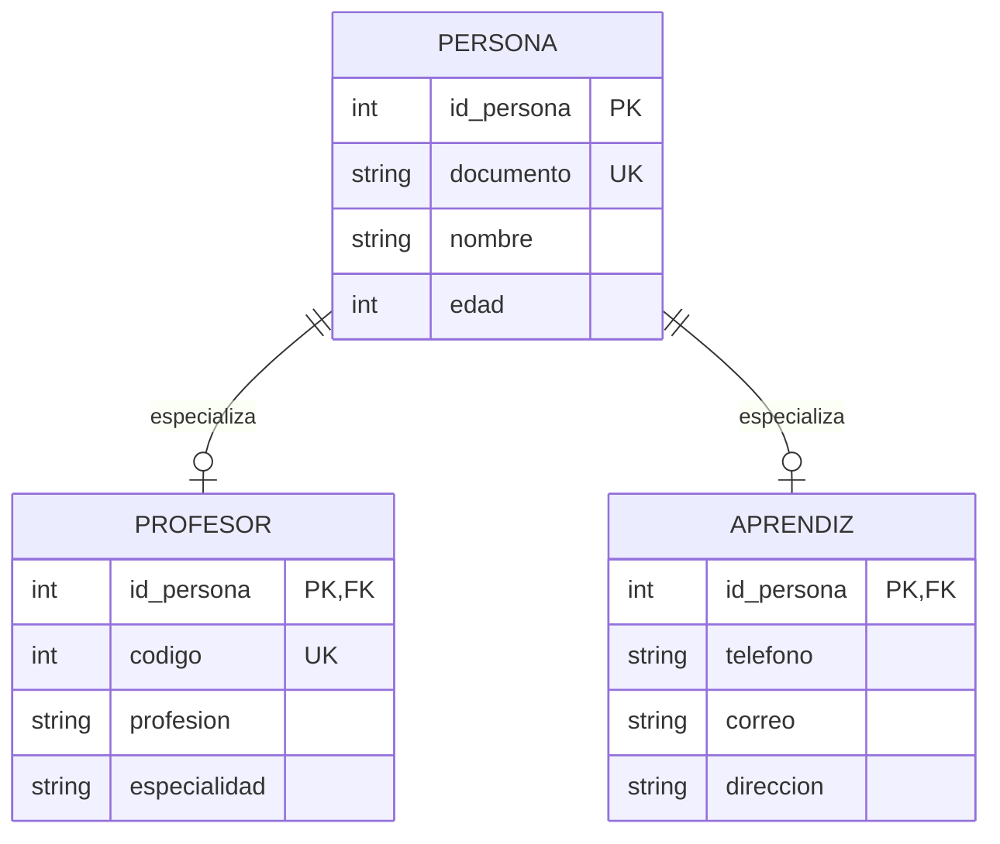
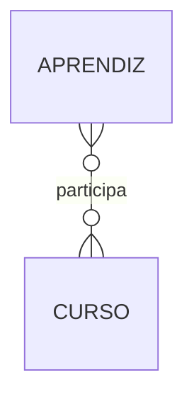
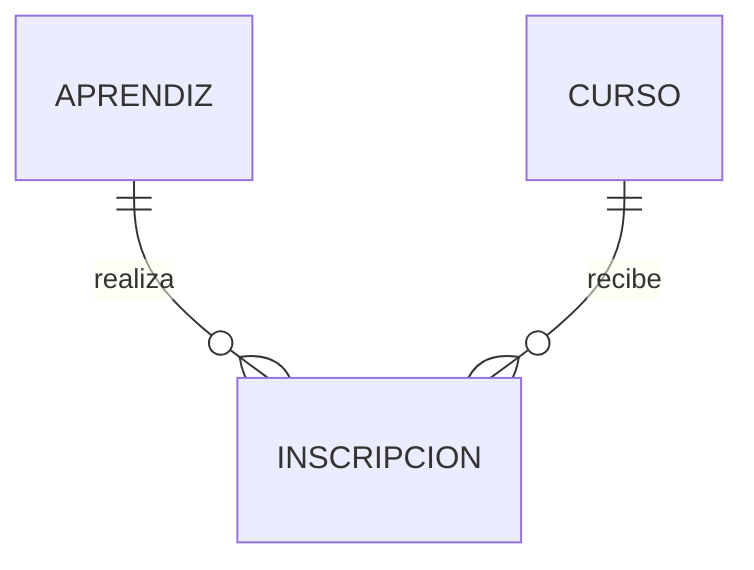
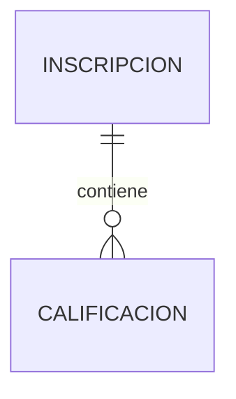
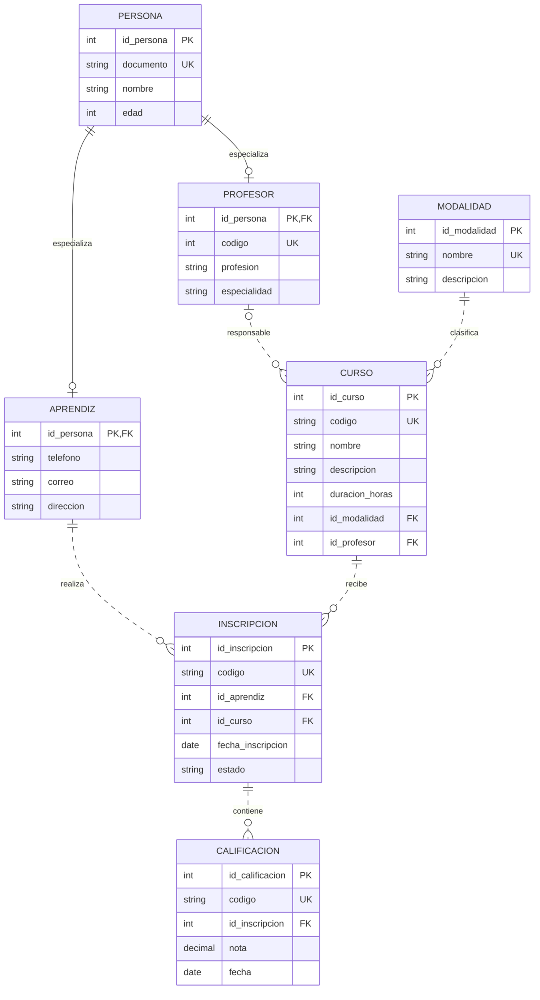

# Normalización de la base de datos

## Fase 1: Análisis y diseño de base de datos

**Proyecto:** Sistema de Gestión Académica  
**Documento:** Normalización de la base de datos  
**Versión:** 1.0

---

## 1. Introducción

La normalización es un proceso de diseño de bases de datos
relacionales que permite organizar los atributos y las
relaciones con el propósito de reducir redundancias,
prevenir inconsistencias y garantizar la integridad
de la información.

En el Sistema de Gestión Académica se requiere almacenar
permanentemente información relacionada con personas,
profesores, aprendices, modalidades, cursos, inscripciones
y calificaciones.

El presente documento analiza las dependencias funcionales
del modelo relacional y justifica su cumplimiento de la
primera, segunda y tercera forma normal.

## 2. Objetivos

### 2.1. Objetivo general

Justificar la normalización del modelo relacional del
Sistema de Gestión Académica hasta la tercera forma normal.

### 2.2. Objetivos específicos

- Identificar posibles redundancias de información.
- Identificar las claves candidatas de cada relación.
- Analizar las dependencias funcionales.
- Verificar el cumplimiento de la primera forma normal.
- Verificar el cumplimiento de la segunda forma normal.
- Verificar el cumplimiento de la tercera forma normal.
- Identificar y prevenir anomalías de datos.
- Justificar la separación de las entidades.
- Garantizar la coherencia con el modelo relacional.

## 3. Documentos de referencia

- [Análisis del aplicativo](analisis-aplicativo.md).
- [Reglas de negocio](reglas-negocio.md).
- [Modelo entidad-relación](modelo-entidad-relacion.md).
- [Modelo relacional](modelo-relacional.md).
- [Diccionario de datos](diccionario-datos.md).

## 4. Fundamentos teóricos

### 4.1. Normalización

La normalización organiza las relaciones de una base
de datos mediante el análisis de sus atributos,
claves candidatas y dependencias funcionales.

Su finalidad no consiste únicamente en dividir tablas,
sino en garantizar que cada relación represente
información coherente con las reglas del negocio.

### 4.2. Dependencia funcional

Una dependencia funcional establece que el valor
de un atributo o conjunto de atributos determina
el valor de otro atributo o conjunto de atributos.

Se representa mediante:

```text
X -> Y
```

Esto significa que dos registros con el mismo valor
de X deben tener el mismo valor de Y.

Por ejemplo:

```text
id_persona -> documento, nombre, edad
```

El identificador de una persona determina sus
atributos personales.

### 4.3. Dependencia funcional completa

Existe cuando un atributo depende de un conjunto
completo de atributos determinantes y no de un
subconjunto propio de estos.

Por ejemplo:

```text
(id_aprendiz, id_curso) -> fecha_inscripcion, estado
```

La fecha y el estado corresponden a la combinación
completa del aprendiz y el curso.

### 4.4. Dependencia funcional parcial

Existe cuando un atributo no primo depende únicamente
de una parte de una clave candidata compuesta.

Por ejemplo, en una relación incorrectamente diseñada:

```text
(id_aprendiz, id_curso) -> nombre_aprendiz
```

El nombre del aprendiz depende únicamente de
id_aprendiz, por lo que no debería almacenarse
como atributo de la inscripción.

### 4.5. Dependencia transitiva

Existe cuando un atributo determina otro atributo
mediante un atributo intermedio.

Por ejemplo:

```text
id_curso -> id_modalidad
id_modalidad -> nombre_modalidad
```

Si nombre_modalidad se almacenara directamente
en curso, existiría una dependencia transitiva
que introduciría redundancia.

### 4.6. Clave candidata

Es un conjunto mínimo de atributos que permite
identificar de manera única un registro.

Una relación puede poseer varias claves candidatas.

### 4.7. Clave primaria

Es la clave candidata seleccionada como identificador
principal de una relación.

### 4.8. Clave alternativa

Es una clave candidata que no fue seleccionada
como clave primaria.

### 4.9. Atributo primo

Es un atributo que pertenece al menos a una
clave candidata.

### 4.10. Atributo no primo

Es un atributo que no pertenece a ninguna
clave candidata.

## 5. Situación inicial del aplicativo

El aplicativo original utiliza clases de Python
y colecciones temporales para gestionar información
académica.

Las relaciones se representan mediante referencias
entre objetos.

Por ejemplo:

- Profesor y Aprendiz heredan de Persona.
- Curso contiene una referencia a Profesor.
- Inscripcion contiene referencias a Aprendiz y Curso.
- Calificacion contiene una referencia a Inscripcion.

Aunque el aplicativo orientado a objetos separa
responsabilidades y entidades, es necesario transformar
estas estructuras en relaciones adecuadas para
el almacenamiento permanente.

La normalización permitirá conservar las relaciones
del dominio sin duplicar innecesariamente los datos.

## 6. Ejemplo de estructura no normalizada

Para ilustrar el proceso de normalización se propone
una estructura hipotética denominada REGISTRO_ACADEMICO.

Esta estructura no corresponde a una tabla existente
del aplicativo.

```text
REGISTRO_ACADEMICO(
    documento_aprendiz,
    nombre_aprendiz,
    edad_aprendiz,
    telefono,
    correo,
    direccion,
    codigo_curso,
    nombre_curso,
    descripcion_curso,
    duracion_horas,
    nombre_modalidad,
    descripcion_modalidad,
    documento_profesor,
    nombre_profesor,
    edad_profesor,
    codigo_profesor,
    profesion,
    especialidad,
    codigo_inscripcion,
    fecha_inscripcion,
    estado_inscripcion,
    calificaciones,
    promedio,
    estado_academico
)
```

### 6.1. Ejemplo de registros

| Aprendiz | Curso | Profesor | Calificaciones | Promedio |
|---|---|---|---|---:|
| Ana Torres | Python | Carlos Pérez | 4.50, 3.80, 4.20 | 4.17 |
| Ana Torres | SQL | Carlos Pérez | 4.00, 5.00, 4.50 | 4.50 |
| Luis Gómez | Python | Carlos Pérez | 3.50, 4.00, 3.80 | 3.77 |

### 6.2. Problemas identificados

- Repetición de datos personales.
- Repetición de información de profesores.
- Repetición de información de cursos.
- Repetición de modalidades.
- Almacenamiento de varias notas en un atributo.
- Dificultad para modificar una calificación individual.
- Dependencias parciales.
- Dependencias transitivas.
- Almacenamiento redundante del promedio.
- Posibles inconsistencias en el estado académico.

## 7. Primera forma normal (1FN)

### 7.1. Definición

Una relación cumple la primera forma normal cuando
sus atributos contienen valores individuales de
sus respectivos dominios y no existen grupos
repetitivos ni colecciones dentro de las columnas.

### 7.2. Problema de grupos repetitivos

En la estructura no normalizada, el atributo
calificaciones contiene varios valores.

```text
calificaciones = [4.50, 3.80, 4.20]
```

Esta representación no resulta adecuada para
gestionar individualmente cada calificación.

### 7.3. Solución

Cada calificación se representa mediante un registro
independiente.

| codigo_calificacion | codigo_inscripcion | nota |
|---|---|---:|
| CAL-001 | INS-001 | 4.50 |
| CAL-002 | INS-001 | 3.80 |
| CAL-003 | INS-001 | 4.20 |

De esta manera, una inscripción puede relacionarse
con múltiples calificaciones sin almacenar listas
dentro de una columna.

### 7.4. Representación de relaciones múltiples

Tampoco se almacenarán listas de cursos dentro
de aprendiz ni listas de aprendices dentro de curso.

La relación muchos a muchos se representará mediante
la tabla inscripcion.

| id_inscripcion | id_aprendiz | id_curso |
|---:|---:|---:|
| 1 | 1 | 1 |
| 2 | 1 | 2 |
| 3 | 3 | 1 |

### 7.5. Verificación por tabla

| Tabla | Justificación de cumplimiento | Resultado |
|---|---|---|
| persona | Cada atributo representa un dato personal individual. | Cumple |
| profesor | Los atributos profesionales contienen valores individuales. | Cumple |
| aprendiz | Cada atributo de contacto representa un valor individual. | Cumple |
| modalidad | Cada registro representa una modalidad. | Cumple |
| curso | Cada registro representa un curso y sus referencias individuales. | Cumple |
| inscripcion | Cada registro representa una asociación aprendiz-curso. | Cumple |
| calificacion | Cada registro representa una nota individual. | Cumple |

### 7.6. Consideraciones sobre atomicidad

El nombre completo se considera un valor individual
dentro de los requisitos actuales.

No se requiere separar nombres y apellidos porque
el aplicativo no necesita administrarlos de manera
independiente.

La dirección y el correo electrónico también se
consideran valores individuales de sus dominios.

Si posteriormente se requiere almacenar varios
teléfonos o correos por aprendiz, deberá evaluarse
la creación de relaciones adicionales.

### 7.7. Conclusión de la primera forma normal

Las siete tablas cumplen la primera forma normal
porque no contienen listas, arreglos ni grupos
repetitivos de atributos.

Cada registro puede identificarse mediante su
correspondiente clave primaria.

## 8. Identificación de claves candidatas

Antes de analizar la segunda y tercera forma normal,
se identifican las claves candidatas del modelo.

| Tabla | Clave primaria | Claves candidatas alternativas |
|---|---|---|
| persona | id_persona | documento |
| profesor | id_persona | codigo |
| aprendiz | id_persona | Ninguna |
| modalidad | id_modalidad | nombre |
| curso | id_curso | codigo |
| inscripcion | id_inscripcion | codigo; (id_aprendiz, id_curso) |
| calificacion | id_calificacion | codigo |

La identificación se fundamenta en las restricciones
de unicidad y obligatoriedad establecidas en el
modelo relacional.

La tabla inscripcion posee una clave candidata
compuesta adicional.

Por esta razón, su análisis requiere especial
atención durante la segunda forma normal.

## 9. Segunda forma normal (2FN)

### 9.1. Definición

Una relación cumple la segunda forma normal cuando:

- Cumple la primera forma normal.
- Todos los atributos no primos dependen completamente
  de cada clave candidata.

No deben existir dependencias parciales respecto
de claves candidatas compuestas.

### 9.2. Ejemplo de dependencia parcial

Considérese la siguiente relación hipotética:

```text
INSCRIPCION_INCORRECTA(
    id_aprendiz,
    id_curso,
    nombre_aprendiz,
    nombre_curso,
    fecha_inscripcion,
    estado
)
```

Clave candidata:

```text
(id_aprendiz, id_curso)
```

Dependencias funcionales:

```text
id_aprendiz -> nombre_aprendiz

id_curso -> nombre_curso

(id_aprendiz, id_curso) -> fecha_inscripcion, estado
```

Los atributos nombre_aprendiz y nombre_curso
dependen únicamente de una parte de la clave.

Por lo tanto, esta estructura no cumple la
segunda forma normal.

### 9.3. Solución aplicada

Los datos personales se almacenan en persona.

Los datos específicos del aprendiz se almacenan
en aprendiz.

Los datos académicos del curso se almacenan
en curso.

La tabla inscripcion conserva exclusivamente
los atributos propios de la asociación.

```text
PERSONA(
    id_persona,
    documento,
    nombre,
    edad
)

APRENDIZ(
    id_persona,
    telefono,
    correo,
    direccion
)

CURSO(
    id_curso,
    codigo,
    nombre,
    descripcion,
    duracion_horas,
    id_modalidad,
    id_profesor
)

INSCRIPCION(
    id_inscripcion,
    codigo,
    id_aprendiz,
    id_curso,
    fecha_inscripcion,
    estado
)
```

### 9.4. Análisis de persona

Claves candidatas:

```text
{id_persona}
{documento}
```

Dependencias funcionales:

```text
id_persona -> documento, nombre, edad

documento -> id_persona, nombre, edad
```

Las claves candidatas son simples.

No existen dependencias parciales.

Resultado: cumple 2FN.

### 9.5. Análisis de profesor

Claves candidatas:

```text
{id_persona}
{codigo}
```

Dependencias funcionales:

```text
id_persona -> codigo, profesion, especialidad

codigo -> id_persona, profesion, especialidad
```

Las claves candidatas son simples.

Los datos personales se encuentran en persona.

Resultado: cumple 2FN.

### 9.6. Análisis de aprendiz

Clave candidata:

```text
{id_persona}
```

Dependencia funcional:

```text
id_persona -> telefono, correo, direccion
```

La clave candidata es simple.

Los atributos de contacto dependen del identificador
del aprendiz.

Resultado: cumple 2FN.

### 9.7. Análisis de modalidad

Claves candidatas:

```text
{id_modalidad}
{nombre}
```

Dependencias funcionales:

```text
id_modalidad -> nombre, descripcion

nombre -> id_modalidad, descripcion
```

Las claves candidatas son simples.

Resultado: cumple 2FN.

### 9.8. Análisis de curso

Claves candidatas:

```text
{id_curso}
{codigo}
```

Dependencias funcionales:

```text
id_curso -> codigo, nombre, descripcion,
            duracion_horas, id_modalidad, id_profesor

codigo -> id_curso, nombre, descripcion,
          duracion_horas, id_modalidad, id_profesor
```

Las claves candidatas son simples.

Los atributos del curso dependen de su identificador
interno o de su código funcional.

Resultado: cumple 2FN.

### 9.9. Análisis de inscripcion

Claves candidatas:

```text
{id_inscripcion}
{codigo}
{id_aprendiz, id_curso}
```

Dependencias funcionales:

```text
id_inscripcion -> codigo, id_aprendiz, id_curso,
                  fecha_inscripcion, estado

codigo -> id_inscripcion, id_aprendiz, id_curso,
          fecha_inscripcion, estado

(id_aprendiz, id_curso) -> id_inscripcion, codigo,
                           fecha_inscripcion, estado
```

Los atributos no primos son:

- fecha_inscripcion.
- estado.

Ambos dependen completamente de la combinación
id_aprendiz e id_curso.

El aprendiz por sí solo no determina una fecha
ni un estado de inscripción, porque puede estar
inscrito en varios cursos.

El curso por sí solo tampoco determina estos
atributos, porque puede tener varios aprendices.

No se almacenan nombres, documentos ni datos
propios del aprendiz o del curso en esta tabla.

Resultado: cumple 2FN.

### 9.10. Análisis de calificacion

Claves candidatas:

```text
{id_calificacion}
{codigo}
```

Dependencias funcionales:

```text
id_calificacion -> codigo, id_inscripcion, nota, fecha

codigo -> id_calificacion, id_inscripcion, nota, fecha
```

Las claves candidatas son simples.

La inscripción no determina una única nota,
porque puede tener múltiples calificaciones.

Resultado: cumple 2FN.

### 9.11. Resumen de la segunda forma normal

| Tabla | Claves candidatas compuestas | Dependencias parciales | Resultado |
|---|---|---|---|
| persona | No | No | Cumple |
| profesor | No | No | Cumple |
| aprendiz | No | No | Cumple |
| modalidad | No | No | Cumple |
| curso | No | No | Cumple |
| inscripcion | Sí | No | Cumple |
| calificacion | No | No | Cumple |

### 9.12. Conclusión de la segunda forma normal

Las siete tablas cumplen la segunda forma normal
según las dependencias funcionales identificadas.

La clave candidata compuesta de inscripcion
fue analizada explícitamente.

No se considera suficiente la existencia de
una clave primaria artificial para garantizar
la segunda forma normal.

## 10. Tercera forma normal (3FN)

### 10.1. Definición

Una relación cumple la tercera forma normal cuando,
para toda dependencia funcional no trivial X -> A:

- X es una superclave; o
- A es un atributo primo.

Una superclave es un conjunto de atributos que
identifica de manera única cada registro.

En términos prácticos, deben evitarse las
dependencias transitivas indebidas de atributos
no primos respecto de las claves candidatas.

### 10.2. Ejemplo de dependencia transitiva

Considérese la siguiente relación hipotética:

```text
CURSO_INCORRECTO(
    id_curso,
    codigo,
    nombre,
    id_modalidad,
    nombre_modalidad,
    descripcion_modalidad
)
```

Dependencias funcionales:

```text
id_curso -> id_modalidad

id_modalidad -> nombre_modalidad, descripcion_modalidad
```

Por transitividad:

```text
id_curso -> nombre_modalidad, descripcion_modalidad
```

Los atributos nombre_modalidad y descripcion_modalidad
dependen directamente de id_modalidad.

Como id_modalidad no identifica de manera única
un curso, almacenar estos atributos en curso
introduciría una dependencia transitiva indebida.

### 10.3. Solución aplicada

Se separa la información de modalidad en una
tabla independiente.

```text
MODALIDAD(
    id_modalidad,
    nombre,
    descripcion
)

CURSO(
    id_curso,
    codigo,
    nombre,
    descripcion,
    duracion_horas,
    id_modalidad,
    id_profesor
)
```

El curso conserva únicamente la referencia
a la modalidad correspondiente.

### 10.4. Análisis de persona

Dependencias funcionales principales:

```text
id_persona -> documento, nombre, edad

documento -> id_persona, nombre, edad
```

Los determinantes identificados son claves candidatas.

No se ha identificado una regla de negocio
según la cual el nombre determine la edad
o viceversa.

Resultado: cumple 3FN.

### 10.5. Análisis de profesor

Dependencias funcionales principales:

```text
id_persona -> codigo, profesion, especialidad

codigo -> id_persona, profesion, especialidad
```

La información personal se almacena en persona.

No existe una regla de negocio que establezca
que una profesión determina una única especialidad.

Resultado: cumple 3FN.

### 10.6. Análisis de aprendiz

Dependencia funcional principal:

```text
id_persona -> telefono, correo, direccion
```

El teléfono y el correo no son claves candidatas
porque el diseño no exige su unicidad.

No se han establecido dependencias funcionales
entre los atributos de contacto.

Resultado: cumple 3FN.

### 10.7. Análisis de modalidad

Dependencias funcionales principales:

```text
id_modalidad -> nombre, descripcion

nombre -> id_modalidad, descripcion
```

Los determinantes identificados son claves candidatas.

La descripción depende de la modalidad identificada.

Resultado: cumple 3FN.

### 10.8. Análisis de curso

Dependencias funcionales principales:

```text
id_curso -> codigo, nombre, descripcion,
            duracion_horas, id_modalidad, id_profesor

codigo -> id_curso, nombre, descripcion,
          duracion_horas, id_modalidad, id_profesor
```

Los datos de modalidad se encuentran en modalidad.

Los datos profesionales se encuentran en profesor.

Los datos personales del profesor se encuentran
en persona.

La tabla curso conserva las claves foráneas
necesarias para recuperar esta información.

No se duplican nombres de profesores, profesiones,
especialidades ni descripciones de modalidades.

Resultado: cumple 3FN.

### 10.9. Análisis de inscripcion

Dependencias funcionales principales:

```text
id_inscripcion -> codigo, id_aprendiz, id_curso,
                  fecha_inscripcion, estado

codigo -> id_inscripcion, id_aprendiz, id_curso,
          fecha_inscripcion, estado

(id_aprendiz, id_curso) -> id_inscripcion, codigo,
                           fecha_inscripcion, estado
```

La tabla no almacena datos personales del aprendiz
ni atributos descriptivos del curso.

El estado administrativo y la fecha corresponden
a la inscripción.

No se ha identificado una dependencia funcional
entre fecha_inscripcion y estado.

Resultado: cumple 3FN.

### 10.10. Análisis de calificacion

Dependencias funcionales principales:

```text
id_calificacion -> codigo, id_inscripcion, nota, fecha

codigo -> id_calificacion, id_inscripcion, nota, fecha
```

La tabla conserva la referencia a inscripcion.

No almacena directamente id_aprendiz ni id_curso,
porque estos pueden obtenerse mediante la inscripción.

Tampoco almacena nombres de aprendices o cursos.

Resultado: cumple 3FN.

### 10.11. Resumen de la tercera forma normal

| Tabla | Dependencias transitivas indebidas identificadas | Resultado |
|---|---|---|
| persona | Ninguna | Cumple |
| profesor | Ninguna | Cumple |
| aprendiz | Ninguna | Cumple |
| modalidad | Ninguna | Cumple |
| curso | Ninguna | Cumple |
| inscripcion | Ninguna | Cumple |
| calificacion | Ninguna | Cumple |

### 10.12. Conclusión de la tercera forma normal

Las siete tablas cumplen la tercera forma normal
de acuerdo con las claves candidatas y dependencias
funcionales derivadas de las reglas de negocio.

Esta conclusión depende de que no existan
dependencias funcionales adicionales que no hayan
sido identificadas durante el análisis.

## 11. Justificación de la especialización de Persona

### 11.1. Problema de duplicación

Una estructura independiente para profesores
y aprendices podría almacenar los datos personales
en ambas tablas.

```text
PROFESOR_INCORRECTO(
    documento,
    nombre,
    edad,
    codigo,
    profesion,
    especialidad
)

APRENDIZ_INCORRECTO(
    documento,
    nombre,
    edad,
    telefono,
    correo,
    direccion
)
```

Si una persona desempeña ambos roles, su nombre,
documento y edad podrían almacenarse dos veces.

Esto produciría redundancia entre relaciones.

### 11.2. Solución propuesta

```text
PERSONA(
    id_persona,
    documento,
    nombre,
    edad
)

PROFESOR(
    id_persona,
    codigo,
    profesion,
    especialidad
)

APRENDIZ(
    id_persona,
    telefono,
    correo,
    direccion
)
```

### 11.3. Representación gráfica



### 11.4. Beneficios

- Centralización de los datos personales.
- Unicidad global del documento.
- Posibilidad de desempeñar ambos roles.
- Reducción de redundancia entre relaciones.
- Conservación de la especialización conceptual
  del aplicativo orientado a objetos.

La separación también responde a decisiones de
modelado del dominio y no exclusivamente a la
aplicación de las formas normales.

## 12. Justificación de la entidad Modalidad

En el aplicativo original, las modalidades
titulada y complementaria se encuentran definidas
en la clase Curso.

En el modelo relacional se representan mediante
un catálogo independiente.

### 12.1. Estructura propuesta

| id_modalidad | nombre | descripcion |
|---:|---|---|
| 1 | titulada | Formación correspondiente a programas titulados. |
| 2 | complementaria | Formación orientada al fortalecimiento de competencias. |

### 12.2. Beneficios

- Centralización de los tipos de formación.
- Eliminación de descripciones repetidas.
- Integridad referencial.
- Facilidad para incorporar modalidades adicionales.
- Independencia entre los datos del catálogo
  y los datos del curso.

La repetición de una clave foránea en varios cursos
es necesaria para representar la relación.

No constituye una redundancia indebida.

## 13. Normalización de la relación muchos a muchos

### 13.1. Relación conceptual

Un aprendiz puede estar inscrito en varios cursos.

Un curso puede contener varios aprendices.



### 13.2. Transformación

La relación se transforma mediante la entidad
asociativa inscripcion.



### 13.3. Restricción de unicidad

```sql
UNIQUE (id_aprendiz, id_curso)
```

Esta restricción garantiza que no se repita
la combinación de aprendiz y curso.

La unicidad compuesta permite identificar
funcionalmente una inscripción.

### 13.4. Beneficios

- Evita almacenar listas de aprendices o cursos.
- Permite representar múltiples inscripciones.
- Conserva la fecha de inscripción.
- Conserva el estado administrativo.
- Facilita las consultas en ambas direcciones.
- Evita inscripciones duplicadas.

## 14. Normalización de las calificaciones

### 14.1. Estructura incorrecta

Una alternativa inadecuada sería almacenar
las notas como columnas repetitivas.

```text
INSCRIPCION(
    id_inscripcion,
    id_aprendiz,
    id_curso,
    nota_1,
    nota_2,
    nota_3,
    promedio
)
```

Esta estructura limita la cantidad de notas
y obliga a modificar el esquema si se requiere
registrar una cuarta calificación.

Aunque las columnas individuales pueden contener
valores escalares, representan un grupo repetitivo
que no resulta adecuado para el dominio.

### 14.2. Estructura propuesta

```text
CALIFICACION(
    id_calificacion,
    codigo,
    id_inscripcion,
    nota,
    fecha
)
```

### 14.3. Relación



### 14.4. Beneficios

- Permite registrar cualquier cantidad de notas.
- Facilita la modificación individual.
- Permite identificar cada calificación.
- Conserva la fecha original de registro.
- Evita duplicar los datos del aprendiz y del curso.
- Facilita el cálculo del rendimiento académico.

La cantidad mínima de tres calificaciones
corresponde a una regla de rendimiento y no
a una cantidad fija de columnas.

## 15. Tratamiento de atributos derivados

### 15.1. Promedio

El promedio se calcula a partir de las
calificaciones de una inscripción.

No se almacenará como atributo permanente.

```text
Promedio = suma de notas / cantidad de notas
```

### 15.2. Estado académico

El estado académico depende de la cantidad
de calificaciones y del promedio redondeado.

| Condición | Estado académico |
|---|---|
| Menos de tres notas | Pendiente |
| Tres o más notas y promedio redondeado >= 3.00 | Aprobado |
| Tres o más notas y promedio redondeado < 3.00 | Reprobado |

### 15.3. Ejemplo de cálculo

| Calificación | Valor |
|---|---:|
| CAL-001 | 4.50 |
| CAL-002 | 3.80 |
| CAL-003 | 4.20 |

```text
Promedio = (4.50 + 3.80 + 4.20) / 3

Promedio = 4.166666...

Promedio redondeado = 4.17

Estado académico = Aprobado
```

### 15.4. Justificación

Al almacenar permanentemente el promedio,
cada modificación de una nota obligaría
a actualizar también el promedio.

Si esta actualización no se realiza correctamente,
podrían existir inconsistencias.

Por esta razón, se calcularán dinámicamente:

- Promedio.
- Estado académico.
- Cantidad de calificaciones.
- Nota máxima.
- Nota mínima.

Esta decisión evita redundancias derivadas.

No se afirma que almacenar cualquier atributo
calculado implique automáticamente incumplir
la tercera forma normal.

Su efecto depende de las dependencias funcionales
y de la estructura específica de la relación.

## 16. Anomalías de datos

### 16.1. Anomalía de inserción

Ocurre cuando no es posible registrar información
de una entidad sin registrar simultáneamente
información de otra entidad no requerida.

#### Ejemplo

En una tabla que combine profesores y cursos,
podría resultar imposible registrar un profesor
que todavía no tiene cursos asignados.

#### Solución

La tabla profesor es independiente de curso.

Un profesor puede registrarse sin tener
cursos asociados.

De igual manera, un curso puede registrarse
sin profesor responsable.

### 16.2. Anomalía de actualización

Ocurre cuando un mismo dato se encuentra repetido
y debe modificarse en múltiples registros.

#### Ejemplo

| Curso | Profesor |
|---|---|
| Python | Carlos Pérez |
| SQL | Carlos Pérez |
| Java | Carlos Pérez |

Si cambia el nombre del profesor, sería necesario
actualizar todos los registros.

#### Solución

El nombre del profesor se almacena únicamente
en persona.

Los cursos conservan la referencia id_profesor.

Una modificación del nombre se realiza sobre
un único registro de persona.

### 16.3. Anomalía de eliminación

Ocurre cuando eliminar un registro provoca
la pérdida involuntaria de información de
otra entidad.

#### Ejemplo

Si los datos del profesor se almacenan dentro
de los registros de cursos, eliminar el último
curso podría ocasionar la pérdida de toda
la información profesional.

#### Solución

Los datos profesionales se almacenan en profesor.

La eliminación de un curso, cuando se encuentre
autorizada, no implica eliminar al profesor.

Las claves foráneas y las políticas RESTRICT
protegen adicionalmente los registros dependientes.

### 16.4. Resumen de anomalías

| Anomalía | Problema | Solución aplicada |
|---|---|---|
| Inserción | Dependencia innecesaria entre registros. | Tablas independientes. |
| Actualización | Repetición de datos. | Centralización de atributos. |
| Eliminación | Pérdida involuntaria de información. | Separación de entidades e integridad referencial. |

## 17. Descomposición y recuperación de información

### 17.1. Recuperación de datos personales

La información de un profesor puede recuperarse
mediante la unión de persona y profesor.

```sql
SELECT
    p.id_persona,
    p.documento,
    p.nombre,
    p.edad,
    pr.codigo,
    pr.profesion,
    pr.especialidad
FROM profesor AS pr
INNER JOIN persona AS p
    ON p.id_persona = pr.id_persona;
```

La clave primaria compartida garantiza que cada
profesor corresponda a una única persona.

### 17.2. Recuperación de cursos y modalidades

```sql
SELECT
    c.codigo,
    c.nombre,
    c.duracion_horas,
    m.nombre AS modalidad
FROM curso AS c
INNER JOIN modalidad AS m
    ON m.id_modalidad = c.id_modalidad;
```

La clave foránea permite recuperar la modalidad
sin duplicar sus atributos descriptivos.

### 17.3. Recuperación de cursos y profesores

```sql
SELECT
    c.codigo,
    c.nombre AS curso,
    p.nombre AS profesor
FROM curso AS c
LEFT JOIN profesor AS pr
    ON pr.id_persona = c.id_profesor
LEFT JOIN persona AS p
    ON p.id_persona = pr.id_persona;
```

Se utiliza LEFT JOIN porque la asignación
de profesor es opcional.

### 17.4. Recuperación de inscripciones

```sql
SELECT
    i.codigo AS inscripcion,
    p.nombre AS aprendiz,
    c.nombre AS curso,
    i.fecha_inscripcion,
    i.estado
FROM inscripcion AS i
INNER JOIN aprendiz AS a
    ON a.id_persona = i.id_aprendiz
INNER JOIN persona AS p
    ON p.id_persona = a.id_persona
INNER JOIN curso AS c
    ON c.id_curso = i.id_curso;
```

### 17.5. Recuperación de calificaciones

```sql
SELECT
    ca.codigo AS calificacion,
    i.codigo AS inscripcion,
    p.nombre AS aprendiz,
    c.nombre AS curso,
    ca.nota,
    ca.fecha
FROM calificacion AS ca
INNER JOIN inscripcion AS i
    ON i.id_inscripcion = ca.id_inscripcion
INNER JOIN aprendiz AS a
    ON a.id_persona = i.id_aprendiz
INNER JOIN persona AS p
    ON p.id_persona = a.id_persona
INNER JOIN curso AS c
    ON c.id_curso = i.id_curso;
```

### 17.6. Conservación de información

Las relaciones establecidas permiten recuperar
los datos asociados mediante operaciones JOIN.

En las separaciones de datos de persona,
profesor, aprendiz y modalidad, los atributos
compartidos corresponden a identificadores
de las entidades referenciadas.

Esto permite reconstruir los registros
relacionados sin introducir combinaciones
espurias, siempre que se respete la
integridad referencial.

Las relaciones opcionales requieren utilizar
el tipo de JOIN adecuado para conservar
los registros sin asociación.

No se presenta una demostración algebraica
formal de descomposición sin pérdida de una
relación universal, porque el modelo fue
construido a partir del análisis del dominio
y no de una relación universal formalizada.

### 17.7. Preservación de dependencias

Las dependencias funcionales principales se
representan dentro de sus correspondientes tablas.

Las restricciones de unicidad permiten preservar
las claves candidatas identificadas.

Las relaciones entre tablas se protegen
mediante claves foráneas.

Las reglas de negocio que requieren consultar
varios registros deberán implementarse mediante
lógica de aplicación y transacciones.

Las consultas presentadas son propuestas
documentales y todavía no han sido ejecutadas.

## 18. Diagrama del modelo normalizado



La restricción UNIQUE compuesta de inscripcion
se conserva según el modelo relacional.

## 19. Resumen de dependencias funcionales

| Tabla | Determinantes principales | Atributos determinados |
|---|---|---|
| persona | id_persona; documento | Restantes atributos personales. |
| profesor | id_persona; codigo | Restantes atributos profesionales. |
| aprendiz | id_persona | telefono, correo, direccion |
| modalidad | id_modalidad; nombre | Restantes atributos de modalidad. |
| curso | id_curso; codigo | Restantes atributos del curso. |
| inscripcion | id_inscripcion; codigo; (id_aprendiz, id_curso) | Restantes atributos de inscripción. |
| calificacion | id_calificacion; codigo | Restantes atributos de calificación. |

Los determinantes identificados corresponden
a claves candidatas.

No se han identificado dependencias funcionales
no triviales adicionales con determinantes
que no sean superclaves.

## 20. Matriz de cumplimiento de formas normales

| Tabla | 1FN | 2FN | 3FN |
|---|---|---|---|
| persona | Cumple | Cumple | Cumple |
| profesor | Cumple | Cumple | Cumple |
| aprendiz | Cumple | Cumple | Cumple |
| modalidad | Cumple | Cumple | Cumple |
| curso | Cumple | Cumple | Cumple |
| inscripcion | Cumple | Cumple | Cumple |
| calificacion | Cumple | Cumple | Cumple |

El cumplimiento se establece mediante el análisis
documental de los atributos, claves candidatas
y dependencias funcionales.

## 21. Beneficios del modelo normalizado

### 21.1. Integridad

Permite establecer restricciones que garantizan
la coherencia entre las entidades.

### 21.2. Reducción de redundancia

Evita repetir innecesariamente información
personal, profesional y académica.

### 21.3. Mantenimiento

Facilita la modificación de los datos sin
actualizar múltiples registros redundantes.

### 21.4. Escalabilidad

Permite incorporar nuevos registros de cursos,
aprendices, profesores y calificaciones sin
modificar continuamente la estructura.

### 21.5. Persistencia

Facilita la implementación de gestores
que almacenen y recuperen información
desde una base de datos relacional.

### 21.6. Integración con la API REST

Permite representar recursos relacionados
mediante identificadores persistentes.

La API podrá consultar y modificar información
sin depender de referencias temporales
entre objetos de Python.

### 21.7. Rendimiento

La normalización puede requerir operaciones JOIN
para recuperar información relacionada.

Por esta razón, se utilizarán índices adecuados
y se evaluarán los planes de ejecución.

No se garantiza una mejora automática del
rendimiento únicamente por normalizar las tablas.

## 22. Consideraciones y limitaciones

- La normalización se fundamenta en las reglas
  de negocio actualmente identificadas.
- Nuevos requisitos pueden introducir dependencias
  funcionales adicionales.
- La normalización no sustituye las restricciones
  de integridad referencial.
- La normalización no sustituye las validaciones
  de la aplicación.
- Las operaciones concurrentes requieren
  mecanismos transaccionales.
- Las claves primarias artificiales no garantizan
  por sí solas el cumplimiento de las formas normales.
- No se incorporará desnormalización sin una
  justificación técnica y pruebas de rendimiento.
- No se almacenará un historial de modificaciones
  de notas en el modelo inicial.
- La conservación de registros académicos no
  equivale a implementar auditoría completa.

## 23. Validación documental

| Criterio | Resultado |
|---|---|
| Identificación de atributos individuales. | Cumple |
| Identificación de claves candidatas. | Cumple |
| Identificación de dependencias funcionales. | Cumple |
| Análisis de dependencias parciales. | Cumple |
| Análisis de dependencias transitivas. | Cumple |
| Justificación de la primera forma normal. | Cumple |
| Justificación de la segunda forma normal. | Cumple |
| Justificación de la tercera forma normal. | Cumple |
| Prevención de anomalías de inserción. | Cumple |
| Prevención de anomalías de actualización. | Cumple |
| Prevención de anomalías de eliminación. | Cumple |
| Justificación de atributos derivados. | Cumple |
| Coherencia con el modelo relacional. | Cumple |

La validación corresponde a una revisión
del diseño y no a pruebas ejecutadas
sobre una base de datos implementada.

## 24. Conclusiones

El análisis de normalización permitió identificar
las claves candidatas y dependencias funcionales
de las siete tablas del Sistema de Gestión Académica.

La primera forma normal se cumple mediante
el almacenamiento de valores individuales
y la eliminación de grupos repetitivos.

La segunda forma normal se cumple al garantizar
que los atributos no primos dependan completamente
de las claves candidatas.

La tercera forma normal se cumple al evitar
dependencias transitivas indebidas entre
los atributos de las relaciones.

La separación de Persona, Profesor y Aprendiz
reduce la duplicación de información personal.

La incorporación de Modalidad permite centralizar
los tipos de formación.

La entidad Inscripcion resuelve la relación
muchos a muchos entre aprendices y cursos.

La entidad Calificacion permite almacenar notas
individuales sin duplicar información académica.

El promedio y el estado académico se calculan
dinámicamente para evitar inconsistencias.

Se concluye que el modelo relacional cumple
hasta la tercera forma normal de acuerdo
con las dependencias funcionales identificadas.

El siguiente paso consiste en seleccionar
y justificar el sistema gestor de base de datos
que se utilizará durante la implementación.
