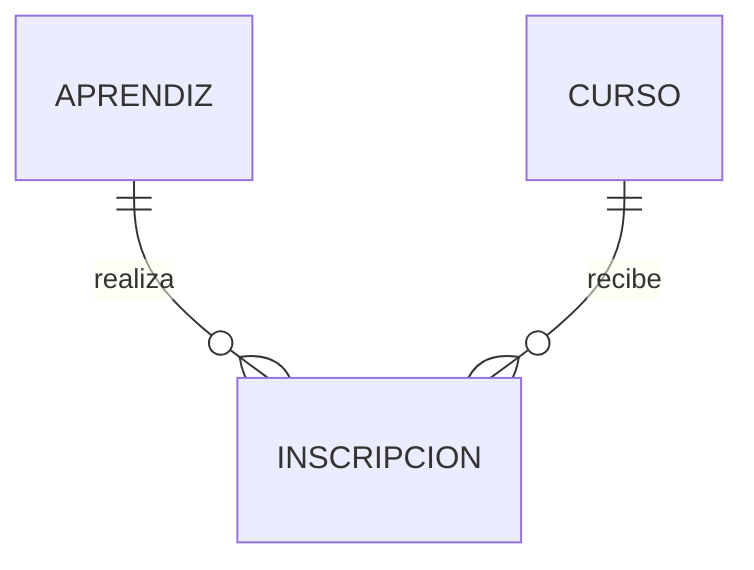
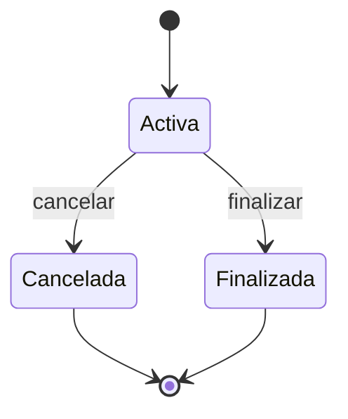
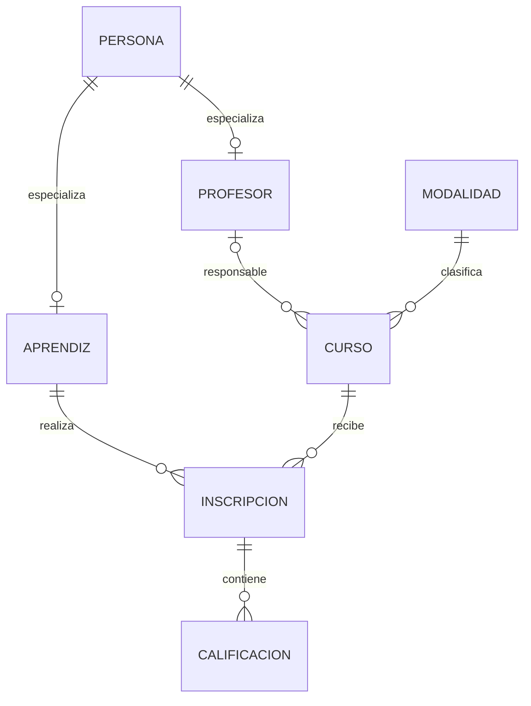

# Reglas de negocio

## Fase 1: Análisis y diseño de base de datos

**Proyecto:** Sistema de Gestión Académica  
**Documento:** Especificación de reglas de negocio  
**Versión:** 1.0

---

## 1. Introducción

Las reglas de negocio establecen las condiciones, restricciones
y comportamientos que debe cumplir el Sistema de Gestión
Académica para garantizar la coherencia, validez e integridad
de la información.

Estas reglas se identificaron mediante el análisis del aplicativo
existente y se complementaron con decisiones de diseño orientadas
a la incorporación de una base de datos relacional.

El documento servirá como referencia para la elaboración del
modelo entidad-relación, el modelo relacional, el diccionario
de datos y la implementación de las restricciones de integridad.

## 2. Objetivos

### 2.1. Objetivo general

Definir las reglas de negocio que deberán garantizar el correcto
funcionamiento del Sistema de Gestión Académica durante su
migración hacia una arquitectura con persistencia permanente.

### 2.2. Objetivos específicos

- Establecer las condiciones de registro de las entidades.
- Definir las restricciones de unicidad.
- Establecer las relaciones entre las entidades.
- Garantizar la integridad referencial.
- Definir los estados y transiciones de las inscripciones.
- Establecer las reglas del rendimiento académico.
- Identificar las validaciones que deberán implementarse
  en la base de datos y en la aplicación.
- Facilitar la elaboración de pruebas automatizadas.

## 3. Clasificación de las reglas

Las reglas se clasifican según su origen:

| Clasificación | Descripción |
|---|---|
| Existente | Regla implementada en el aplicativo actual. |
| Adaptada | Regla existente que requiere cambios para la persistencia relacional. |
| Nueva | Regla incorporada mediante una decisión de diseño. |

### 3.1. Nomenclatura

| Prefijo | Módulo |
|---|---|
| RN-PER | Personas |
| RN-PRO | Profesores |
| RN-APR | Aprendices |
| RN-MOD | Modalidades |
| RN-CUR | Cursos |
| RN-INS | Inscripciones |
| RN-CAL | Calificaciones |
| RN-REN | Rendimiento académico |
| RN-REP | Reportes académicos |
| RN-INT | Integridad de datos |
| RN-PERST | Persistencia |

## 4. Reglas de negocio de personas

La entidad Persona almacenará los atributos comunes de
profesores y aprendices.

| Código | Regla de negocio | Origen |
|---|---|---|
| RN-PER-01 | Toda persona debe poseer un identificador interno único. | Nueva |
| RN-PER-02 | El nombre es obligatorio y no puede estar vacío. | Existente |
| RN-PER-03 | El documento de identificación es obligatorio. | Existente |
| RN-PER-04 | El documento debe ser único en todo el sistema. | Nueva |
| RN-PER-05 | El documento se almacenará como texto con una longitud máxima de 20 caracteres. | Adaptada |
| RN-PER-06 | El documento deberá contener únicamente dígitos y representar un valor positivo. | Adaptada |
| RN-PER-07 | La edad debe ser un número entero mayor o igual a cero. | Existente |
| RN-PER-08 | Una persona puede desempeñar el rol de profesor. | Existente |
| RN-PER-09 | Una persona puede desempeñar el rol de aprendiz. | Existente |
| RN-PER-10 | Una misma persona puede desempeñar ambos roles simultáneamente. | Nueva |
| RN-PER-11 | Los datos personales comunes se almacenarán una sola vez. | Nueva |
| RN-PER-12 | Los registros de profesor y aprendiz deberán estar asociados a una persona existente. | Nueva |

### 4.1. Justificación del documento como texto

En el aplicativo actual, el documento se representa mediante
un número entero.

Para el modelo relacional se utilizará VARCHAR(20), debido
a que el documento representa un identificador y no un valor
destinado a operaciones aritméticas.

Esta decisión permite conservar posibles ceros iniciales.

La aplicación deberá adaptar las conversiones y validaciones
que actualmente utilizan el tipo int.

La comparación de documentos se realizará sobre su
representación textual, después de eliminar espacios externos.

### 4.2. Especialización de Persona

Una persona puede estar asociada a un registro de Profesor,
a un registro de Aprendiz o a ambos.

Los datos comunes, como nombre, documento y edad, se
almacenarán exclusivamente en Persona.

Esta estructura evita duplicar información personal cuando
una misma persona desempeña ambos roles.

La especialización será solapada, debido a que los roles
no son mutuamente excluyentes.

## 5. Reglas de negocio de profesores

| Código | Regla de negocio | Origen |
|---|---|---|
| RN-PRO-01 | Todo profesor debe estar asociado a una persona existente. | Nueva |
| RN-PRO-02 | Una persona puede tener como máximo un registro de profesor. | Nueva |
| RN-PRO-03 | La profesión es obligatoria. | Existente |
| RN-PRO-04 | El código del profesor es obligatorio. | Existente |
| RN-PRO-05 | El código del profesor debe ser un entero positivo. | Existente |
| RN-PRO-06 | El código del profesor debe ser único. | Nueva |
| RN-PRO-07 | La especialidad es obligatoria. | Existente |
| RN-PRO-08 | Un profesor puede tener cero o muchos cursos asignados. | Existente |
| RN-PRO-09 | Los profesores podrán consultarse mediante su documento de identificación. | Existente |
| RN-PRO-10 | Se podrán consultar todos los profesores registrados. | Existente |
| RN-PRO-11 | Se podrán consultar los cursos asignados a un profesor. | Existente |
| RN-PRO-12 | Se podrán consultar los aprendices inscritos en los cursos de un profesor. | Existente |

### 5.1. Restricciones propuestas

- Clave primaria asociada a Persona.
- Clave foránea hacia Persona.
- Código del profesor único.
- Profesión obligatoria.
- Especialidad obligatoria.
- Código mayor que cero.

## 6. Reglas de negocio de aprendices

| Código | Regla de negocio | Origen |
|---|---|---|
| RN-APR-01 | Todo aprendiz debe estar asociado a una persona existente. | Nueva |
| RN-APR-02 | Una persona puede tener como máximo un registro de aprendiz. | Nueva |
| RN-APR-03 | El teléfono es obligatorio. | Existente |
| RN-APR-04 | El teléfono debe contener dígitos y puede incluir un prefijo internacional. | Existente |
| RN-APR-05 | El correo electrónico es obligatorio. | Existente |
| RN-APR-06 | El correo electrónico debe cumplir una validación básica de formato. | Existente |
| RN-APR-07 | La dirección es obligatoria. | Existente |
| RN-APR-08 | Un aprendiz puede estar inscrito en cero o muchos cursos. | Existente |
| RN-APR-09 | Los aprendices podrán consultarse mediante su documento. | Existente |
| RN-APR-10 | Se podrán consultar todos los aprendices registrados. | Existente |
| RN-APR-11 | Se podrán consultar los cursos asociados a un aprendiz. | Existente |

### 6.1. Datos de contacto

El teléfono se almacenará como texto para conservar prefijos
internacionales y posibles ceros iniciales.

El correo electrónico y el teléfono no tendrán inicialmente
restricciones de unicidad, debido a que el aplicativo actual
no establece dichas restricciones.

La validación detallada del formato del correo electrónico
y del teléfono corresponderá principalmente a la aplicación.

## 7. Reglas de negocio de modalidades

La modalidad representa el tipo de formación al que pertenece
un curso.

Actualmente las modalidades se encuentran definidas mediante
una colección constante dentro de la clase Curso.

Se propone convertirlas en un catálogo independiente.

| Código | Regla de negocio | Origen |
|---|---|---|
| RN-MOD-01 | Toda modalidad debe poseer un identificador único. | Nueva |
| RN-MOD-02 | El nombre de la modalidad es obligatorio. | Nueva |
| RN-MOD-03 | El nombre de la modalidad debe ser único. | Nueva |
| RN-MOD-04 | Las modalidades iniciales serán titulada y complementaria. | Existente |
| RN-MOD-05 | Todo curso debe estar asociado a una modalidad existente. | Adaptada |
| RN-MOD-06 | Una modalidad puede estar asociada a cero o muchos cursos. | Nueva |
| RN-MOD-07 | Una modalidad referenciada por cursos no podrá eliminarse. | Nueva |

### 7.1. Catálogo inicial

| Modalidad | Descripción |
|---|---|
| titulada | Formación correspondiente a programas de formación titulada. |
| complementaria | Formación orientada al fortalecimiento de competencias específicas. |

### 7.2. Justificación

La incorporación de un catálogo independiente permitirá:

- Centralizar las modalidades permitidas.
- Evitar inconsistencias en los nombres.
- Garantizar la integridad referencial.
- Evitar modificaciones directas del código para administrar
  los valores del catálogo, una vez adaptada la aplicación.
- Facilitar futuras ampliaciones autorizadas.

## 8. Reglas de negocio de cursos

| Código | Regla de negocio | Origen |
|---|---|---|
| RN-CUR-01 | Todo curso debe poseer un identificador interno único. | Nueva |
| RN-CUR-02 | El código del curso es obligatorio. | Existente |
| RN-CUR-03 | El código del curso debe ser único. | Existente |
| RN-CUR-04 | El nombre del curso es obligatorio. | Existente |
| RN-CUR-05 | La descripción del curso es obligatoria. | Existente |
| RN-CUR-06 | La duración debe expresarse en horas mediante un número entero. | Existente |
| RN-CUR-07 | La duración debe ser mayor que cero. | Existente |
| RN-CUR-08 | Todo curso debe pertenecer a una modalidad válida. | Existente |
| RN-CUR-09 | Un curso puede registrarse sin profesor asignado. | Existente |
| RN-CUR-10 | Un curso puede tener como máximo un profesor responsable. | Existente |
| RN-CUR-11 | El profesor asignado debe estar registrado. | Existente |
| RN-CUR-12 | El curso debe existir antes de asignarle un profesor. | Existente |
| RN-CUR-13 | El profesor responsable de un curso puede reemplazarse. | Existente |
| RN-CUR-14 | Un curso puede tener cero o muchos aprendices inscritos. | Existente |
| RN-CUR-15 | Los cursos podrán consultarse mediante su código. | Existente |
| RN-CUR-16 | Se podrán consultar todos los cursos registrados. | Existente |
| RN-CUR-17 | Se podrán consultar los aprendices asociados a un curso. | Existente |

### 8.1. Asignación de profesores

La asignación de un profesor es opcional durante el registro
inicial de un curso.

Posteriormente podrá asignarse o reemplazarse el profesor
responsable.

La relación entre Profesor y Curso será de uno a muchos.

La clave foránea correspondiente al profesor permitirá
valores nulos mientras no exista una asignación.

## 9. Reglas de negocio de inscripciones

La inscripción representa la relación entre un aprendiz
y un curso.

| Código | Regla de negocio | Origen |
|---|---|---|
| RN-INS-01 | Toda inscripción debe poseer un identificador interno único. | Nueva |
| RN-INS-02 | El código de inscripción es obligatorio. | Existente |
| RN-INS-03 | El código de inscripción debe ser único. | Existente |
| RN-INS-04 | Toda inscripción debe estar asociada a un aprendiz existente. | Existente |
| RN-INS-05 | Toda inscripción debe estar asociada a un curso existente. | Existente |
| RN-INS-06 | Un aprendiz no puede inscribirse dos veces en el mismo curso. | Existente |
| RN-INS-07 | Un aprendiz puede inscribirse en diferentes cursos. | Existente |
| RN-INS-08 | Un curso puede tener múltiples aprendices inscritos. | Existente |
| RN-INS-09 | La fecha de inscripción debe registrarse automáticamente. | Existente |
| RN-INS-10 | La fecha original deberá conservarse al recuperar la inscripción. | Adaptada |
| RN-INS-11 | Toda inscripción comienza en estado Activa. | Existente |
| RN-INS-12 | Los estados permitidos son Activa, Cancelada y Finalizada. | Existente |
| RN-INS-13 | Solo una inscripción activa puede cancelarse. | Nueva |
| RN-INS-14 | Solo una inscripción activa puede finalizarse. | Nueva |
| RN-INS-15 | Una inscripción cancelada no puede reactivarse. | Nueva |
| RN-INS-16 | Una inscripción finalizada no puede reactivarse. | Nueva |
| RN-INS-17 | No se permite una nueva inscripción para la misma combinación de aprendiz y curso, independientemente del estado anterior. | Existente |
| RN-INS-18 | Cancelar una inscripción no implica eliminar el registro. | Existente |
| RN-INS-19 | Los cambios de estado deberán almacenarse permanentemente. | Adaptada |
| RN-INS-20 | Se podrán consultar inscripciones por código, aprendiz o curso. | Existente |
| RN-INS-21 | Una inscripción puede tener cero o muchas calificaciones. | Existente |

### 9.1. Relación muchos a muchos

La relación entre Aprendiz y Curso es de muchos a muchos.

Esta relación se resolverá mediante la entidad asociativa
Inscripcion.



### 9.2. Restricción de unicidad compuesta

La combinación de aprendiz y curso deberá ser única.

Conceptualmente, esta restricción se representará mediante:

```sql
UNIQUE (id_aprendiz, id_curso)
```

La restricción evitará que se registren inscripciones duplicadas,
incluso cuando existan solicitudes concurrentes.

### 9.3. Estados permitidos

| Estado | Descripción |
|---|---|
| Activa | Inscripción vigente. |
| Cancelada | Inscripción cancelada antes de su finalización. |
| Finalizada | Inscripción cuyo proceso académico ha terminado. |

### 9.4. Diagrama de estados



### 9.5. Matriz de transiciones

| Estado actual | Activa | Cancelada | Finalizada |
|---|---|---|---|
| Activa | Sin cambio | Permitido | Permitido |
| Cancelada | No permitido | Sin cambio | No permitido |
| Finalizada | No permitido | No permitido | Sin cambio |

Las operaciones de cancelación y finalización deberán
rechazarse cuando la inscripción no se encuentre activa.

Los estados Cancelada y Finalizada se consideran terminales.

## 10. Reglas de negocio de calificaciones

| Código | Regla de negocio | Origen |
|---|---|---|
| RN-CAL-01 | Toda calificación debe poseer un identificador interno único. | Nueva |
| RN-CAL-02 | El código de calificación es obligatorio. | Existente |
| RN-CAL-03 | El código de calificación debe ser único. | Existente |
| RN-CAL-04 | Toda calificación debe pertenecer a una inscripción existente. | Existente |
| RN-CAL-05 | La nota debe ser un valor numérico. | Existente |
| RN-CAL-06 | La nota mínima permitida es 0.00. | Existente |
| RN-CAL-07 | La nota máxima permitida es 5.00. | Existente |
| RN-CAL-08 | La nota podrá tener como máximo dos decimales. | Nueva |
| RN-CAL-09 | La nota se almacenará mediante DECIMAL(3,2). | Nueva |
| RN-CAL-10 | No se admitirán valores booleanos como calificaciones. | Existente |
| RN-CAL-11 | La fecha de registro se generará automáticamente. | Existente |
| RN-CAL-12 | La fecha original deberá conservarse al recuperar la calificación. | Adaptada |
| RN-CAL-13 | Solo se podrán registrar calificaciones en inscripciones activas. | Nueva |
| RN-CAL-14 | Solo se podrán modificar calificaciones de inscripciones activas. | Nueva |
| RN-CAL-15 | La calificación debe existir antes de modificarse. | Existente |
| RN-CAL-16 | Una inscripción puede tener múltiples calificaciones. | Existente |
| RN-CAL-17 | No se establece inicialmente una cantidad máxima de calificaciones. | Existente |
| RN-CAL-18 | Las calificaciones podrán consultarse por código, inscripción, aprendiz o curso. | Existente |
| RN-CAL-19 | La modificación de una nota deberá almacenarse permanentemente. | Adaptada |

### 10.1. Restricción del rango

El valor de la calificación deberá mantenerse dentro del
intervalo comprendido entre 0.00 y 5.00.

Conceptualmente:

```sql
CHECK (nota BETWEEN 0.00 AND 5.00)
```

La aplicación deberá validar también la cantidad de decimales
antes de enviar los datos a la base de datos.

### 10.2. Justificación de DECIMAL

Se utilizará DECIMAL(3,2) para almacenar valores decimales
exactos y evitar las aproximaciones propias de los tipos
de punto flotante.

### 10.3. Restricciones según el estado

| Estado de inscripción | Registrar notas | Modificar notas | Consultar notas |
|---|---|---|---|
| Activa | Permitido | Permitido | Permitido |
| Cancelada | No permitido | No permitido | Permitido |
| Finalizada | No permitido | No permitido | Permitido |

Las calificaciones existentes deberán conservarse cuando
una inscripción sea cancelada o finalizada.

## 11. Reglas de rendimiento académico

| Código | Regla de negocio | Origen |
|---|---|---|
| RN-REN-01 | El promedio se calculará mediante la media aritmética de las notas de una inscripción. | Existente |
| RN-REN-02 | Se requieren mínimo tres calificaciones para determinar el promedio académico. | Existente |
| RN-REN-03 | Una inscripción con menos de tres calificaciones tendrá rendimiento Pendiente. | Existente |
| RN-REN-04 | El promedio se redondeará a dos decimales. | Existente |
| RN-REN-05 | La aprobación se determinará utilizando el promedio redondeado. | Nueva |
| RN-REN-06 | Un promedio redondeado mayor o igual a 3.00 determinará el estado Aprobado. | Adaptada |
| RN-REN-07 | Un promedio redondeado inferior a 3.00 determinará el estado Reprobado. | Adaptada |
| RN-REN-08 | Los estados académicos permitidos serán Pendiente, Aprobado y Reprobado. | Existente |
| RN-REN-09 | El promedio se calculará dinámicamente. | Existente |
| RN-REN-10 | El estado académico se calculará dinámicamente. | Existente |
| RN-REN-11 | El promedio y el estado académico no se almacenarán como columnas permanentes. | Nueva |
| RN-REN-12 | La modificación de una nota deberá reflejarse en el siguiente cálculo del rendimiento. | Existente |
| RN-REN-13 | Se podrá consultar el rendimiento por inscripción, aprendiz o curso. | Existente |
| RN-REN-14 | El estado académico será independiente del estado administrativo de la inscripción. | Existente |

### 11.1. Fórmula del promedio

El promedio académico se obtiene mediante:

$$
P = \frac{\sum_{i=1}^{n} nota_i}{n}
$$

Donde:

- P representa el promedio académico.
- n representa la cantidad de calificaciones.
- nota representa el valor de cada calificación.
- n debe ser mayor o igual a tres.

### 11.2. Determinación del resultado académico

| Cantidad de notas | Promedio redondeado | Resultado |
|---|---|---|
| Menor que 3 | No disponible | Pendiente |
| Mayor o igual a 3 | Mayor o igual a 3.00 | Aprobado |
| Mayor o igual a 3 | Menor que 3.00 | Reprobado |

### 11.3. Política de redondeo

La aprobación deberá determinarse utilizando el mismo
promedio de dos decimales que se presenta al usuario.

Se deberá implementar una política de redondeo decimal
consistente entre Python y el sistema gestor de base de datos.

El criterio exacto de redondeo en valores intermedios deberá
definirse antes de implementar las consultas y las pruebas.

### 11.4. Ejemplos

| Calificaciones | Promedio presentado | Resultado |
|---|---:|---|
| Sin calificaciones | No disponible | Pendiente |
| 4.00, 3.50 | No disponible | Pendiente |
| 3.00, 3.00, 3.00 | 3.00 | Aprobado |
| 2.00, 2.50, 3.00 | 2.50 | Reprobado |
| 4.00, 4.50, 5.00 | 4.50 | Aprobado |
| 2.99, 3.00, 3.00 | 3.00 | Aprobado |
| 3.00, 4.00, 5.00, 2.00 | 3.50 | Aprobado |

### 11.5. Datos derivados

El promedio y el estado académico no se almacenarán
directamente en la tabla Calificacion ni en Inscripcion.

Estos valores se obtendrán mediante operaciones de cálculo
sobre las calificaciones registradas.

Esta decisión permitirá evitar redundancia e inconsistencias
cuando se modifique una nota.

## 12. Reglas de reportes académicos

| Código | Regla de negocio | Origen |
|---|---|---|
| RN-REP-01 | El sistema deberá generar un resumen de profesores registrados. | Existente |
| RN-REP-02 | El sistema deberá generar un resumen de aprendices registrados. | Existente |
| RN-REP-03 | El sistema deberá generar un resumen de cursos registrados. | Existente |
| RN-REP-04 | El sistema deberá generar un resumen de inscripciones registradas. | Existente |
| RN-REP-05 | El sistema deberá generar un resumen de calificaciones registradas. | Existente |
| RN-REP-06 | El reporte general deberá mostrar la cantidad total de calificaciones. | Existente |
| RN-REP-07 | El reporte general deberá mostrar el promedio general de las notas. | Existente |
| RN-REP-08 | El reporte general deberá mostrar la nota máxima. | Existente |
| RN-REP-09 | El reporte general deberá mostrar la nota mínima. | Existente |
| RN-REP-10 | Se podrá consultar el rendimiento académico por aprendiz. | Existente |
| RN-REP-11 | Se podrá consultar el rendimiento académico por curso. | Existente |
| RN-REP-12 | Se podrá consultar el rendimiento académico por inscripción. | Existente |
| RN-REP-13 | Los reportes deberán obtenerse a partir de los registros persistentes. | Adaptada |

### 12.1. Consultas sin información

Cuando no existan registros, el sistema deberá presentar
una respuesta coherente con la operación realizada.

Por ejemplo:

- Listados vacíos.
- Conteos iguales a cero.
- Promedios no disponibles.
- Rendimiento académico Pendiente cuando corresponda.

No deberá generarse un promedio mediante una división entre cero.

## 13. Reglas de integridad de datos

| Código | Regla de negocio | Origen |
|---|---|---|
| RN-INT-01 | Cada tabla deberá poseer una clave primaria. | Nueva |
| RN-INT-02 | Las relaciones deberán implementarse mediante claves foráneas. | Nueva |
| RN-INT-03 | Los atributos obligatorios deberán impedir valores nulos. | Nueva |
| RN-INT-04 | Los identificadores funcionales únicos deberán protegerse mediante restricciones de unicidad. | Adaptada |
| RN-INT-05 | Los rangos numéricos deberán protegerse mediante restricciones de validación. | Adaptada |
| RN-INT-06 | No podrán existir registros dependientes sin su registro principal. | Nueva |
| RN-INT-07 | Las eliminaciones que comprometan la integridad referencial deberán restringirse. | Nueva |
| RN-INT-08 | Los códigos alfanuméricos deberán distinguir entre mayúsculas y minúsculas. | Existente |
| RN-INT-09 | Los textos obligatorios no deberán aceptar cadenas vacías ni compuestas únicamente por espacios. | Existente |
| RN-INT-10 | Las relaciones deberán utilizar identificadores persistentes en lugar de depender exclusivamente de referencias en memoria. | Adaptada |
| RN-INT-11 | Los identificadores internos deberán mantenerse estables durante la existencia del registro. | Nueva |
| RN-INT-12 | Las restricciones deberán garantizarse independientemente de la interfaz utilizada. | Nueva |

### 13.1. Integridad de entidad

Cada registro deberá identificarse de manera única mediante
una clave primaria.

Las claves primarias no podrán contener valores nulos.

### 13.2. Integridad referencial

Las claves foráneas deberán hacer referencia a registros
existentes en las tablas relacionadas.

Esto evitará registros huérfanos, como:

- Profesores sin una persona asociada.
- Aprendices sin una persona asociada.
- Cursos asociados a modalidades inexistentes.
- Cursos asociados a profesores inexistentes.
- Inscripciones asociadas a aprendices inexistentes.
- Inscripciones asociadas a cursos inexistentes.
- Calificaciones asociadas a inscripciones inexistentes.

### 13.3. Integridad de dominio

Los atributos deberán cumplir las restricciones establecidas
para su tipo, rango, formato y obligatoriedad.

### 13.4. Sensibilidad de los códigos

Los códigos de cursos, inscripciones y calificaciones
distinguirán entre letras mayúsculas y minúsculas.

Por ejemplo, CUR-001 y cur-001 serán considerados códigos
diferentes.

La configuración de comparación de textos de la base de
datos deberá conservar este comportamiento.

### 13.5. Políticas de eliminación

Inicialmente se propone restringir la eliminación de registros
que posean dependencias.

| Entidad principal | Entidad dependiente | Política propuesta |
|---|---|---|
| Persona | Profesor | RESTRICT |
| Persona | Aprendiz | RESTRICT |
| Profesor | Curso | RESTRICT |
| Modalidad | Curso | RESTRICT |
| Aprendiz | Inscripcion | RESTRICT |
| Curso | Inscripcion | RESTRICT |
| Inscripcion | Calificacion | RESTRICT |

Estas restricciones protegen la información académica y evitan
eliminaciones accidentales en cascada.

La eliminación física de registros no forma parte de las
operaciones disponibles en el aplicativo actual.

## 14. Reglas de persistencia

| Código | Regla de negocio | Origen |
|---|---|---|
| RN-PERST-01 | La información deberá conservarse después de cerrar la aplicación. | Nueva |
| RN-PERST-02 | Los registros deberán recuperarse desde la base de datos al consultarlos. | Nueva |
| RN-PERST-03 | Las modificaciones deberán almacenarse permanentemente. | Nueva |
| RN-PERST-04 | Las operaciones relacionadas deberán utilizar transacciones cuando sea necesario. | Nueva |
| RN-PERST-05 | Una operación fallida no deberá dejar información parcialmente registrada. | Nueva |
| RN-PERST-06 | Las restricciones deberán mantenerse ante solicitudes concurrentes. | Nueva |
| RN-PERST-07 | Las fechas originales deberán conservarse durante la recuperación de registros. | Nueva |
| RN-PERST-08 | Las consultas SQL deberán utilizar parámetros para los datos proporcionados por el usuario. | Nueva |
| RN-PERST-09 | Los errores de persistencia deberán gestionarse sin comprometer la integridad de los datos. | Nueva |
| RN-PERST-10 | La consola y la futura API REST deberán utilizar la misma lógica de negocio. | Nueva |

### 14.1. Transacciones

Las operaciones que requieran modificar varias tablas deberán
ejecutarse dentro de una transacción.

Por ejemplo, registrar una nueva persona con el rol de profesor
puede requerir insertar información en Persona y Profesor.

Si alguna de las operaciones falla, deberán revertirse los
cambios correspondientes.

### 14.2. Concurrencia

La prevención de duplicados no deberá depender únicamente
de consultas previas realizadas desde Python.

Las restricciones de unicidad de la base de datos deberán
garantizar la consistencia incluso cuando varios clientes
intenten registrar información simultáneamente.

Las operaciones sobre el estado de una inscripción y sus
calificaciones deberán coordinarse mediante transacciones
para evitar modificaciones incompatibles.

## 15. Cardinalidades identificadas

| Entidad A | Entidad B | Relación | Participación |
|---|---|---|---|
| Persona | Profesor | 1:1 | Una persona puede tener cero o un registro de profesor. |
| Persona | Aprendiz | 1:1 | Una persona puede tener cero o un registro de aprendiz. |
| Profesor | Curso | 1:N | Un profesor puede tener cero o muchos cursos. |
| Modalidad | Curso | 1:N | Una modalidad puede tener cero o muchos cursos. |
| Aprendiz | Inscripcion | 1:N | Un aprendiz puede tener cero o muchas inscripciones. |
| Curso | Inscripcion | 1:N | Un curso puede tener cero o muchas inscripciones. |
| Inscripcion | Calificacion | 1:N | Una inscripción puede tener cero o muchas calificaciones. |
| Aprendiz | Curso | N:M | Relación resuelta mediante Inscripcion. |

Cada Profesor y Aprendiz deberá pertenecer exactamente
a una Persona.

Cada Curso deberá pertenecer exactamente a una Modalidad
y podrá tener cero o un Profesor.

Cada Inscripcion deberá pertenecer exactamente a un Aprendiz
y a un Curso.

Cada Calificacion deberá pertenecer exactamente a una
Inscripcion.

### 15.1. Representación preliminar



El modelo entidad-relación definitivo incluirá los atributos,
identificadores y restricciones correspondientes.

## 16. Matriz de implementación de restricciones

Las reglas deberán distribuirse entre la base de datos y
la aplicación, según su naturaleza.

| Restricción | Base de datos | Aplicación |
|---|---|---|
| Claves primarias | PRIMARY KEY | Identificación de registros |
| Relaciones entre entidades | FOREIGN KEY | Validación de existencia |
| Campos obligatorios | NOT NULL | Validación de entrada |
| Textos no vacíos | CHECK cuando corresponda | Validación de cadenas |
| Documento único | UNIQUE | Validación previa |
| Código de profesor único | UNIQUE | Validación previa |
| Código de curso único | UNIQUE | Validación previa |
| Código de inscripción único | UNIQUE | Validación previa |
| Código de calificación único | UNIQUE | Validación previa |
| Inscripción no duplicada | UNIQUE compuesto | Validación previa |
| Edad no negativa | CHECK | Validación numérica |
| Duración positiva | CHECK | Validación numérica |
| Código de profesor positivo | CHECK | Validación numérica |
| Rango de calificaciones | CHECK | Validación numérica |
| Precisión de calificaciones | DECIMAL(3,2) | Validación de decimales |
| Estados permitidos | CHECK | Validación de estado |
| Estado inicial | DEFAULT | Inicialización |
| Fecha de registro | DEFAULT o valor explícito | Gestión de fechas |
| Transiciones de estado | Transacción y actualización condicionada | Lógica de negocio |
| Notas en inscripciones activas | Control transaccional | Lógica de negocio |
| Mínimo tres calificaciones | Consulta de agregación | Lógica de negocio |
| Promedio académico | AVG y redondeo | Interpretación del resultado |
| Estado académico | Consulta calculada | Lógica de negocio |
| Eliminaciones restringidas | FOREIGN KEY RESTRICT | Validación de dependencias |
| Sensibilidad de códigos | Configuración de comparación | Comparación de cadenas |
| Operaciones atómicas | Transacciones | Coordinación de operaciones |

Las reglas que dependen de varias filas o tablas no podrán
resolverse exclusivamente mediante restricciones CHECK
simples.

Estas reglas deberán garantizarse mediante operaciones
transaccionales y validaciones de negocio.

## 17. Decisiones de diseño aprobadas

| Código | Decisión | Justificación |
|---|---|---|
| DD-01 | Documento único global. | Evitar duplicidad de información personal. |
| DD-02 | Permitir que una persona desempeñe ambos roles. | Representar diferentes responsabilidades académicas. |
| DD-03 | Código de profesor único. | Garantizar una identificación profesional inequívoca. |
| DD-04 | Documento VARCHAR(20). | Conservar identificadores y posibles ceros iniciales. |
| DD-05 | Conservar el atributo edad. | Mantener compatibilidad con el aplicativo existente. |
| DD-06 | Profesor opcional en Curso. | Permitir registrar cursos antes de asignar responsables. |
| DD-07 | Modalidad como catálogo independiente. | Centralizar valores y garantizar integridad. |
| DD-08 | Unicidad de aprendiz y curso en Inscripcion. | Evitar inscripciones duplicadas. |
| DD-09 | No permitir reinscripciones inicialmente. | Conservar el comportamiento actual. |
| DD-10 | Tres estados administrativos de inscripción. | Representar el ciclo de vida existente. |
| DD-11 | Transiciones únicamente desde Activa. | Evitar cambios de estado inconsistentes. |
| DD-12 | Registrar y modificar notas únicamente en inscripciones activas. | Proteger los registros académicos cerrados. |
| DD-13 | Calificaciones con dos decimales. | Garantizar precisión y consistencia. |
| DD-14 | Mínimo tres notas para determinar el rendimiento. | Conservar la regla académica existente. |
| DD-15 | Aprobación basada en el promedio redondeado. | Evitar diferencias entre el promedio mostrado y el resultado académico. |
| DD-16 | Promedio y estado académico calculados dinámicamente. | Evitar redundancia de información. |
| DD-17 | Eliminaciones restringidas ante dependencias. | Proteger la integridad referencial. |
| DD-18 | Códigos sensibles a mayúsculas y minúsculas. | Conservar el comportamiento de las comparaciones actuales. |

## 18. Cambios requeridos en fases posteriores

Las siguientes adaptaciones deberán considerarse durante
la implementación de la persistencia.

| Componente | Comportamiento actual | Comportamiento requerido |
|---|---|---|
| Persona | Documento entero. | Documento textual de hasta 20 caracteres. |
| Persona | Datos independientes por rol. | Datos personales centralizados. |
| Profesor | Código positivo sin control de duplicados. | Código positivo y único. |
| Curso | Modalidades definidas en el código. | Modalidades almacenadas en un catálogo. |
| Inscripcion | Cambios de estado sin restricciones de transición. | Transiciones únicamente desde Activa. |
| Inscripcion | Actualización directa del objeto. | Actualización persistente y transaccional. |
| Calificacion | Nota representada mediante float. | Representación decimal consistente. |
| Calificacion | Sin restricción por estado de inscripción. | Registro y modificación únicamente en inscripciones activas. |
| Rendimiento | Aprobación mediante promedio sin redondear. | Aprobación mediante promedio redondeado. |
| GestionAcademica | Validación mediante identidad de objetos. | Validación mediante identificadores persistentes. |
| Gestores | Almacenamiento en listas. | Almacenamiento en base de datos relacional. |
| Reportes | Recorridos de colecciones. | Consultas y agregaciones sobre registros persistentes. |
| main.py | Única interfaz de interacción. | Consola y futura API REST con lógica compartida. |

Estas modificaciones no deberán implementarse durante
la fase de análisis y diseño.

## 19. Escenarios de aceptación

Los siguientes escenarios servirán como referencia para
las pruebas de la futura implementación.

| Código | Escenario | Resultado esperado |
|---|---|---|
| CA-01 | Registrar una persona con documento nuevo. | Registro exitoso. |
| CA-02 | Registrar otra persona con el mismo documento. | Registro rechazado. |
| CA-03 | Asociar ambos roles a una misma persona. | Operación exitosa sin duplicar datos personales. |
| CA-04 | Registrar profesores con códigos iguales. | Segundo registro rechazado. |
| CA-05 | Registrar un curso sin profesor. | Registro exitoso. |
| CA-06 | Registrar un curso con modalidad inexistente. | Registro rechazado. |
| CA-07 | Asignar un profesor inexistente. | Operación rechazada. |
| CA-08 | Inscribir un aprendiz en un curso existente. | Registro exitoso. |
| CA-09 | Repetir la combinación aprendiz y curso. | Registro rechazado. |
| CA-10 | Inscribir un aprendiz inexistente. | Registro rechazado. |
| CA-11 | Cancelar una inscripción activa. | Estado Cancelada. |
| CA-12 | Finalizar una inscripción activa. | Estado Finalizada. |
| CA-13 | Finalizar una inscripción cancelada. | Operación rechazada. |
| CA-14 | Cancelar una inscripción finalizada. | Operación rechazada. |
| CA-15 | Reinscribir un aprendiz en un curso previamente cancelado. | Registro rechazado. |
| CA-16 | Registrar una nota de 0.00. | Registro exitoso si la inscripción está activa. |
| CA-17 | Registrar una nota de 5.00. | Registro exitoso si la inscripción está activa. |
| CA-18 | Registrar una nota de 5.01. | Registro rechazado. |
| CA-19 | Registrar una nota negativa. | Registro rechazado. |
| CA-20 | Registrar una nota con más de dos decimales. | Registro rechazado. |
| CA-21 | Registrar una nota en una inscripción cancelada. | Registro rechazado. |
| CA-22 | Modificar una nota de una inscripción finalizada. | Operación rechazada. |
| CA-23 | Consultar rendimiento sin calificaciones. | Estado Pendiente. |
| CA-24 | Consultar rendimiento con dos calificaciones. | Estado Pendiente. |
| CA-25 | Consultar rendimiento con promedio de 3.00. | Estado Aprobado. |
| CA-26 | Consultar rendimiento con promedio de 2.99. | Estado Reprobado. |
| CA-27 | Consultar notas de una inscripción finalizada. | Consulta exitosa. |
| CA-28 | Eliminar un curso con inscripciones asociadas. | Operación rechazada. |
| CA-29 | Cerrar y ejecutar nuevamente el aplicativo. | Los registros se conservan. |
| CA-30 | Registrar códigos que solo difieren en mayúsculas. | Ambos registros permitidos si cumplen las demás reglas. |
| CA-31 | Registrar simultáneamente la misma inscripción. | Solo un registro exitoso. |
| CA-32 | Fallar durante el registro de una persona y su rol. | Reversión de los cambios parciales. |
| CA-33 | Consultar notas de 2.99, 3.00 y 3.00. | Promedio 3.00 y estado Aprobado. |

Los escenarios anteriores representan criterios de aceptación
propuestos para las fases posteriores.

No constituyen resultados de pruebas ejecutadas.

## 20. Trazabilidad con los documentos de diseño

| Grupo de reglas | Aplicación en el diseño |
|---|---|
| Personas | Entidad Persona y especializaciones. |
| Profesores | Entidad Profesor y relación con Curso. |
| Aprendices | Entidad Aprendiz y relación con Inscripcion. |
| Modalidades | Catálogo Modalidad. |
| Cursos | Entidad Curso y restricciones de dominio. |
| Inscripciones | Entidad asociativa y unicidad compuesta. |
| Calificaciones | Entidad Calificacion y restricciones numéricas. |
| Rendimiento | Consultas y atributos derivados. |
| Reportes | Consultas de agregación. |
| Integridad | Claves y restricciones relacionales. |
| Persistencia | Transacciones y gestores de almacenamiento. |

## 21. Consideraciones pendientes

Durante la elaboración del modelo relacional y del diccionario
de datos deberán definirse:

- Longitudes definitivas de los campos de texto.
- Tipos de datos de los identificadores internos.
- Configuración de caracteres y comparación de textos.
- Política exacta de redondeo decimal.
- Política de validación detallada de teléfonos y correos.
- Participación obligatoria de Persona en al menos un rol.
- Posibles requisitos adicionales para finalizar inscripciones.
- Necesidad de incorporar auditoría o historial de cambios.

Estas consideraciones no modifican las 18 decisiones aprobadas,
sino que permiten completar sus detalles de implementación.

## 22. Conclusiones

Las reglas de negocio establecidas permiten definir las
condiciones necesarias para garantizar la coherencia de la
información académica.

Se conservaron las funcionalidades principales del aplicativo
existente y se incorporaron nuevas restricciones orientadas
a la persistencia permanente y la integridad relacional.

Las decisiones de diseño permiten centralizar los datos
personales, controlar duplicados, proteger las relaciones,
establecer transiciones válidas y garantizar la consistencia
del rendimiento académico.

La implementación de estas reglas deberá distribuirse entre
la base de datos y la lógica de negocio de Python.

El presente documento constituye la base para la elaboración
del modelo entidad-relación, el modelo relacional y el
diccionario de datos del Sistema de Gestión Académica.
