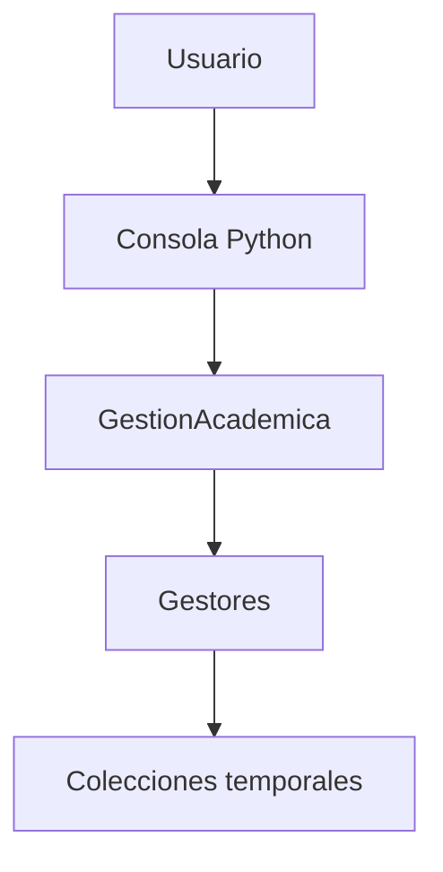
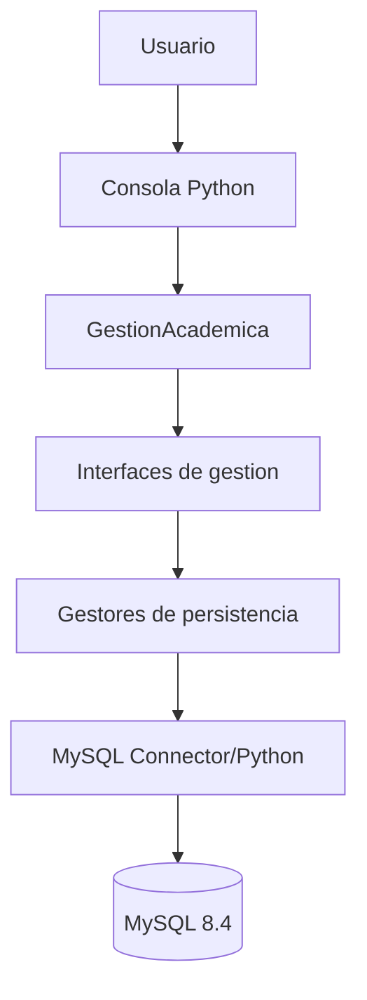
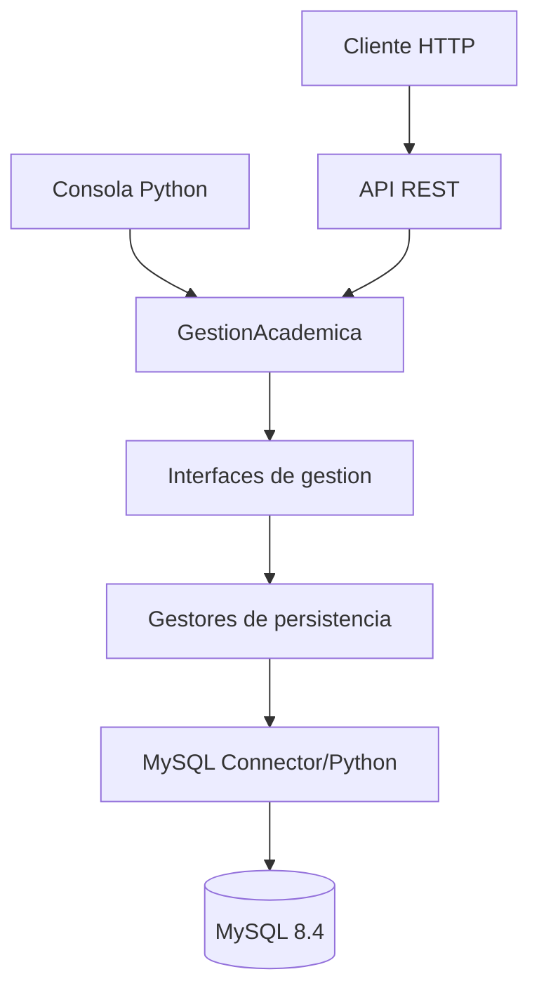

# Selección del sistema gestor de base de datos

## Fase 1: Análisis y diseño de base de datos

**Proyecto:** Sistema de Gestión Académica  
**Documento:** Selección del SGBD  
**Versión:** 1.0

---

## 1. Introducción

El Sistema de Gestión Académica utiliza actualmente
estructuras de almacenamiento temporal implementadas
mediante colecciones de Python.

Esta característica impide conservar la información
después de finalizar la ejecución del aplicativo.

Para solucionar esta limitación, se requiere incorporar
un sistema gestor de bases de datos relacional que
permita almacenar, consultar y modificar permanentemente
la información académica.

El presente documento analiza diferentes alternativas
y justifica la selección de MySQL 8.4 LTS como sistema
gestor de base de datos del proyecto.

## 2. Objetivos

### 2.1. Objetivo general

Seleccionar un sistema gestor de base de datos relacional
que satisfaga los requisitos funcionales y técnicos
del Sistema de Gestión Académica.

### 2.2. Objetivos específicos

- Identificar los requisitos de almacenamiento.
- Comparar diferentes sistemas gestores.
- Evaluar la compatibilidad con Python.
- Evaluar los mecanismos de integridad.
- Identificar las herramientas de administración.
- Justificar la selección del sistema gestor.
- Establecer las tecnologías de implementación.
- Identificar riesgos y limitaciones.

## 3. Documentos de referencia

- [Análisis del aplicativo](analisis-aplicativo.md).
- [Reglas de negocio](reglas-negocio.md).
- [Modelo entidad-relación](modelo-entidad-relacion.md).
- [Modelo relacional](modelo-relacional.md).
- [Diccionario de datos](diccionario-datos.md).
- [Normalización](normalizacion.md).

## 4. Definición de SGBD

Un sistema gestor de bases de datos es un conjunto
de herramientas de software que permite definir,
almacenar, consultar, actualizar y administrar datos.

Entre sus responsabilidades se encuentran:

- Administración de estructuras de almacenamiento.
- Ejecución de consultas.
- Control de acceso.
- Integridad de los datos.
- Administración de transacciones.
- Control de concurrencia.
- Recuperación de información.
- Administración de usuarios y permisos.

Un SGBD relacional organiza la información mediante
tablas relacionadas a través de claves primarias
y claves foráneas.

## 5. Requisitos del proyecto

### 5.1. Requisitos funcionales

El sistema gestor debe permitir almacenar:

- Personas.
- Profesores.
- Aprendices.
- Modalidades.
- Cursos.
- Inscripciones.
- Calificaciones.

También debe permitir:

- Registrar información.
- Consultar registros.
- Actualizar información autorizada.
- Buscar registros mediante identificadores.
- Consultar relaciones entre entidades.
- Calcular promedios.
- Generar reportes académicos.
- Evitar registros duplicados.
- Conservar información histórica académica.

La conservación de registros académicos no implica
implementar un historial completo de modificaciones
durante la primera versión.

### 5.2. Requisitos técnicos

- Modelo de almacenamiento relacional.
- Persistencia permanente.
- Compatibilidad con SQL.
- Compatibilidad con Python.
- Soporte de claves primarias.
- Soporte de claves foráneas.
- Restricciones UNIQUE.
- Restricciones NOT NULL.
- Restricciones CHECK.
- Transacciones.
- Control de concurrencia.
- Índices.
- Funciones de agregación.
- Administración de usuarios.
- Copias de seguridad.
- Compatibilidad con Linux.

### 5.3. Requisitos de integración

El sistema gestor deberá integrarse con:

- El aplicativo de consola existente.
- Las clases del dominio académico.
- Los gestores de persistencia.
- Las pruebas automatizadas.
- La futura API REST.

La incorporación de la base de datos deberá conservar
los principios de programación orientada a objetos
y los principios SOLID.

## 6. Alternativas evaluadas

### 6.1. MySQL

MySQL es un sistema gestor de bases de datos
relacional que utiliza SQL.

Características:

- Arquitectura cliente-servidor.
- Disponibilidad de una edición comunitaria.
- Compatibilidad con múltiples sistemas operativos.
- Soporte de transacciones mediante InnoDB.
- Integridad referencial.
- Administración de usuarios y permisos.
- Compatibilidad con Python.
- Herramientas gráficas de administración.
- Disponibilidad de imágenes oficiales para Docker.

Ventajas:

- Amplia documentación.
- Familiaridad con su administración.
- Compatibilidad con el modelo relacional diseñado.
- Disponibilidad de un conector oficial para Python.
- Soporte de restricciones de integridad.

Desventajas:

- Requiere configurar un servidor.
- Requiere administrar credenciales.
- Consume más recursos que una solución embebida.
- Algunas características SQL son específicas
  de MySQL.

### 6.2. PostgreSQL

PostgreSQL es un sistema gestor de bases de datos
objeto-relacional de código abierto.

Características:

- Arquitectura cliente-servidor.
- Soporte avanzado de SQL.
- Transacciones.
- Integridad referencial.
- Control de concurrencia.
- Compatibilidad con Python.

Ventajas:

- Amplias capacidades de consulta.
- Extensibilidad.
- Soporte de tipos de datos avanzados.
- Sólidos mecanismos de integridad.

Desventajas para el proyecto:

- Requiere familiarización con sus herramientas.
- Requiere adaptar algunos tipos y convenciones
  del modelo relacional propuesto.

Es una alternativa técnicamente adecuada.

### 6.3. MariaDB

MariaDB es un sistema gestor de bases de datos
relacional derivado originalmente de MySQL.

Características:

- Código abierto.
- Arquitectura cliente-servidor.
- Compatibilidad con Python.
- Transacciones.
- Integridad referencial.

Ventajas:

- Sintaxis familiar para usuarios de MySQL.
- Amplia disponibilidad en Linux.
- Herramientas de administración.

Desventajas para el proyecto:

- Existen diferencias de comportamiento,
  características y compatibilidad entre versiones
  de MariaDB y MySQL.

Es una alternativa viable, aunque requeriría
verificar las restricciones del diseño.

### 6.4. SQLite

SQLite es un motor de bases de datos relacional
embebido que almacena la información generalmente
en un archivo.

Características:

- No requiere un servidor independiente.
- Compatible con SQL.
- Soporta transacciones.
- Disponible mediante sqlite3 en la biblioteca
  estándar de Python.

Ventajas:

- Configuración sencilla.
- Bajo consumo de recursos.
- Fácil distribución.
- Adecuado para aplicaciones locales.

Desventajas para el proyecto:

- No utiliza una arquitectura cliente-servidor.
- Permite un único escritor simultáneo por base
  de datos.
- No proporciona administración de usuarios
  equivalente a un servidor MySQL.
- Requiere adaptar algunos tipos y restricciones
  del modelo propuesto.

Aunque SQLite puede utilizarse como almacenamiento
de una API REST, se considera menos conveniente
para los objetivos de aprendizaje relacionados
con administración de servidores y concurrencia.

### 6.5. Microsoft SQL Server

SQL Server es un sistema gestor de bases de datos
relacional desarrollado por Microsoft.

Características:

- Arquitectura cliente-servidor.
- Soporte de transacciones.
- Integridad referencial.
- Herramientas de administración.
- Compatibilidad con Python mediante controladores.

Ventajas:

- Amplias herramientas administrativas.
- Capacidades de seguridad.
- Soporte de consultas y procedimientos.

Desventajas para el proyecto:

- Algunas ediciones requieren licenciamiento comercial.
- Las ediciones gratuitas poseen condiciones
  o limitaciones específicas.
- Requiere familiarización con sus herramientas.
- Requiere adaptar el diseño a Transact-SQL.

## 7. Comparación de alternativas

| Criterio | MySQL | PostgreSQL | MariaDB | SQLite | SQL Server |
|---|---|---|---|---|---|
| Modelo relacional | Sí | Sí | Sí | Sí | Sí |
| Edición gratuita | Sí | Sí | Sí | Sí | Sí |
| Compatibilidad con Python | Sí | Sí | Sí | Sí | Sí |
| Arquitectura cliente-servidor | Sí | Sí | Sí | No | Sí |
| Claves primarias | Sí | Sí | Sí | Sí | Sí |
| Claves foráneas | Sí | Sí | Sí | Sí | Sí |
| Restricciones UNIQUE | Sí | Sí | Sí | Sí | Sí |
| Restricciones CHECK | Sí | Sí | Sí | Sí | Sí |
| Transacciones | Sí | Sí | Sí | Sí | Sí |
| Usuarios y permisos propios | Sí | Sí | Sí | No | Sí |
| Escrituras concurrentes | Sí | Sí | Sí | Limitadas | Sí |
| Funciones de agregación | Sí | Sí | Sí | Sí | Sí |
| Compatibilidad con Linux | Sí | Sí | Sí | Sí | Sí |
| Compatibilidad con Docker | Sí | Sí | Sí | Sí | Sí |

La comparación considera versiones modernas
de los sistemas gestores evaluados.

En SQLite, la aplicación deberá habilitar
explícitamente la comprobación de claves foráneas
cuando corresponda.

La disponibilidad de una edición gratuita no implica
que todos los productos tengan las mismas condiciones
de licenciamiento.

## 8. Sistema gestor seleccionado

### 8.1. Identificación

| Característica | Selección |
|---|---|
| Sistema gestor | MySQL |
| Versión objetivo | 8.4 LTS |
| Edición | Community Edition |
| Modelo | Relacional |
| Arquitectura | Cliente-servidor |
| Lenguaje de consulta | SQL |
| Motor de almacenamiento | InnoDB |
| Conector de Python | MySQL Connector/Python |
| Entorno de desarrollo | Linux |
| Base de datos propuesta | sistema_gestion_academica |
| Codificación | utf8mb4 |

### 8.2. Justificación de la versión

Se selecciona MySQL 8.4 LTS por pertenecer
a una línea de versiones orientada al soporte
a largo plazo.

Esta selección busca mantener un entorno estable
durante las diferentes fases del proyecto.

La versión de mantenimiento específica se definirá
durante la instalación y se documentará para
garantizar la reproducibilidad del entorno.

## 9. Justificación de la selección

### 9.1. Compatibilidad con el modelo relacional

MySQL permite implementar las siete tablas
identificadas durante la fase de diseño:

- persona.
- profesor.
- aprendiz.
- modalidad.
- curso.
- inscripcion.
- calificacion.

Permite establecer las relaciones mediante
claves primarias y claves foráneas.

### 9.2. Compatibilidad con los tipos de datos

| Tipo requerido | Tipo en MySQL |
|---|---|
| Identificadores | INT UNSIGNED |
| Textos de longitud variable | VARCHAR |
| Descripciones extensas | TEXT |
| Fechas | DATE |
| Calificaciones decimales | DECIMAL(3,2) |

Estos tipos corresponden a los establecidos
en el diccionario de datos.

### 9.3. Integridad de entidad

Las claves primarias permitirán identificar
de manera única cada registro.

Ejemplo:

```sql
PRIMARY KEY (id_persona)
```

### 9.4. Integridad referencial

Las claves foráneas permitirán garantizar
la existencia de los registros relacionados.

Ejemplo:

```sql
FOREIGN KEY (id_curso)
REFERENCES curso(id_curso)
ON DELETE RESTRICT
ON UPDATE RESTRICT
```

### 9.5. Restricciones de unicidad

MySQL permite establecer restricciones
para evitar registros duplicados.

Ejemplo:

```sql
UNIQUE (documento)
```

También permite restricciones compuestas.

```sql
UNIQUE (id_aprendiz, id_curso)
```

Esta última restricción evitará registrar
dos inscripciones para la misma combinación
de aprendiz y curso.

### 9.6. Restricciones de dominio

MySQL permite establecer restricciones CHECK.

Ejemplo:

```sql
CHECK (nota BETWEEN 0.00 AND 5.00)
```

También permite controlar los estados administrativos.

```sql
CHECK (
    estado IN (
        'Activa',
        'Cancelada',
        'Finalizada'
    )
)
```

La comparación exacta de los estados dependerá
de la intercalación configurada.

Las reglas que requieren consultar varios registros
deberán complementarse mediante lógica de aplicación
y transacciones.

### 9.7. Persistencia permanente

Los registros se conservarán después de finalizar
la ejecución del aplicativo de Python.

La información podrá recuperarse al iniciar
una nueva ejecución.

La persistencia deberá complementarse con copias
de seguridad y procedimientos de recuperación.

### 9.8. Compatibilidad con Python

MySQL proporciona MySQL Connector/Python.

Este controlador permitirá:

- Establecer conexiones.
- Ejecutar consultas parametrizadas.
- Registrar información.
- Recuperar registros.
- Actualizar información.
- Administrar transacciones.
- Gestionar errores de conexión.

No será necesario utilizar un ORM ni un framework
que genere automáticamente la capa de persistencia.

### 9.9. Compatibilidad con la futura API REST

MySQL podrá recibir operaciones provenientes
de la capa de persistencia del aplicativo.

La API REST no deberá conectarse directamente
a la base de datos desde los clientes.

Los clientes realizarán solicitudes HTTP a la API.

La API delegará las operaciones a la lógica
de negocio y a los gestores de persistencia.

### 9.10. Experiencia y facilidad de implementación

La selección también considera la experiencia
previa del desarrollador con MySQL y Docker.

Esto permite reducir la curva de aprendizaje
relacionada con:

- Configuración del servidor.
- Administración de bases de datos.
- Consultas SQL.
- Administración de contenedores.
- Diagnóstico de errores.

La experiencia previa complementa los criterios
técnicos y no constituye el único motivo
de selección.

## 10. Motor de almacenamiento InnoDB

Se utilizará InnoDB como motor de almacenamiento.

### 10.1. Características

- Soporte de transacciones.
- Integridad referencial.
- Bloqueos a nivel de fila cuando corresponda.
- Control de concurrencia multiversión.
- Recuperación ante fallos.
- Compatibilidad con claves foráneas.

### 10.2. Propiedades ACID

Las transacciones permiten trabajar con las
propiedades ACID.

#### Atomicidad

Una operación compuesta debe completarse
totalmente o revertirse.

Por ejemplo, el registro de una persona
y su rol de profesor.

#### Consistencia

Las operaciones deben conservar las restricciones
de integridad y las reglas implementadas.

#### Aislamiento

Las transacciones concurrentes deben coordinarse
para evitar interferencias incompatibles
con el nivel de aislamiento establecido.

#### Durabilidad

Una transacción confirmada debe conservarse
de acuerdo con las garantías de persistencia
y la configuración del servidor.

### 10.3. Ejemplo conceptual

```sql
START TRANSACTION;

-- Registrar la persona.
-- Registrar el rol de profesor.

COMMIT;
```

Si alguna operación falla:

```sql
ROLLBACK;
```

Las operaciones definitivas se desarrollarán
durante la fase de implementación.

## 11. Arquitectura propuesta

### 11.1. Arquitectura actual



### 11.2. Arquitectura con persistencia



### 11.3. Arquitectura futura con API REST



La arquitectura permitirá compartir la lógica
de negocio entre la consola y la futura API REST.

## 12. Integración con programación orientada a objetos

### 12.1. Abstracción

Las operaciones de persistencia se representarán
mediante contratos o interfaces.

### 12.2. Encapsulamiento

Los detalles de conexión y ejecución de consultas
se mantendrán dentro de los componentes responsables
de la persistencia.

### 12.3. Herencia

Se conservará la especialización de Persona
mediante Profesor y Aprendiz.

### 12.4. Polimorfismo

Los gestores podrán proporcionar diferentes
implementaciones de los contratos establecidos.

Por ejemplo:

- Gestores de almacenamiento temporal.
- Gestores de almacenamiento en MySQL.

La adaptación de los contratos existentes
se evaluará durante la fase de persistencia.

## 13. Integración con los principios SOLID

### 13.1. Responsabilidad única

Se separarán las responsabilidades de:

- Presentación.
- Lógica de negocio.
- Validación.
- Persistencia.
- Administración de conexiones.

### 13.2. Abierto y cerrado

Se buscará incorporar implementaciones de persistencia
sin introducir modificaciones innecesarias
en los componentes existentes.

### 13.3. Sustitución de Liskov

Las implementaciones de persistencia deberán respetar
el comportamiento definido por sus contratos.

### 13.4. Segregación de interfaces

Cada gestor dependerá únicamente de las operaciones
necesarias para su responsabilidad.

### 13.5. Inversión de dependencias

GestionAcademica dependerá de abstracciones
y no directamente del controlador MySQL.

La selección de las implementaciones concretas
se realizará en el punto de inicialización
del aplicativo.

El cumplimiento efectivo de estos principios
se verificará mediante revisión de código
y pruebas durante las siguientes fases.

## 14. Tecnologías propuestas

| Tecnología | Responsabilidad |
|---|---|
| Python | Lenguaje de programación. |
| MySQL 8.4 LTS | Almacenamiento relacional. |
| InnoDB | Motor de almacenamiento. |
| MySQL Connector/Python | Comunicación entre Python y MySQL. |
| Docker | Entorno reproducible de base de datos. |
| Docker Compose | Configuración de servicios. |
| MySQL Workbench | Administración y consultas gráficas. |
| Cliente mysql | Administración mediante terminal. |
| unittest | Pruebas automatizadas. |
| Git | Control de versiones. |
| GitHub | Repositorio remoto. |
| Visual Studio Code | Editor de código. |
| Mermaid | Diagramas documentales. |
| http.server | Alternativa para implementar la futura API. |
| json | Serialización de información JSON. |

Docker y MySQL Workbench serán herramientas
de apoyo y no requisitos funcionales del sistema.

La selección definitiva de la implementación HTTP
se realizará durante la fase de API REST.

No se utilizarán frameworks que implementen
automáticamente la API REST sin autorización
del instructor.

## 15. Configuración propuesta

### 15.1. Nombre de la base de datos

```text
sistema_gestion_academica
```

### 15.2. Base de datos de pruebas

```text
sistema_gestion_academica_test
```

Se utilizará una base de datos independiente
para las pruebas de integración.

Esto permitirá evitar modificaciones accidentales
sobre los datos del entorno de desarrollo.

### 15.3. Codificación

Se utilizará utf8mb4 para almacenar caracteres
Unicode, incluyendo nombres y descripciones
con caracteres propios del idioma español.

### 15.4. Intercalación

Se evaluará el uso de utf8mb4_0900_as_cs
para los atributos que requieren distinguir
mayúsculas, minúsculas y acentos.

Entre estos atributos se encuentran:

- Código de curso.
- Código de inscripción.
- Código de calificación.
- Estado administrativo.

La intercalación definitiva de cada columna
se verificará durante la implementación.

### 15.5. Modo SQL

Se utilizará una configuración estricta
que permita detectar valores inválidos
y conversiones incompatibles.

La configuración específica se documentará
durante la instalación.

### 15.6. Variables de entorno

Se propone utilizar las siguientes variables:

```text
DB_HOST
DB_PORT
DB_NAME
DB_USER
DB_PASSWORD
```

Las credenciales reales no deberán almacenarse
en el repositorio.

Se podrá proporcionar un archivo .env.example
con valores ilustrativos.

El mecanismo de carga de las variables se definirá
durante la implementación.

## 16. Seguridad de la información

### 16.1. Consultas parametrizadas

Las consultas deberán utilizar parámetros
en lugar de concatenar directamente entradas
proporcionadas por los usuarios.

Ejemplo conceptual en Python:

```python
consulta = """
    SELECT id_persona, documento, nombre, edad
    FROM persona
    WHERE documento = %s
"""

cursor.execute(consulta, (documento,))
```

Esto contribuye a prevenir vulnerabilidades
de inyección SQL.

### 16.2. Administración de usuarios

Se propone utilizar cuentas diferenciadas para:

- Administración de la base de datos.
- Ejecución del aplicativo.
- Ejecución de pruebas.

El aplicativo no deberá utilizar permanentemente
la cuenta administrativa root.

### 16.3. Principio de mínimo privilegio

Cada usuario deberá contar únicamente con
los permisos necesarios para su responsabilidad.

### 16.4. Protección de credenciales

Las credenciales deberán mantenerse fuera
del código fuente y del historial de Git.

### 16.5. Protección de datos personales

Se utilizarán datos ficticios para las pruebas
y demostraciones académicas.

No se publicarán documentos, teléfonos, correos
ni direcciones reales de terceros.

### 16.6. Acceso al servidor

Durante el desarrollo local se evitará exponer
innecesariamente el servidor MySQL a redes públicas.

## 17. Copias de seguridad

MySQL proporciona herramientas para generar
y recuperar copias de seguridad lógicas.

Se propone utilizar mysqldump.

Ejemplo conceptual de respaldo:

```bash
mysqldump -u usuario -p \
    sistema_gestion_academica > respaldo.sql
```

Ejemplo conceptual de restauración:

```bash
mysql -u usuario -p \
    sistema_gestion_academica < respaldo.sql
```

La restauración deberá realizarse sobre una base
de datos previamente preparada y autorizada.

Las copias de seguridad deberán protegerse
cuando contengan información personal.

La ejecución y verificación de estos procedimientos
se realizará durante las fases posteriores.

## 18. Rendimiento y consultas

MySQL permite ejecutar consultas relacionadas
con las operaciones académicas.

### 18.1. Operaciones previstas

- Buscar profesores por documento.
- Buscar aprendices por documento.
- Consultar cursos por código.
- Consultar cursos asignados a un profesor.
- Consultar aprendices inscritos en un curso.
- Consultar cursos de un aprendiz.
- Consultar calificaciones por inscripción.
- Calcular promedios.
- Generar reportes académicos.

### 18.2. Funciones de agregación

| Función | Responsabilidad |
|---|---|
| COUNT | Contar registros. |
| AVG | Calcular promedios. |
| MAX | Obtener el valor máximo. |
| MIN | Obtener el valor mínimo. |
| SUM | Sumar valores. |
| ROUND | Redondear resultados. |

### 18.3. Índices

Se utilizarán índices asociados a:

- Claves primarias.
- Restricciones de unicidad.
- Claves foráneas.
- Consultas frecuentes que lo justifiquen.

No se crearán índices adicionales sin evaluar
su necesidad.

### 18.4. Evaluación del rendimiento

Durante la implementación se podrán utilizar:

```sql
EXPLAIN
```

```sql
EXPLAIN ANALYZE
```

Estas herramientas permitirán analizar
los planes de ejecución de consultas compatibles.

Los resultados deberán obtenerse sobre una base
de datos implementada y con datos de prueba.

## 19. Estrategia de pruebas

### 19.1. Pruebas de conexión

- Conexión con credenciales válidas.
- Rechazo de credenciales incorrectas.
- Manejo de servidor no disponible.
- Cierre adecuado de conexiones.

### 19.2. Pruebas de persistencia

- Registro de información.
- Recuperación de registros.
- Actualización de información.
- Conservación de datos después de reiniciar
  el aplicativo.
- Conservación de datos después de reiniciar
  el servicio de base de datos.

### 19.3. Pruebas de integridad

- Rechazo de documentos duplicados.
- Rechazo de códigos duplicados.
- Rechazo de claves foráneas inexistentes.
- Rechazo de calificaciones fuera del rango.
- Rechazo de inscripciones duplicadas.
- Rechazo de estados inválidos.
- Rechazo de eliminaciones que vulneren
  la integridad referencial.

### 19.4. Pruebas de transacciones

- Confirmación de operaciones válidas.
- Reversión de operaciones incompletas.
- Registro atómico de persona y rol.
- Coordinación de operaciones concurrentes.

### 19.5. Pruebas de rendimiento académico

- Promedio con menos de tres calificaciones.
- Promedio con tres o más calificaciones.
- Aprobación con promedio igual a 3.00.
- Reprobación con promedio inferior a 3.00.
- Consistencia del redondeo.
- Actualización del rendimiento al modificar
  una calificación.

### 19.6. Pruebas existentes

El aplicativo original cuenta con 182 pruebas
automatizadas ejecutadas satisfactoriamente
antes de iniciar la implementación de persistencia.

Estas pruebas constituyen una referencia inicial
para conservar el comportamiento existente.

Las reglas de negocio modificadas durante el diseño
requerirán adaptar las pruebas correspondientes.

Las nuevas pruebas de MySQL todavía no han sido
implementadas ni ejecutadas.

## 20. Riesgos y medidas de mitigación

| Riesgo | Medida propuesta |
|---|---|
| Pérdida de información | Copias de seguridad y pruebas de restauración. |
| Credenciales expuestas | Variables de entorno y archivos ignorados por Git. |
| Inyección SQL | Consultas parametrizadas. |
| Registros duplicados | Restricciones UNIQUE. |
| Relaciones inválidas | Claves foráneas. |
| Operaciones incompletas | Transacciones. |
| Conflictos concurrentes | Bloqueos y coordinación transaccional. |
| Consultas lentas | Índices y análisis de ejecución. |
| Incompatibilidad de versiones | Versiones documentadas y pruebas. |
| Modificación de datos de desarrollo | Base de datos de pruebas independiente. |
| Pérdida de principios SOLID | Separación de responsabilidades y pruebas. |
| Diferencias de precisión | Uso de DECIMAL y validaciones con Decimal. |

## 21. Limitaciones de la selección

- MySQL requiere administrar un servidor.
- La aplicación dependerá de la disponibilidad
  del servicio de base de datos.
- Será necesario configurar conexiones y credenciales.
- Las reglas complejas no pueden resolverse
  exclusivamente mediante restricciones CHECK.
- Algunas consultas y tipos serán específicos
  de MySQL.
- Se deberá verificar la compatibilidad del conector
  con la versión de Python utilizada.
- No se ha realizado una comparación experimental
  de rendimiento entre los sistemas gestores.
- No se ha implementado todavía la base de datos.
- No se ha definido un entorno de producción.
- No se implementará inicialmente alta disponibilidad.

Estas limitaciones serán consideradas durante
las siguientes fases del proyecto.

## 22. Alcance de la siguiente fase

La fase de implementación de la base de datos
incluirá:

1. Preparación del entorno MySQL.
2. Configuración de la base de datos.
3. Creación de las siete tablas.
4. Definición de claves primarias.
5. Definición de claves foráneas.
6. Implementación de restricciones.
7. Creación del catálogo inicial de modalidades.
8. Incorporación de datos ficticios.
9. Consultas de registro y recuperación.
10. Consultas de actualización.
11. Pruebas de integridad.
12. Pruebas de transacciones.
13. Documentación de los resultados.

La adaptación de Python y la implementación
de la API REST se realizarán progresivamente
en sus respectivas fases.

## 23. Referencias técnicas oficiales

- MySQL 8.4 Reference Manual:
  https://dev.mysql.com/doc/refman/8.4/en/

- MySQL Connector/Python:
  https://dev.mysql.com/doc/connector-python/en/

- MySQL Workbench:
  https://dev.mysql.com/doc/workbench/en/

- PostgreSQL:
  https://www.postgresql.org/docs/

- MariaDB:
  https://mariadb.com/docs/

- SQLite:
  https://www.sqlite.org/docs.html

- Microsoft SQL Server:
  https://learn.microsoft.com/sql/

- Python:
  https://docs.python.org/3/

- Docker:
  https://docs.docker.com/

Estas referencias servirán como fuentes técnicas
para verificar la configuración y las características
durante la implementación.

## 24. Conclusiones

Después de analizar diferentes alternativas,
se selecciona MySQL 8.4 LTS Community Edition
como sistema gestor de base de datos
del Sistema de Gestión Académica.

La selección se fundamenta en:

- Compatibilidad con el modelo relacional.
- Persistencia permanente.
- Integridad de entidad.
- Integridad referencial.
- Restricciones de dominio.
- Soporte de transacciones.
- Control de concurrencia.
- Compatibilidad con Python.
- Disponibilidad de herramientas administrativas.
- Experiencia previa del desarrollador.

Se utilizará InnoDB como motor de almacenamiento
y MySQL Connector/Python como mecanismo
de comunicación con el aplicativo.

La incorporación de MySQL permitirá evolucionar
el sistema desde estructuras temporales hacia
una arquitectura con persistencia permanente.

El diseño conservará la programación orientada
a objetos y los principios SOLID, facilitando
la posterior implementación de una API REST.

Con este documento se completa la documentación
propuesta para la fase de análisis y diseño
de base de datos.

La implementación física y la validación técnica
se realizarán durante las siguientes fases.
