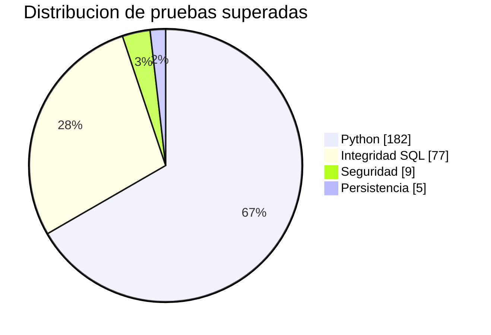

# Evidencias de pruebas - Fase 2

## 1. Información general

Proyecto: Sistema de Gestión Académica.

Fase: Implementación de la base de datos.

Rama: feature/database-implementation.

Sistema operativo: Linux Kubuntu.

Sistema gestor: MySQL 8.4.

Infraestructura: Docker y Docker Compose.

## 2. Objetivo

Presentar los resultados obtenidos durante la ejecución
de las pruebas automatizadas de integridad, seguridad,
persistencia y funcionamiento del aplicativo Python.

## 3. Comando de ejecución

```bash
./database/tests/test_permissions.sh &&
./database/tests/run_tests.sh &&
./database/tests/test_persistence.sh &&
python3 -m unittest discover -s tests -v
```

El operador && permite continuar con el siguiente grupo
de pruebas únicamente cuando el anterior termina
correctamente.

## 4. Evidencia de seguridad

```text
PRUEBAS DE SEGURIDAD Y PERMISOS

PASS: Aplicacion accede a la base principal
PASS: Aplicacion sin acceso a la base de pruebas
PASS: Usuario de pruebas accede a su base
PASS: Usuario de pruebas sin acceso a la base principal
PASS: Aplicacion sin acceso a usuarios de MySQL
PASS: Usuario de pruebas sin acceso a usuarios de MySQL
PASS: Aplicacion puede realizar operaciones CRUD
PASS: Usuario de pruebas puede crear tablas temporales
PASS: Aplicacion sin permiso para crear tablas temporales

Pruebas superadas: 9
Pruebas fallidas:  0

RESULTADO: PERMISOS CORRECTOS
```

## 5. Evidencia de integridad SQL

```text
OK: test_persona.sql (8/8)
OK: test_profesor.sql (10/10)
OK: test_aprendiz.sql (8/8)
OK: test_modalidad.sql (6/6)
OK: test_curso.sql (10/10)
OK: test_inscripcion.sql (10/10)
OK: test_calificacion.sql (11/11)
OK: test_rendimiento.sql (7/7)
OK: test_reportes.sql (7/7)

RESUMEN FINAL

Archivos ejecutados: 9
Archivos superados:  9
Archivos fallidos:   0
Pruebas superadas:   77

RESULTADO: TODAS LAS PRUEBAS SUPERADAS
```

## 6. Evidencia de persistencia

```text
PRUEBAS DE PERSISTENCIA DE DATOS

PASS: Registro almacenado correctamente

Reiniciando contenedor MySQL...

PASS: MySQL reiniciado correctamente
PASS: Datos conservados despues del reinicio
PASS: Registro actualizado correctamente
PASS: Datos de prueba eliminados

Pruebas superadas: 5
Pruebas fallidas:  0

RESULTADO: PERSISTENCIA CORRECTA
```

## 7. Evidencia de pruebas Python

```text
Ran 182 tests in 0.012s

OK
```

El tiempo corresponde a la ejecución registrada y puede
variar según el equipo utilizado.

## 8. Distribución de pruebas Python

| Módulo | Pruebas |
|---|---:|
| Personas | 6 |
| Profesores | 8 |
| Aprendices | 12 |
| Cursos | 24 |
| Inscripciones | 20 |
| Calificaciones | 31 |
| Gestión académica | 45 |
| Menú principal | 36 |
| Total | 182 |

## 9. Resultados consolidados

| Categoría | Ejecutadas | Superadas | Fallidas |
|---|---:|---:|---:|
| Seguridad | 9 | 9 | 0 |
| Integridad SQL | 77 | 77 | 0 |
| Persistencia | 5 | 5 | 0 |
| Python | 182 | 182 | 0 |
| Total | 273 | 273 | 0 |

## 10. Porcentaje de éxito

Pruebas superadas: 273.

Pruebas ejecutadas: 273.

Porcentaje de éxito:

(273 / 273) * 100 = 100 %

## 11. Representación de resultados



## 12. Criterios de aceptación

| Criterio evaluado | Resultado |
|---|---|
| Creación de bases de datos | Cumplido |
| Implementación de siete tablas | Cumplido |
| Integridad referencial evaluada | Cumplido |
| Restricciones evaluadas | Cumplido |
| Separación de ambientes | Cumplido |
| Permisos restringidos evaluados | Cumplido |
| Persistencia después de reinicio | Cumplido |
| Pruebas SQL automatizadas | Cumplido |
| Pruebas del aplicativo original | Cumplido |

## 13. Interpretación

Los resultados demuestran que las estructuras y operaciones
evaluadas funcionan correctamente en el ambiente utilizado.

La ejecución de las pruebas Python confirma que el aplicativo
original conserva su funcionamiento después de incorporar
la infraestructura de base de datos al repositorio.

## 14. Alcance de la evidencia

Los resultados corresponden a la ejecución realizada
durante la fase 2.

Las pruebas Python todavía no verifican una conexión
integrada con MySQL.

La prueba de persistencia verifica la conservación de
datos después de reiniciar el contenedor.

El porcentaje de éxito corresponde a los casos ejecutados
y no representa una medición de cobertura total del código.

## 15. Conclusión

Se ejecutaron satisfactoriamente 273 comprobaciones,
sin registrar fallos en la ejecución final.

La infraestructura de base de datos queda preparada
para avanzar hacia la fase de integración con Python.
