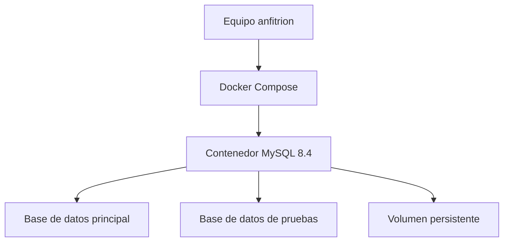
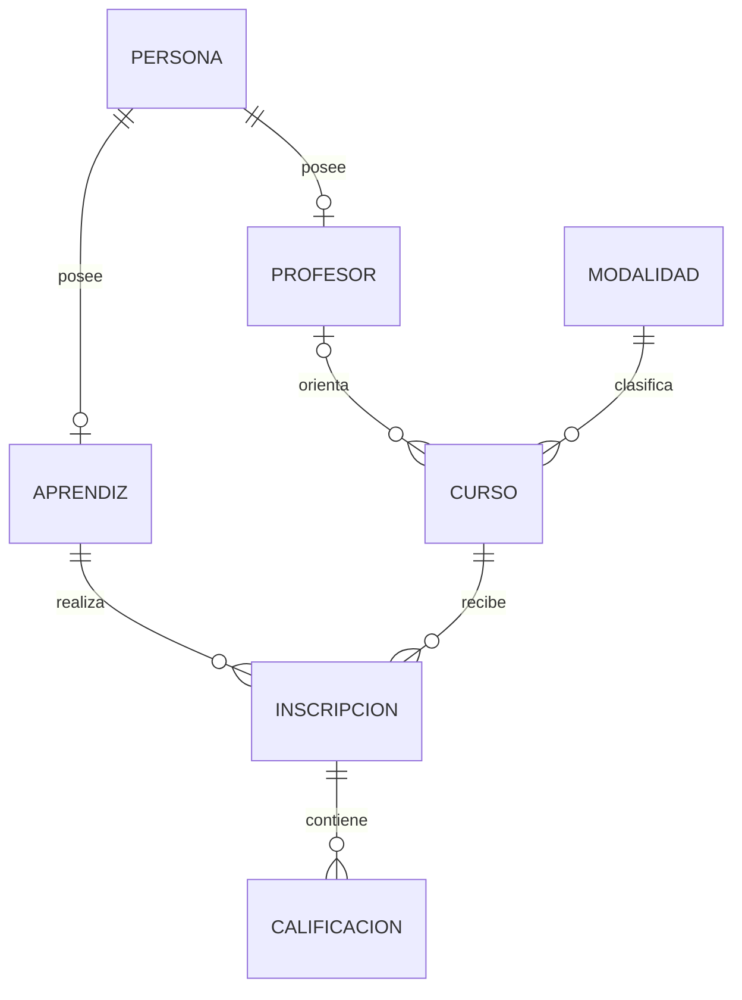

# Fase 2 - Implementación de la base de datos

## 1. Introducción

El Sistema de Gestión Académica fue desarrollado inicialmente
en Python utilizando programación orientada a objetos y los
principios SOLID.

La información se almacenaba temporalmente en memoria, lo que
provocaba la pérdida de los registros al finalizar la ejecución
del aplicativo.

Durante esta fase se implementó una base de datos relacional
que permitirá incorporar almacenamiento permanente al sistema.

## 2. Objetivo general

Implementar una base de datos relacional en MySQL que garantice
la integridad, seguridad, organización y persistencia de la
información académica.

## 3. Objetivos específicos

- Implementar el modelo relacional diseñado en la fase 1.
- Configurar MySQL mediante Docker.
- Crear las tablas y sus relaciones.
- Implementar restricciones de integridad.
- Desarrollar consultas SQL.
- Separar los ambientes de desarrollo y pruebas.
- Configurar usuarios con privilegios restringidos.
- Verificar la persistencia de los datos.
- Ejecutar pruebas automatizadas.

## 4. Tecnologías utilizadas

| Tecnología | Propósito |
|---|---|
| MySQL 8.4 | Sistema gestor de bases de datos |
| InnoDB | Motor de almacenamiento |
| Docker | Ejecución aislada del servidor |
| Docker Compose | Configuración de infraestructura |
| SQL | Definición y manipulación de datos |
| Bash | Automatización de pruebas |
| Python | Aplicativo de gestión académica |
| unittest | Pruebas del aplicativo |
| Git | Control de versiones |
| GitHub | Repositorio remoto |

## 5. Arquitectura implementada

El servidor MySQL se ejecuta dentro de un contenedor Docker
denominado academic-mysql.

La información se almacena en un volumen persistente
denominado academic_mysql_data dentro de la configuración
de Docker Compose.

El servidor utiliza el puerto interno 3306 y el puerto
3307 del equipo anfitrión.

## 6. Bases de datos

| Base de datos | Finalidad |
|---|---|
| sistema_gestion_academica | Almacenamiento principal |
| sistema_gestion_academica_test | Pruebas automatizadas |

La separación permite ejecutar pruebas sin utilizar los
registros del ambiente principal.

## 7. Tablas implementadas

| Tabla | Responsabilidad |
|---|---|
| persona | Información personal compartida |
| profesor | Información profesional |
| aprendiz | Información de contacto |
| modalidad | Catálogo de modalidades académicas |
| curso | Información de los cursos |
| inscripcion | Relación entre aprendices y cursos |
| calificacion | Notas asociadas a inscripciones |

## 8. Relaciones implementadas

La tabla inscripcion resuelve la relación de muchos a muchos
entre aprendices y cursos.

## 9. Restricciones de integridad

Se implementaron las siguientes restricciones:

- PRIMARY KEY: identificación única de registros.
- FOREIGN KEY: integridad referencial.
- UNIQUE: prevención de duplicados.
- NOT NULL: obligatoriedad de atributos.
- CHECK: validación de valores.
- DEFAULT: asignación de valores iniciales.
- AUTO_INCREMENT: generación de identificadores.

Las relaciones utilizan restricciones de eliminación para
evitar la pérdida de información relacionada.

## 10. Reglas de negocio

- El documento de una persona debe ser único.
- El código de profesor debe ser único.
- El código de curso debe ser único.
- Un aprendiz no puede inscribirse dos veces en el mismo curso.
- Las calificaciones deben estar entre 0.00 y 5.00.
- Las inscripciones pueden estar activas, canceladas o finalizadas.
- El promedio académico requiere al menos tres calificaciones.
- La aprobación académica requiere un promedio mínimo de 3.00.

Las restricciones estructurales se implementaron en las tablas.

Las transiciones de estado, las operaciones sobre inscripciones
activas y los cálculos académicos se verificaron mediante
consultas SQL controladas. Su integración definitiva con
Python corresponde a la siguiente fase.

## 11. Datos iniciales

Se implementó un catálogo inicial con dos modalidades:

- Titulada.
- Complementaria.

El archivo seed.sql permite cargar estos registros sin
duplicarlos durante ejecuciones consecutivas.

## 12. Consultas SQL

El archivo queries.sql contiene operaciones relacionadas con:

- Profesores.
- Aprendices.
- Modalidades.
- Cursos.
- Inscripciones.
- Calificaciones.
- Rendimiento académico.
- Reportes generales.

Se utilizaron operaciones SELECT, INSERT, UPDATE, JOIN,
GROUP BY, ORDER BY, funciones de agregación y transacciones.

## 13. Seguridad

Se configuraron tres perfiles de acceso:

- root: administración del servidor.
- academic_user: operaciones sobre la base principal.
- academic_test_user: ejecución de pruebas.

Las credenciales privadas se almacenan en un archivo .env
excluido del control de versiones.

## 14. Persistencia

Se verificó que un registro confirmado mediante COMMIT
permanece almacenado después de reiniciar el contenedor MySQL.

Posteriormente se comprobó su actualización y eliminación.

## 15. Resultados de pruebas

| Categoría | Superadas | Fallidas |
|---|---:|---:|
| Integridad SQL | 77 | 0 |
| Seguridad | 9 | 0 |
| Persistencia | 5 | 0 |
| Python | 182 | 0 |
| Total | 273 | 0 |

## 16. Control de versiones

La implementación se desarrolló en la rama:

feature/database-implementation

Los cambios se organizaron mediante commits independientes
para facilitar su revisión y trazabilidad.

## 17. Alcance y limitaciones

Esta fase implementa y verifica la infraestructura de datos.

El aplicativo Python todavía requiere la incorporación de
repositorios y conexiones a MySQL.

La persistencia fue comprobada mediante un reinicio del
contenedor, no mediante su eliminación y recreación.

Las pruebas de seguridad verifican permisos específicos,
pero no constituyen una auditoría integral.

## 18. Conclusión

La implementación de MySQL proporciona una estructura
relacional con restricciones de integridad, almacenamiento
persistente y separación de ambientes.

Los resultados obtenidos permiten avanzar hacia la fase 3,
correspondiente a la integración del aplicativo Python
con la base de datos.
