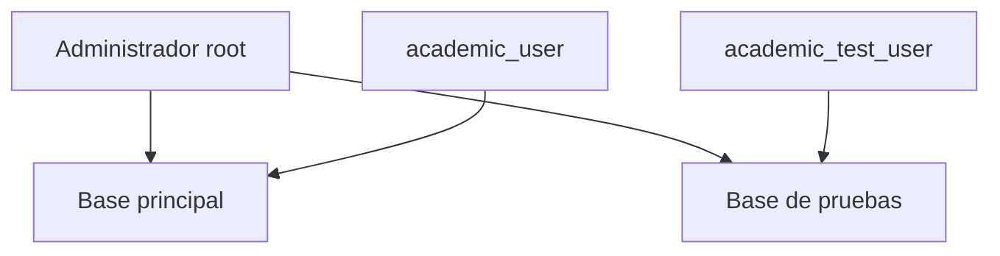

# Seguridad de la base de datos

## 1. Introducción

La seguridad de la información académica requiere controlar
el acceso a los datos y reducir los privilegios innecesarios
de los usuarios del sistema.

## 2. Objetivo

Implementar mecanismos de seguridad que permitan separar
las responsabilidades administrativas, operativas y de
pruebas dentro del servidor MySQL.

## 3. Principio de mínimo privilegio

Cada usuario debe disponer únicamente de los permisos
necesarios para cumplir sus responsabilidades.

La aplicación no debe utilizar las credenciales del
administrador root.

## 4. Usuarios configurados

| Usuario | Responsabilidad |
|---|---|
| root | Administración de MySQL |
| academic_user | Operaciones del aplicativo |
| academic_test_user | Pruebas automatizadas |

## 5. Separación de ambientes



El usuario de aplicación no tiene acceso a la base de
pruebas.

El usuario de pruebas no tiene acceso a la base principal.

## 6. Matriz de privilegios

| Privilegio | Aplicación | Pruebas |
|---|---|---|
| SELECT | Sí | Sí |
| INSERT | Sí | Sí |
| UPDATE | Sí | Sí |
| DELETE | Sí | Sí |
| CREATE ROUTINE | No | Sí |
| ALTER ROUTINE | No | Sí |
| EXECUTE | No | Sí |
| CREATE TEMPORARY TABLES | No | Sí |
| CREATE TABLE | No | No |
| DROP TABLE | No | No |
| Administración de usuarios | No | No |

Los permisos se limitan a la base asignada a cada usuario.

El permiso DELETE permite las operaciones evaluadas durante
las pruebas CRUD. Su necesidad deberá revisarse cuando
se implementen los repositorios definitivos.

## 7. Configuración de permisos

El archivo database/permissions.sql contiene las
instrucciones necesarias para revocar privilegios
anteriores y asignar los permisos definidos.

El archivo no contiene contraseñas reales.

## 8. Protección de credenciales

Se utilizan dos archivos de configuración:

- infra/.env: configuración privada.
- infra/.env.example: plantilla pública.

La plantilla pública contiene valores de ejemplo.

El archivo privado debe permanecer excluido de Git.

## 9. Protección mediante permisos del sistema

```bash
chmod 600 infra/.env
```

Este permiso permite al propietario leer y modificar
el archivo privado.

## 10. Verificación de Git

```bash
git check-ignore -v infra/.env

git ls-files infra/.env
```

El segundo comando no debe mostrar resultados.

## 11. Rotación de contraseñas

Las contraseñas pueden modificarse directamente en MySQL
mediante ALTER USER.

Ejemplo:

```sql
ALTER USER 'academic_user'@'%'
IDENTIFIED BY RANDOM PASSWORD;
```

La contraseña generada debe almacenarse de forma privada
y sincronizarse con infra/.env.

No deben publicarse contraseñas en GitHub, documentación,
capturas de pantalla o registros de pruebas.

Si una credencial fue publicada anteriormente, debe
considerarse comprometida y reemplazarse.

## 12. Seguridad de infraestructura

MySQL utiliza el puerto interno 3306.

El puerto 3307 del anfitrión está publicado mediante
la dirección local 127.0.0.1.

Esto limita la exposición directa del puerto publicado
a través de las interfaces externas del anfitrión.

El acceso desde otros contenedores y redes Docker debe
evaluarse por separado.

## 13. Pruebas de seguridad

| Caso evaluado | Resultado |
|---|---|
| Aplicación accede a su base | PASS |
| Aplicación sin acceso a pruebas | PASS |
| Usuario de pruebas accede a su base | PASS |
| Usuario de pruebas sin acceso a base principal | PASS |
| Aplicación sin acceso a mysql.user | PASS |
| Pruebas sin acceso a mysql.user | PASS |
| Aplicación realiza operaciones CRUD | PASS |
| Pruebas crea tablas temporales | PASS |
| Aplicación no crea tablas temporales | PASS |

Total: 9 pruebas superadas.

## 14. Ejecución

```bash
./database/tests/test_permissions.sh
```

Resultado obtenido:

```text
Pruebas superadas: 9
Pruebas fallidas:  0

RESULTADO: PERMISOS CORRECTOS
```

## 15. Incidentes durante la implementación

Durante la configuración se presentaron errores 1045
relacionados con la autenticación de los usuarios.

También se presentó un error de interpretación de
variables del archivo .env mediante Bash.

La solución consistió en corregir la sintaxis del archivo,
actualizar las contraseñas en MySQL y sincronizar las
credenciales privadas.

Posteriormente las nueve pruebas fueron superadas.

## 16. Seguridad en fases posteriores

Durante la integración con Python se deberán incorporar:

- Consultas SQL parametrizadas.
- Manejo seguro de conexiones.
- Control de transacciones.
- Manejo de excepciones.
- Validación de entradas.
- Protección de información sensible.
- Autenticación y autorización para la futura API.

## 17. Limitaciones

Las pruebas realizadas verifican permisos concretos,
pero no constituyen una auditoría completa.

La revisión de cuentas administrativas remotas,
las políticas de respaldo, el cifrado de conexiones
y la seguridad de la futura API requieren evaluación
adicional.

## 18. Conclusión

La separación de usuarios y ambientes reduce el riesgo
de operaciones no autorizadas y permite ejecutar las
pruebas sin utilizar privilegios administrativos.

Las nueve pruebas de seguridad realizadas fueron
superadas correctamente.
