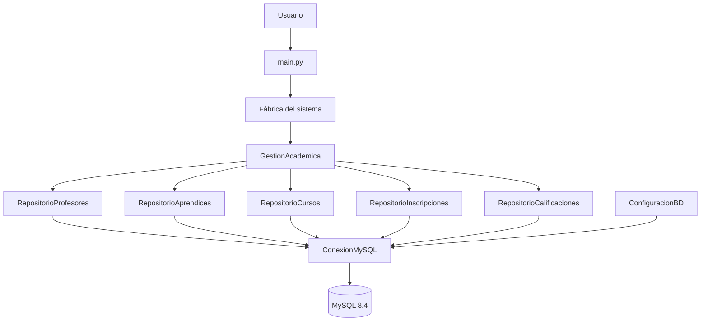
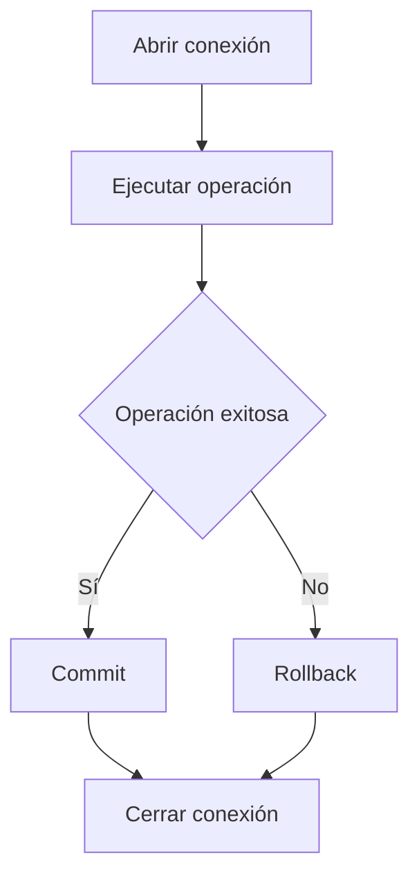

# Arquitectura de persistencia

## 1. Introducción

La tercera fase del Sistema de Gestión Académica
incorpora persistencia permanente mediante MySQL,
permitiendo conservar la información después de
finalizar la ejecución del aplicativo.

La implementación mantiene la programación orientada
a objetos y los principios SOLID desarrollados en
las fases anteriores.

## 2. Objetivo general

Integrar el aplicativo Python con una base de datos
relacional mediante repositorios especializados,
manteniendo la separación de responsabilidades
y la independencia de la lógica de negocio.

## 3. Objetivos específicos

- Implementar conexiones seguras con MySQL.
- Gestionar transacciones y operaciones SQL.
- Implementar repositorios especializados.
- Reconstruir objetos desde la base de datos.
- Mantener la compatibilidad con las pruebas originales.
- Garantizar la persistencia de los registros.
- Preparar la arquitectura para una futura API REST.

## 4. Arquitectura por capas

El aplicativo se organiza en las siguientes capas:

| Capa | Responsabilidad |
|---|---|
| Presentación | Interacción mediante el menú de consola. |
| Aplicación | Coordinación de operaciones académicas. |
| Dominio | Entidades y reglas de negocio. |
| Persistencia | Acceso a datos mediante repositorios. |
| Infraestructura | Configuración, conexión y base de datos. |

## 5. Diagrama de arquitectura



## 6. Estructura de persistencia

```text
persistencia/
├── __init__.py
├── configuracion.py
├── conexion.py
├── excepciones.py
├── fabrica.py
└── repositorios/
    ├── __init__.py
    ├── repositorio_profesores.py
    ├── repositorio_aprendices.py
    ├── repositorio_cursos.py
    ├── repositorio_inscripciones.py
    └── repositorio_calificaciones.py
```

## 7. Patrón repositorio

El patrón repositorio separa la lógica de negocio
de las operaciones realizadas sobre MySQL.

Cada repositorio administra las operaciones
correspondientes a una entidad del dominio.

| Repositorio | Entidad |
|---|---|
| RepositorioProfesores | Profesor |
| RepositorioAprendices | Aprendiz |
| RepositorioCursos | Curso |
| RepositorioInscripciones | Inscripcion |
| RepositorioCalificaciones | Calificacion |

Los repositorios utilizan consultas parametrizadas
y reconstruyen objetos Python a partir de los
registros almacenados.

## 8. Fábrica del sistema

El archivo fabrica.py contiene la función
crear_sistema_mysql(), responsable de construir
el aplicativo con sus dependencias.

Sus responsabilidades son:

1. Cargar la configuración del ambiente.
2. Construir la conexión MySQL.
3. Verificar la disponibilidad de la base de datos.
4. Instanciar los cinco repositorios.
5. Inyectar los repositorios en GestionAcademica.
6. Retornar el sistema configurado.

## 9. Inyección de dependencias

GestionAcademica recibe sus dependencias mediante
el constructor.

Esto permite utilizar administradores en memoria
o repositorios MySQL sin reemplazar completamente
la lógica de aplicación.

La fábrica configura entidades_persistidas=True
para trabajar con objetos reconstruidos desde
la base de datos.

## 10. Programación orientada a objetos

### Encapsulamiento

Los atributos internos de las entidades y las
dependencias de los repositorios se protegen
mediante atributos privados.

### Abstracción

Las interfaces de gestión definen los contratos
utilizados por la capa de aplicación.

### Herencia

Profesor y Aprendiz conservan la herencia
de la clase abstracta Persona.

### Polimorfismo

GestionAcademica puede trabajar con diferentes
implementaciones de los contratos de gestión.

## 11. Principios SOLID

### SRP: responsabilidad única

La configuración, conexión, persistencia y lógica
académica se distribuyen en componentes especializados.

### OCP: abierto/cerrado

La arquitectura permite incorporar nuevas
implementaciones de almacenamiento.

### LSP: sustitución de Liskov

Los repositorios implementan las operaciones
esperadas por los contratos de gestión.

Las diferencias entre almacenamiento en memoria
y MySQL deben considerarse al sustituirlos.

### ISP: segregación de interfaces

Cada entidad dispone de un contrato de gestión
especializado.

### DIP: inversión de dependencias

GestionAcademica utiliza contratos de gestión
en lugar de depender directamente de MySQL.

## 12. Gestión de transacciones

ConexionMySQL centraliza las operaciones
transaccionales.



Este mecanismo permite confirmar operaciones
exitosas y revertir operaciones fallidas.

## 13. Reconstrucción de entidades

Los repositorios transforman los registros SQL
en objetos del dominio.

La reconstrucción conserva información como:

- Datos personales.
- Profesores asignados.
- Modalidades de los cursos.
- Fechas de inscripción.
- Estados de inscripción.
- Fechas y valores de las calificaciones.

Los objetos recuperados pueden ser instancias
diferentes que representan el mismo registro.

Por esta razón, la identificación persistente
utiliza documentos y códigos académicos.

## 14. Manejo de excepciones

La capa de persistencia define excepciones
especializadas:

- ErrorPersistencia.
- ErrorConfiguracion.
- ErrorConexion.
- ErrorOperacion.
- ErrorIntegridad.

El menú de consola gestiona los errores de
persistencia y validación para informar al usuario.

## 15. Seguridad

La implementación incorpora:

- Variables de entorno.
- Credenciales excluidas del repositorio.
- Usuarios independientes por ambiente.
- Consultas SQL parametrizadas.
- Restricciones de integridad referencial.
- Transacciones.
- Conexiones locales mediante Docker.

## 16. Limitaciones actuales

- No se ha implementado todavía la API REST.
- No existe autenticación de usuarios del aplicativo.
- No se utiliza un pool de conexiones.
- Los documentos se representan como enteros en
  Python, por lo que no conservan ceros iniciales.
- MySQL exige una precisión máxima de dos decimales
  para las calificaciones desde los repositorios.
- El cálculo del promedio persistente utiliza
  redondeo decimal a dos posiciones.
- Las implementaciones en memoria y MySQL conservan
  algunas diferencias de validación.

## 17. Conclusión

La arquitectura incorpora almacenamiento permanente
sin abandonar la estructura orientada a objetos
del aplicativo original.

La separación entre aplicación y persistencia
establece una base para desarrollar posteriormente
los servicios de la API REST.