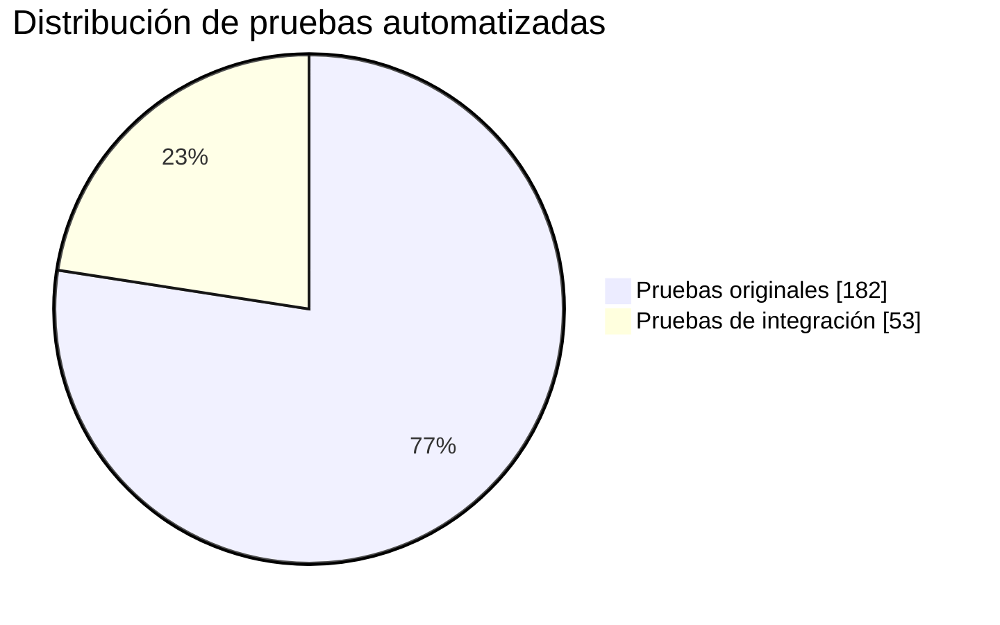

# Evidencias de pruebas - Fase 3

## 1. Información general

| Campo | Información |
|---|---|
| Proyecto | Sistema de Gestión Académica |
| Fase | Persistencia con Python y MySQL |
| Fecha | 28 de noviembre de 2026 |
| Sistema operativo | Kubuntu |
| Rama | feature/database-persistence |
| Motor de base de datos | MySQL 8.4 |
| Herramienta de pruebas | unittest |

## 2. Objetivo

Registrar los resultados obtenidos durante
la implementación y validación de la capa
de persistencia del aplicativo.

## 3. Dependencias instaladas

```text
mysql-connector-python==26.10.0
python-dotenv==1.2.4
```

## 4. Infraestructura

La infraestructura utiliza un contenedor MySQL
administrado mediante Docker.

| Componente | Resultado observado |
|---|---|
| Contenedor | academic-mysql |
| Imagen | mysql:8.4 |
| Estado | healthy |
| Puerto local | 3307 |
| Puerto interno | 3306 |

## 5. Evidencia de ejecución del aplicativo

Comando:

```bash
python3 main.py
```

Resultado observado:

```text
Conexión con MySQL establecida correctamente.

====================================
   SISTEMA DE GESTIÓN ACADÉMICA
====================================
1. Gestión de profesores
2. Gestión de aprendices
3. Gestión de cursos
4. Gestión de inscripciones
5. Gestión de calificaciones
6. Reportes académicos
0. Salir

Seleccione una opción: 0

Gracias por utilizar el sistema.
```

## 6. Pruebas originales

El aplicativo conserva las 182 pruebas
desarrolladas anteriormente.

Resultado observado:

```text
----------------------------------------------------------------------
Ran 182 tests in 0.007s

OK
```

## 7. Pruebas de integración

Se implementaron 53 pruebas automatizadas
para validar la conexión, los repositorios
y la persistencia.

| Componente | Aprobadas |
|---|---:|
| Conexión | 4 |
| Profesores | 5 |
| Aprendices | 5 |
| Cursos | 7 |
| Inscripciones | 9 |
| Calificaciones | 14 |
| Persistencia | 9 |
| Total | 53 |

## 8. Ejecución general

Comando utilizado:

```bash
RUN_MYSQL_TESTS=1 python3 -m unittest discover -s tests -q
```

Resultado final observado:

```text
----------------------------------------------------------------------
Ran 235 tests in 6.945s

OK
```

## 9. Resumen de resultados

| Indicador | Resultado |
|---|---:|
| Pruebas originales aprobadas | 182 |
| Pruebas de integración aprobadas | 53 |
| Total ejecutadas | 235 |
| Total aprobadas | 235 |
| Fallos | 0 |
| Errores de ejecución | 0 |
| Tiempo de ejecución | 6.945 segundos |
| Porcentaje de aprobación | 100 % |

El porcentaje de aprobación corresponde a
las pruebas ejecutadas y no a la cobertura
total del código fuente.

## 10. Distribución de pruebas



## 11. Comprobaciones funcionales adicionales

Durante la integración se ejecutó un script
de validación con 27 comprobaciones.

Se verificaron operaciones como:

- Registro de profesores.
- Registro de aprendices.
- Registro de cursos.
- Asignación de profesores.
- Registro de inscripciones.
- Registro de calificaciones.
- Cálculo y modificación de promedios.
- Finalización de inscripciones.
- Recuperación mediante nuevas instancias.
- Generación de reportes.

Resultado observado:

```text
Registros temporales eliminados correctamente
=======================================================
TOTAL: 27 comprobaciones superadas
```

Estas comprobaciones son adicionales y no
se contabilizan dentro de las 235 pruebas
automatizadas de unittest.

## 12. Análisis estático

Durante el desarrollo se identificaron 40
diagnósticos de Pylance en los archivos
de integración.

Se corrigieron mediante validaciones explícitas
de objetos opcionales y tipos de datos.

Resultado informado después de las correcciones:

| Indicador | Antes | Después |
|---|---:|---:|
| Diagnósticos de Pylance | 40 | 0 |

Posteriormente se ejecutaron nuevamente
las 235 pruebas con resultado satisfactorio.

## 13. Verificación de seguridad

Comando:

```bash
git ls-files infra/.env .vend/ .venv/
```

Resultado observado: ninguna salida.

Esto indica que las rutas consultadas no
están registradas en Git.

Comando:

```bash
git check-ignore -v infra/.env
```

Resultado observado:

```text
.gitignore:15:.env      infra/.env
```

La configuración privada se encuentra
excluida del seguimiento de Git.

Esta comprobación no constituye una auditoría
completa del historial del repositorio.

## 14. Verificación de cambios

Comando:

```bash
git diff --check
```

Resultado observado: ninguna salida.

No se detectaron problemas de espacios en blanco
en los cambios no preparados examinados.

## 15. Evidencia de control de versiones

Los siguientes commits corresponden a la
implementación de las pruebas de integración:

| Commit | Descripción |
|---|---|
| 7377b2e | test: implement reusable MySQL integration test base |
| 68f2d1b | test: verify MySQL connection and transaction rollback |
| 42d59f7 | test: validate MySQL professor repository |
| 8f75656 | test: validate MySQL learner repository |
| a6bde81 | test: validate MySQL course repository |
| 4d144b7 | test: validate MySQL enrollment repository |
| f26eab7 | test: validate MySQL grade repository |
| 8202690 | test: verify end-to-end academic data persistence |

La rama local se encontraba sincronizada con:

```text
origin/feature/database-persistence
```

## 16. Criterios de aceptación

| Criterio | Estado |
|---|---|
| Conexión MySQL | Cumplido |
| Repositorios implementados | Cumplido |
| Persistencia de entidades | Cumplido |
| Pruebas originales | Cumplido |
| Pruebas de integración | Cumplido |
| Aislamiento de pruebas | Cumplido |
| Exclusión del archivo .env | Cumplido |
| Corrección de diagnósticos reportados | Cumplido |

## 17. Conclusión

La implementación de la persistencia fue validada
mediante 235 pruebas automatizadas aprobadas.

Los resultados demuestran que los escenarios
evaluados permiten almacenar y recuperar
información mediante MySQL, conservando
el funcionamiento del aplicativo original.

La arquitectura queda preparada para continuar
con el desarrollo de la API REST.