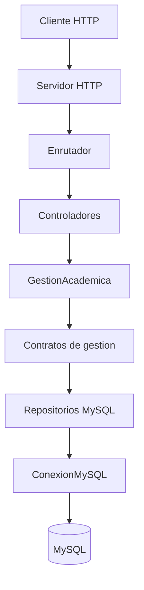
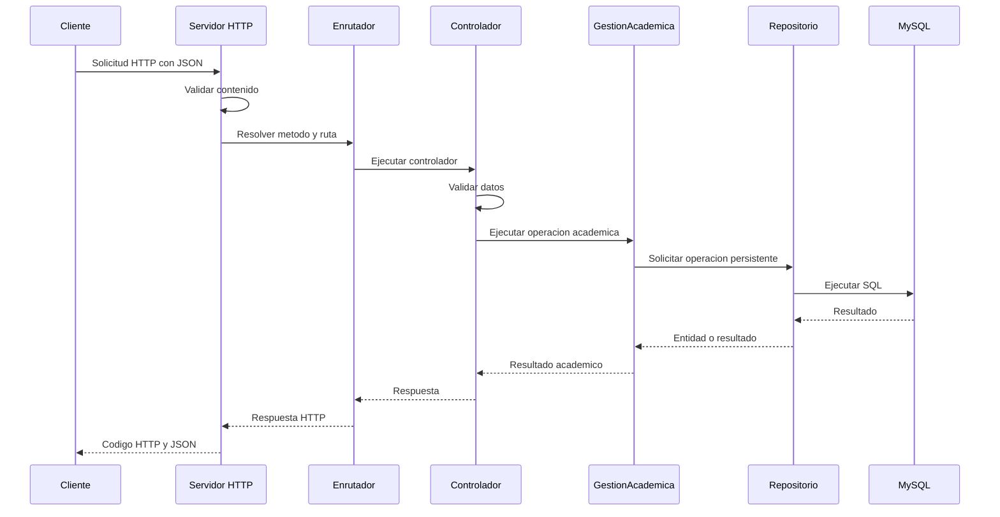
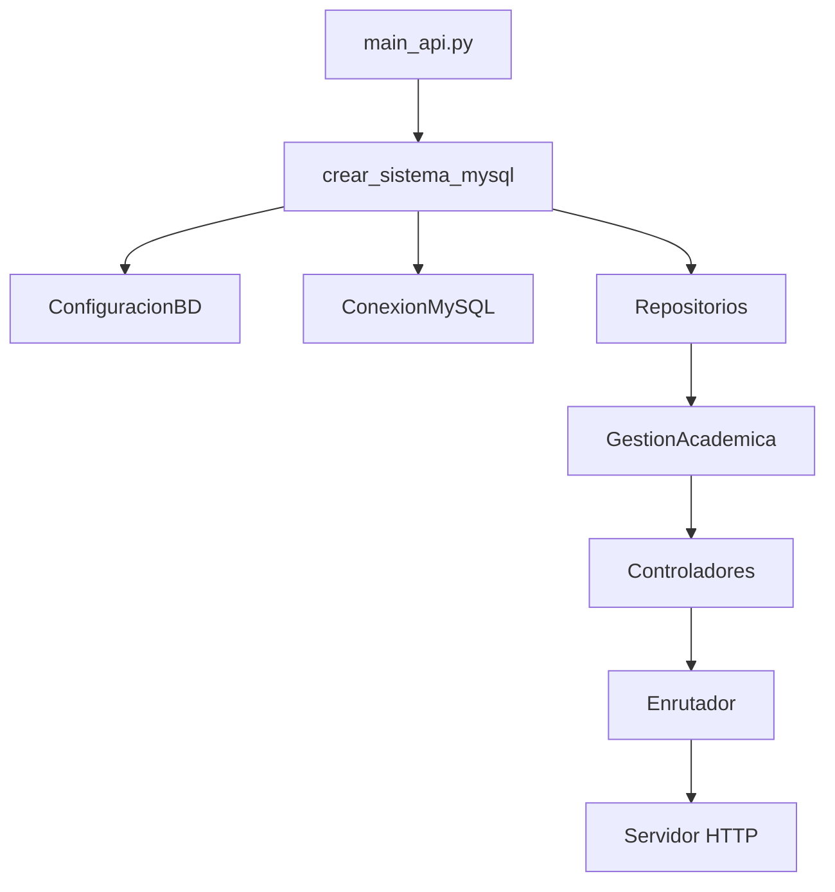

# Arquitectura de la API REST

## 1. Introducción

La cuarta fase del Sistema de Gestión Académica incorpora una API REST que permite acceder a las funcionalidades académicas mediante solicitudes HTTP y respuestas JSON.

La implementación reutiliza la lógica de negocio desarrollada en las fases anteriores y mantiene la persistencia de información mediante MySQL.

## 2. Objetivos

- Exponer las funcionalidades académicas mediante HTTP.
- Reutilizar las entidades y servicios existentes.
- Mantener la persistencia de datos en MySQL.
- Estandarizar las solicitudes y respuestas JSON.
- Aplicar programación orientada a objetos y principios SOLID.
- Separar la comunicación HTTP de la lógica de negocio.
- Implementar una API sin frameworks REST externos.

## 3. Tecnologías utilizadas

| Tecnología | Responsabilidad |
|---|---|
| Python 3.14.4 | Lenguaje de programación |
| http.server | Servidor HTTP |
| ThreadingHTTPServer | Procesamiento concurrente |
| urllib.parse | Procesamiento de rutas |
| json | Serialización y deserialización |
| HTTPStatus | Códigos de respuesta HTTP |
| argparse | Argumentos de ejecución |
| logging | Registro de eventos |
| MySQL 8.4 | Persistencia relacional |
| mysql-connector-python | Comunicación con MySQL |
| Docker Compose | Infraestructura de base de datos |
| unittest | Pruebas automatizadas |
| Git y GitHub | Control de versiones |

## 4. Arquitectura por capas



La arquitectura separa la comunicación HTTP, la lógica académica y el acceso a datos.

## 5. Estructura de archivos

```text
api/
├── __init__.py
├── enrutador.py
├── excepciones.py
├── respuestas.py
├── rutas.py
├── serializadores.py
├── servidor.py
├── validaciones.py
└── controladores/
    ├── __init__.py
    ├── profesores.py
    ├── aprendices.py
    ├── cursos.py
    ├── inscripciones.py
    ├── calificaciones.py
    └── reportes.py

main_api.py
```

## 6. Responsabilidades de los componentes

| Componente | Responsabilidad |
|---|---|
| __init__.py | Configuración general de la API |
| enrutador.py | Resolución de rutas y métodos HTTP |
| excepciones.py | Representación de errores HTTP |
| respuestas.py | Construcción de respuestas JSON |
| rutas.py | Registro de los endpoints |
| serializadores.py | Conversión de entidades a diccionarios |
| servidor.py | Recepción y procesamiento de solicitudes |
| validaciones.py | Validación de datos de entrada |
| controladores/ | Coordinación de operaciones académicas |
| main_api.py | Inicialización del servidor y MySQL |

## 7. Controladores

La API dispone de seis controladores.

| Controlador | Responsabilidad | Endpoints |
|---|---|---:|
| ControladorProfesores | Gestión de profesores | 5 |
| ControladorAprendices | Gestión de aprendices | 7 |
| ControladorCursos | Gestión de cursos | 8 |
| ControladorInscripciones | Gestión de inscripciones | 7 |
| ControladorCalificaciones | Gestión de calificaciones | 4 |
| ControladorReportes | Consultas y reportes | 2 |

Adicionalmente, existe un endpoint de salud del servidor.

Total: 34 endpoints.

## 8. Flujo de una solicitud HTTP



## 9. Métodos HTTP

| Método | Uso |
|---|---|
| GET | Consultar recursos |
| POST | Registrar recursos |
| PUT | Asignar profesor a un curso |
| PATCH | Modificar calificaciones o estados |

No se implementa DELETE como operación académica debido a las reglas de conservación de registros.

## 10. Versionamiento

La API utiliza el prefijo:

```text
/api/v1
```

URL local predeterminada:

```text
http://127.0.0.1:8000/api/v1
```

El versionamiento permite incorporar futuras modificaciones mediante nuevas versiones de la API.

## 11. Formato de comunicación

Las solicitudes que contienen datos utilizan:

```http
Content-Type: application/json
```

Las respuestas se transmiten mediante JSON codificado en UTF-8.

Ejemplo ilustrativo de respuesta:

```json
{
    "exito": true,
    "mensaje": "Operación exitosa",
    "datos": {}
}
```

## 12. Programación orientada a objetos

### Encapsulamiento

Las entidades académicas mantienen sus atributos privados y utilizan propiedades para controlar el acceso y la modificación de sus datos.

### Herencia

Profesor y Aprendiz heredan de Persona.

ManejadorHTTP hereda de BaseHTTPRequestHandler.

### Abstracción

Los contratos de gestión permiten utilizar diferentes implementaciones de almacenamiento sin modificar GestionAcademica.

### Polimorfismo

Las implementaciones en memoria y los repositorios MySQL pueden proporcionar las operaciones requeridas por los contratos de gestión.

## 13. Principios SOLID

### SRP: responsabilidad única

El servidor, el enrutador, los controladores, los validadores y los serializadores tienen responsabilidades diferenciadas.

### OCP: abierto y cerrado

El registro de rutas facilita incorporar nuevos endpoints sin reescribir el mecanismo central de enrutamiento.

### LSP: sustitución de Liskov

La arquitectura permite sustituir implementaciones de gestión compatibles con sus contratos.

Las diferencias de comportamiento entre almacenamiento en memoria y MySQL deben verificarse mediante pruebas.

### ISP: segregación de interfaces

Los contratos académicos se encuentran separados según sus responsabilidades.

### DIP: inversión de dependencias

GestionAcademica depende de contratos de gestión y recibe sus implementaciones mediante inyección de dependencias.

## 14. Integración con MySQL



La fábrica crea las implementaciones persistentes y las inyecta en GestionAcademica.

El servidor verifica la conexión inicial con MySQL antes de comenzar a recibir solicitudes.

## 15. Ambientes de ejecución

| Ambiente | Base de datos |
|---|---|
| Principal | sistema_gestion_academica |
| Pruebas | sistema_gestion_academica_test |

El argumento --pruebas permite seleccionar el ambiente de pruebas.

## 16. Validación y protección de solicitudes

La implementación incorpora:

- Validación de datos JSON.
- Rechazo de campos JSON duplicados.
- Rechazo de constantes JSON no permitidas.
- Validación de Content-Length.
- Rechazo de Transfer-Encoding.
- Validación del tipo de contenido.
- Límite de contenido de 1 MiB.
- Tiempo de espera del socket de 15 segundos.
- Validación de documentos y códigos.
- Validación de notas entre 0.0 y 5.0.
- Validación de modalidades y estados.
- Manejo centralizado de errores.

Las respuestas incluyen los encabezados Cache-Control: no-store y X-Content-Type-Options: nosniff.

El servidor evita registrar las rutas completas en su registro ordinario de solicitudes.

## 17. Concurrencia

ThreadingHTTPServer permite procesar solicitudes mediante múltiples hilos.

Los repositorios utilizan conexiones y transacciones para ejecutar operaciones persistentes.

La existencia de procesamiento multihilo no constituye por sí sola una garantía de ausencia de condiciones de carrera.

Las pruebas específicas de concurrencia se desarrollarán en la fase 5.

## 18. Alcance y limitaciones

La API está destinada a un entorno académico local.

Actualmente:

- Utiliza HTTP/1.0.
- Escucha en 127.0.0.1.
- No implementa autenticación.
- No implementa autorización por roles.
- No utiliza HTTPS.
- No implementa paginación.
- No dispone de limitación de solicitudes por cliente.
- No implementa eliminación de recursos mediante HTTP.

El endpoint de salud verifica la respuesta del servidor, pero no realiza una nueva consulta a MySQL en cada solicitud.

No se considera una implementación preparada para producción.

## 19. Resultados de validación

Durante la fase 4 se comprobaron:

- 34 endpoints.
- 235 pruebas automatizadas de regresión.
- 100 comprobaciones temporales de integración HTTP y MySQL.
- Recuperación de información persistente.
- Aplicación de reglas de negocio.
- Limpieza de registros temporales.

## 20. Conclusión

La arquitectura permite utilizar las funcionalidades académicas mediante una API REST, conservando el aplicativo de consola, la lógica de negocio y la persistencia desarrolladas anteriormente.

La siguiente fase incorporará pruebas automatizadas permanentes de la API.